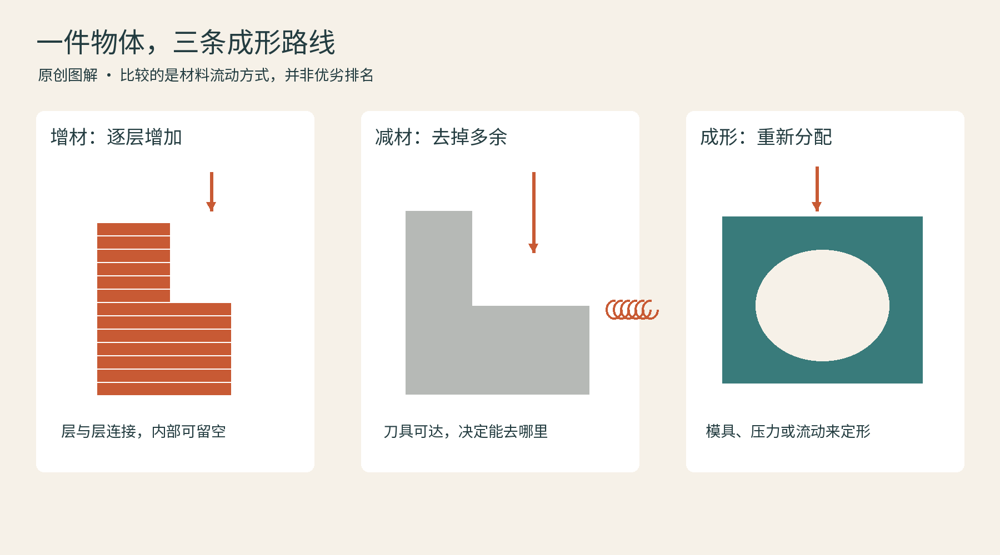
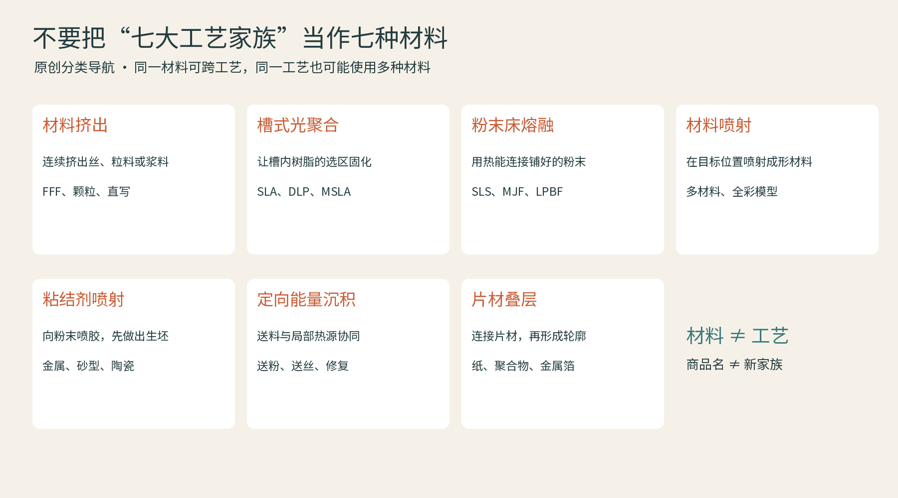

# 01 造物之前：先看材料怎样变成形状

拿起一个塑料收纳盒，先别急着问它是不是打印的。看看内壁是否有浇口痕迹，转角是否圆滑，表面有没有连续层纹。制造工艺会在物体上留下自己的“笔迹”。这本书以3D打印为主线，但我们始终把它放回制造世界：形状从哪里来，材料经历了什么，为何选这种方法。

## 加、减，以及改变形状

增材制造按照三维模型数据逐步形成物体，最常见的方式是逐层添加或结合材料；3D打印是日常更熟悉的叫法。减材制造从毛坯出发，移除不需要的部分，例如铣、车、磨以及某些切割工艺。成形则让已有材料流动或变形，注塑、铸造、锻造、冲压都不能简单塞进“加或者减”二选一。美国能源部的入门介绍把逐层制造与去除毛坯作对照，但它谈的是工艺思路，不意味着每种打印都比切削省能。[资料：美国能源部《How 3D Printers Work》](https://www.energy.gov/articles/how-3d-printers-work)

可以用一个带弯曲内水道的金属块作想象实验。铣刀能很方便地修平外表面，却很难沿封闭的弯道钻进去；打印可以把通道逐层包围出来，但还得让内部粉末排出来。把任务换成一根表面光滑、直径严格的长轴，车削又十分自然。这里的核心是几何、材料和数量之间的配合，而不是谁取代谁。

## 七个家族，比一串缩写更有用

面对SLA、FFF、SLS、MJF等名称，先问材料以什么形态进入设备，再问它怎样被固定。常用标准分类将增材分成七个工艺家族：材料挤出、槽式光聚合、粉末床熔融、黏结剂喷射、材料喷射、定向能量沉积、薄材叠层。它们是按成形原理分组，不是按“塑料机、金属机”分组。同一种材料可能走不同路线，同一工艺家族也可能处理不同材料。[资料：SME《Additive Manufacturing Glossary》](https://www.sme.org/additive-manufacturing-glossary)

| 入场状态 | 关键动作 | 常见家族 |
| --- | --- | --- |
| 丝、颗粒或膏体 | 从喷嘴沉积 | 材料挤出 |
| 槽内液体 | 光选择性固化 | 槽式光聚合 |
| 铺开的粉末 | 选择性热结合 | 粉末床熔融 |
| 铺开的粉末 | 喷黏结剂形成坯体 | 黏结剂喷射 |
| 可喷射液滴 | 选择性沉积并固化 | 材料喷射 |
| 粉或丝 | 送入能量作用区 | 定向能量沉积 |
| 薄片或箔材 | 逐层结合 | 薄材叠层 |

这个表是读机器的入口，不能代替具体工艺条件。比如“有粉末、有喷头”并不足以判断是黏结剂喷射，后文会看到MJF为什么属于粉末床熔融。

## 从快速原型走向生产

现代3D打印的产业化集中发生在20世纪80年代。历史中既有日本研究者小玉秀男等人的早期工作，也有Chuck Hull推动立体光刻商业化的路线。ASME把1987年商用SLA-1列为工程历史地标。写历史时应区分早期构想、实验、申请专利、专利授权和商业销售，“某一年一个人发明了所有3D打印”会抹掉很多并行探索。[资料：ASME《#261 Stereolithography》](https://www.asme.org/about-asme/engineering-history/landmarks/261-stereolithography)

早期的重要价值，是让设计师先摸到一个形状，再决定是否开模。此后，机器、软件、材料和测量能力共同进步，打印逐渐进入工装、定制用品和合格零件生产。NIST把金属、高分子、陶瓷、复合材料等分成研究方向，说明行业真正要解决的已不只是“能不能堆起来”，还有材料和过程能否被可靠描述、测量和复现。[资料：NIST《Additive Manufacturing Technologies》](https://www.nist.gov/additive-manufacturing/research-areas/technologies)

## 几段相互重叠的发展，而不是一条替代史

| 阶段 | 发生的变化 | 今天仍能看见的遗产 |
|---|---|---|
| 20世纪80年代的商业化探索 | 光固化等路线从实验走向成套设备 | 模型数据与实体样件之间的直接联系 |
| 90年代的工艺扩展 | 激光烧结、更多材料与工业系统发展 | 塑料、金属与模具等不同应用分工 |
| 2000年代以来的开放硬件与桌面化 | 设计文件、固件和社区经验传播 | 套件、可修改机器、共享模型与切片生态 |
| 2010年代以来的生产化与应用深化 | 工作室和工厂都开始重视端到端流程 | 定制、工装、认证零件、后处理与服务 |

这个分段是本书的阅读框架，各阶段并没有整齐结束。EOS的官方历史列出1989年成立以及90年代激光烧结发展的节点；RepRap则展示开放设计怎样把机器本身变成可共同研究的对象。所谓“自我复制”，主要指能制造自身的一部分构件，仍需要电机、电子元件与其他外购件，不能理解成一台机器可以独自产生全部材料与零件。[EOS历史](https://www.eos.info/about-us/who-we-are/history)、[RepRap项目介绍](https://reprap.org/wiki/About)

桌面化和工业化也不是互斥路线。一个小工作室可能用桌面机生产夹具，大型工厂也可能用工业设备只做试样。真正变化的是对交付的要求：能否再次做出相同结果，能否记录材料批次，能否说明零件适用于什么条件。往后的品牌故事，都可以放回这张发展地图理解。

读后观察：找家里三个物体，分别猜测它们更适合打印、切削还是模具成形。不要只看外形复杂度，也看看数量、表面要求和材料。你能提出理由，就已经开始理解制造。
