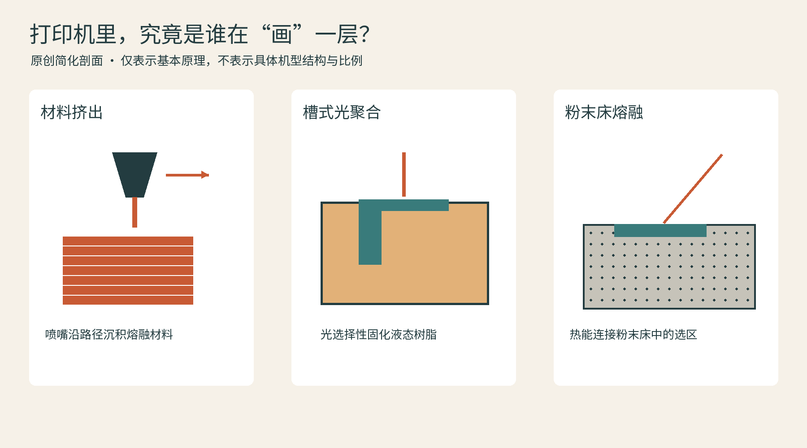
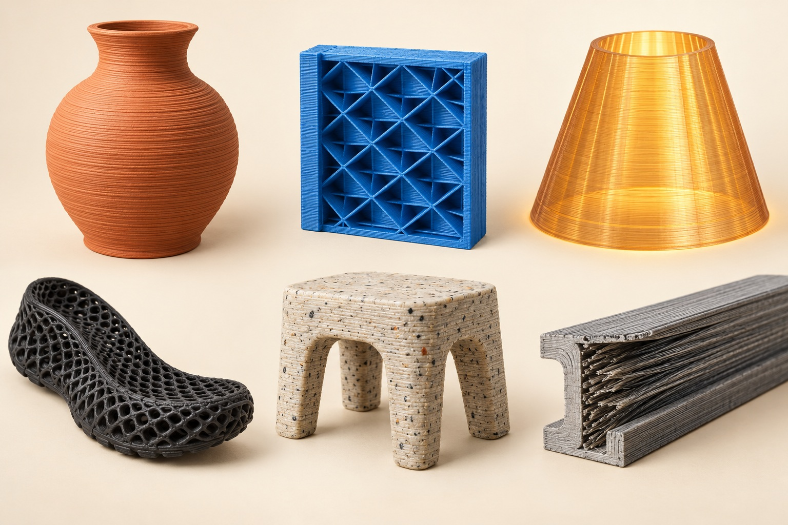
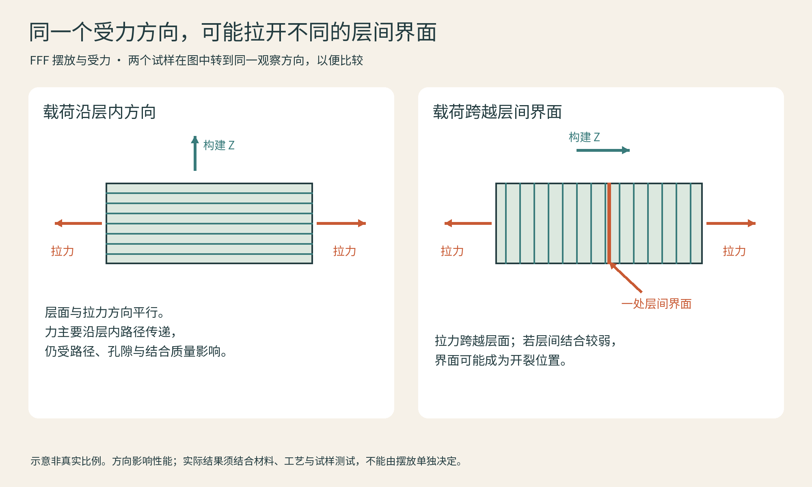
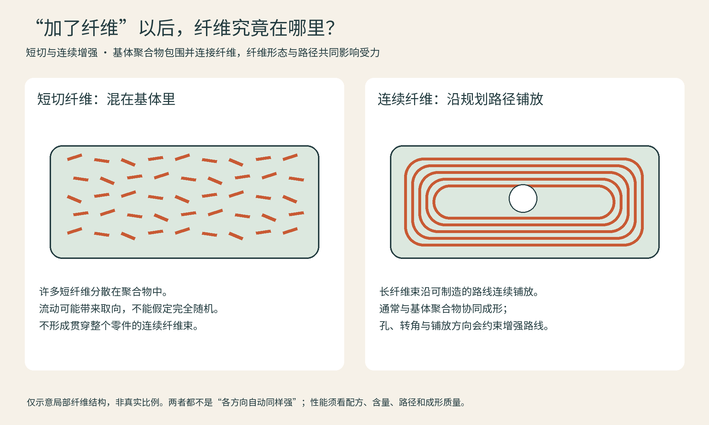
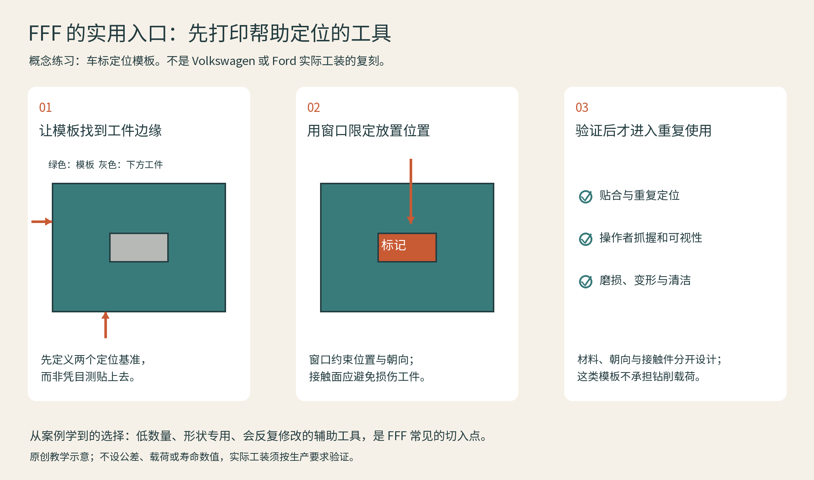

# 02 一根塑料丝，怎样变成一个世界

桌面打印最容易让人着迷的时刻，是喷嘴绕完一圈，眼前的物体忽然比刚才高了一点。材料挤出把这种重复变成了制造：材料从喷嘴出来，在安排好的位置沉积，下一条与前一条、下一层与前一层结合。我们熟悉的FFF是其中以热塑性丝材为原料的一条路线。FDM是Stratasys使用的商标名称；日常讨论经常混用两者，读技术资料时仍要注意具体设备与材料条件。[资料：UltiMaker《Introduction to FFF 3D printing》](https://ultimaker.com/learn/introduction-to-fff-3d-printing/)

## 喷嘴画的不是实体，而是路径

一个看上去实心的盒子，切片后可能由外壁、顶底面和内部填充构成。外壁决定轮廓与许多表面效果，填充给内部提供支撑和结构。把填充从稀疏改到很密，既不保证每处都更坚固，也可能耗时很多；螺丝周围加厚、让主要受力方向沿连续挤出路径传递，有时更有效。这是作者给初学者的观察方法：先想力往哪里走，再调整塑料往哪里放。

层高影响竖直方向的台阶和打印时间，喷嘴、挤出线宽、流量与运动控制共同影响平面细节。小层高不等于所有尺寸都更准。一个斜屋顶的台阶可以因薄层变细，但一个细小圆孔仍受喷嘴路径、收缩和校准影响。比较作品时，应区分细节、尺寸准确、重复一致和表面粗糙度。

## 第一层与层间结合，是两件事

首层需要可靠附着在平台上，后续层则需要与已经打印的材料结合。前者失败常表现为翘边、移动或整件脱落；后者不足可能让作品沿层面分开。不要见到裂纹就把平台胶水当成统一答案。Prusa的官方知识库把平台清洁、首层状态及打印表面匹配列为排查重点；不同材料甚至需要隔离层，目的是避免粘得过牢损伤表面。[资料：Prusa《First layer issues》](https://help.prusa3d.com/article/first-layer-issues_1804)

图：FFF 层面与受力方向。示意中试样已转到相同观察方向；实际强度不能仅由摆放决定。原理参见 [UltiMaker FFF 指南](https://ultimaker.com/learn/introduction-to-fff-3d-printing/)。

| 你想做什么 | 可以先考虑 | 应继续检查 |
| --- | --- | --- |
| 展示模型与色彩练习 | PLA | 受热环境、薄件脆性 |
| 日用外壳与夹具 | PETG | 拉丝、尺寸配合、长期载荷 |
| 户外外壳 | ASA等适配材料 | 通风、腔温、具体耐候数据 |
| 可弯曲缓冲件 | TPU | 硬度、送料路径、回弹需求 |
| 较高要求结构件 | PA、PC及合适复合材料 | 干燥、设备条件、方向性 |

这里是选材方向，不是性能排名；同名聚合物的配方差异很大，测试件与实际零件也不同。

## 短切纤维和连续纤维，别混为一谈

“碳纤维打印”可能指把短纤维混入塑料丝，也可能指在塑料基体内铺设连续纤维。前者仍是复合耗材被挤出，表面常有细腻哑光感，但名字本身并不证明零件在所有方向更强。Prusa明确提醒，碳纤维、玻璃纤维等填料会磨损喷嘴，需要适合的耐磨配置。[资料：Prusa《Composite materials》](https://help.prusa3d.com/article/composite-materials-filled-with-carbon-kevlar-or-glass_167387)

连续纤维路线则要规划纤维铺在哪里、沿什么方向走。Markforged的技术资料把连续增强材料与塑料基体配合使用；它不能脱离基体独自作为普通丝材打印。你可以把它想成“在关键路径里铺一束绳”，而不是“往面粉里撒粉末”。这个比喻用于理解增强方向，不代表材料结构完全相同。[资料：Markforged《CFR 3D Printing》](https://markforged.com/resources/10x-stronger)

图：短切与连续纤维的结构差别，非真实比例。基体、路径与工艺共同影响性能。依据 [Prusa 复合材料指南](https://help.prusa3d.com/article/composite-materials-filled-with-carbon-kevlar-or-glass_167387)及 [Markforged 连续增强说明](https://markforged.com/resources/10x-stronger)绘制。

## 从桌面丝材到大尺度颗粒

材料挤出不局限于一卷丝。颗粒喂料通过塑化挤出处理粒料，更适合某些大尺寸、高沉积量任务，代价是不能沿用小喷嘴桌面打印的精细尺度和参数习惯。大型模具毛坯常会再加工表面，打印负责长出体积，铣削负责关键几何。用于模具的粗大层纹并非必然失败，它可能是工艺链有意保留的中间状态。

一个很好的观察练习，是比较同一个小支架的两种朝向：哪边需要支撑，哪边的螺丝孔更容易成形，预计从哪里断裂？先在纸上判断，再看切片预览。你会发现，打印机并不是单纯把三维模型“复印”出来，它还要求我们设计制造过程。

## 应用现场：工厂先打印的，常常是工具

FFF很适合从“只有少量、形状专用、还会修改”的任务开始：电路板外壳先验证插头能否插入，包装模型先验证抓握，装配模板先验证定位。它们的共同点是，打印件让下一次决定更容易，并不要求一开始就替代最终量产材料。进入实际生产时，还要把环境温度、重复受力和磨损纳入选材。

**Volkswagen Autoeuropa：轮毂保护与车标定位。** UltiMaker公开的历史案例展示了这家葡萄牙工厂使用打印的轮毂保护工具、尾门车标定位工具和车窗量规。它们围绕具体工位定制，作用是辅助装配和减少接触损伤，而不是替代汽车的金属结构。现场试用后可以修改形状，再打印下一版。[CASE-P01]

这类案例的实用启发是把“接触哪里、定位哪里、手握哪里”分开设计。塑料主体可以提供贴合外形；需要耐磨或精确配合的位置，则应另行考虑接触件、衬套和检验。以下模板是作者的概念练习，不是大众实际工装的复刻，也不是已验证的生产设计。

图：原创FFF应用示意。以平面定位模板解释“打印辅助工具”的任务，图中不包含实际公差或耐久性指标；应用背景见Volkswagen Autoeuropa案例[CASE-P01]。

**Ford：把工具设计送到工厂，就地打印。** UltiMaker的Ford案例讲述了试制工厂开发专用工具，并把设计传给其他工厂本地打印；报道还介绍了与trinckle合作，以汽车几何、把手和磁铁座等模块生成装配辅助工具。这说明收益不只来自打印速度，也来自设计复用与现场反馈。[CASE-P02]

在这种分布式工作流里，需要随文件一起流转的是版本、材料、打印方向和验收要求。不能让不同工厂拿着名字相同的文件，却使用未经确认的材料和参数。对兴趣读者，也可以用同样思路给桌面电源做一个定位托架：先用纸板验证轮廓，再打印试配，检查线缆弯折和散热空间；这只是低风险设计练习，不涉及带电部件改造。

## 本章资料

- [CASE-P01] UltiMaker，Volkswagen Autoeuropa工装案例（历史案例）：https://ultimaker.com/learn/volkswagen-autoeuropa-maximizing-production-efficiency-with-3d-printed-tools-jigs-and-fixtures/
- [CASE-P02] UltiMaker，Ford制造辅助工具与本地打印案例：https://ultimaker.com/learn/ford-reinventing-efficient-manufacturing-using-3d-printing/
