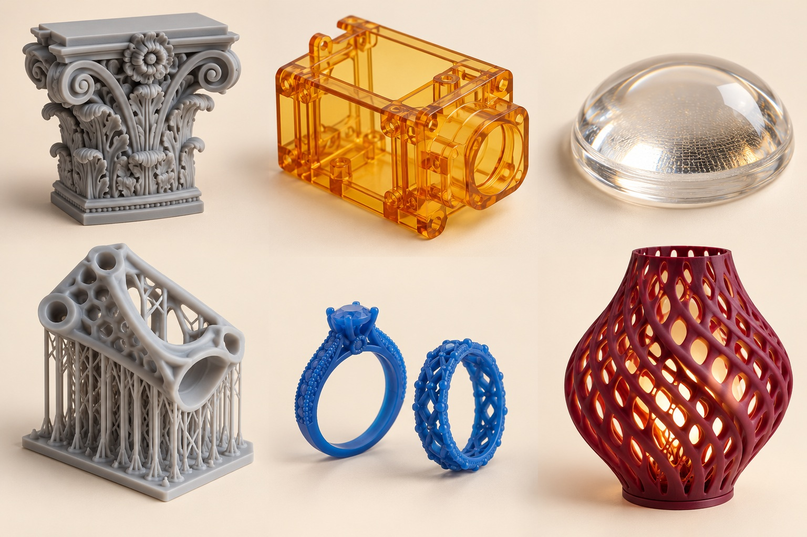

# 03 用光写形状：树脂打印的细节与代价

为什么精细人像、牙模和珠宝蜡型的照片里，经常出现一台带罩子的树脂打印机？它使用的不是融化塑料丝，而是能够被光引发固化的液体配方。光只在需要的位置作用，液体的一部分变成固体；重复这个过程，形状便逐步出现。这一家族的标准名称是槽式光聚合。树脂是材料形态的俗称，不是单一化学材料。[资料：NIST《Vat Photopolymerization》](https://www.nist.gov/additive-manufacturing/research-areas/technologies/vat-photopolymerization)

## 同样用光，如何“画一层”很不同

SLA通常用激光扫描层内轮廓和区域；DLP用数字投影系统把一层图案投射出来；MSLA则常通过液晶屏形成遮罩，让背景光选择性通过。市场宣传中也会把多种树脂工艺统称为SLA，所以不能只凭产品类别名判断光路。Formlabs的技术指南讨论了激光、DLP与遮罩式路线，也解释了自上而下和倒置结构的区别。[资料：Formlabs《Guide to Stereolithography》](https://formlabs.com/blog/ultimate-guide-to-stereolithography-sla-3d-printing/)

| 路线 | 形成截面的办法 | 读参数时的关注点 |
| --- | --- | --- |
| 激光SLA | 光点逐处扫描 | 光斑、扫描策略、树脂条件 |
| DLP | 投影一幅层图像 | 投影像素与成形面积的关系 |
| MSLA/LCD | 屏幕遮罩控制曝光 | 实际像素尺寸、光学均匀性 |
| 连续或近连续路线 | 光学与界面控制协同 | 树脂、补液、运动与后固化 |

“16K”这类屏幕数字只描述图像离散程度的一部分。大成形面积会分摊像素密度；曝光扩散、材料反应和运动同样影响最终边界。不要把一个显示分辨率直接当成零件能实现的公差，也不要拿不同测试方法的“精度”数字横向排序。

## 为什么模型常常斜着吊起来

倒置式树脂打印通常在料槽底部形成新层，平台抬升时需要处理新固化截面与槽底之间的分离，再补入树脂。朝向既影响表面台阶，也影响截面积、支撑和液体排出。一个空心杯若形成封闭吸附区域，远比同样外观的开口结构难处理。支撑不是随意粘上的树枝，而是要在打印期间固定作品，同时尽量把接点放在不重要或易修整的位置。[资料：Formlabs《Model orientation best practices》](https://formlabs.com/support/Model-Orientation/)

对于雕像，脸部通常比底座更值得保护；对于装配外壳，配合面可能比背面更重要。这是作品导向的设计判断。不能用“斜45度”一条口诀覆盖所有几何，也不能把支撑越少当成独立目标。

## 连续打印，不是取消化学与后处理

Carbon的DLS利用投影、可透氧窗口和配套树脂体系控制成形界面。它的意义在于把光、氧和树脂反应结合起来，而不是把所有传统树脂机调快就能得到同样过程。某些材料还通过热处理获得目标性能，实际流程应按对应材料和设备要求执行。[资料：Carbon《DLS Technology》](https://www.carbon3d.com/carbon-dls-technology)

这也解释了为什么“从槽里拿出来”并不等于“已经完成”。清洗处理表面未固化树脂，后固化帮助达到所要求的转化与性能，支撑去除和表面修整则决定最终外观。实际所需步骤依材料而变，不能用普通模型树脂的经验代替牙科、铸造或工程树脂的流程。

## 漂亮表面不等于适合所有用途

树脂可为手办提供细腻眼睫和纹理，也能用于牙科模型、透明流体观察件或铸造前的牺牲模型。但“像橡胶”“像ABS”描述的通常是部分性能相近，不意味着其化学成分、寿命与热塑材料完全相同。制造一个透明演示流道和制造长期接触身体的器具，要求完全不同；要分别核对材料适用范围与经过验证的处理流程。

读图时留意三种痕迹：细小支撑疤、斜面层纹、空心件排液孔。观察这些细节，能把“这模型好精致”的直觉，变成对制造过程的理解。精美是重要目标，但真正有趣的，是知道精美怎样被稳定地做出来。
