# 04 从粉末里挖出零件：SLS与MJF

树脂件像从液面升起，粉末打印件则常像一次小型考古：打开成形单元，零件埋在粉末中，需要清理出来。粉末床路线先铺一层薄粉，再选择性让其中一部分结合。周围未结合的粉末包围着作品，使一些复杂几何不必像桌面挤出那样设置独立支撑。这里先谈高分子粉末；金属粉床的热传导和支撑要求在下一章另外解释。[资料：EOS《Selective Laser Sintering》](https://www.eos.info/about-us/what-we-do/sls)

## SLS：用激光选择区域

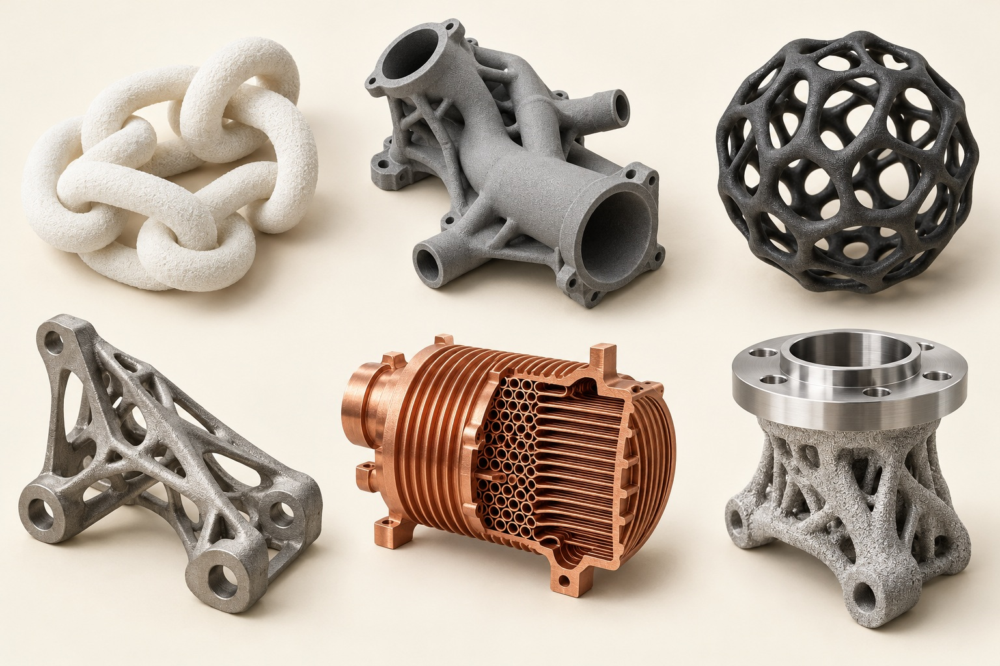

选择性激光烧结SLS常用于尼龙等高分子粉末。铺粉之后，激光沿截面扫描，重复铺粉与扫描形成零件。打印不是在一盒完全冷的粉中随意画线，预热、温度均匀性和冷却控制很重要。它适合生产复杂卡扣、管道、外壳或铰接结构，但小孔、薄壁与狭窄间隙都需要符合相应设计边界。[资料：Formlabs《Selective Laser Sintering: Complete Guide》](https://formlabs.com/blog/what-is-selective-laser-sintering/)

可以把若干互不相连的零件安排在成形空间中，不过摆放不是越挤越好。空间利用、热行为、清粉可达性都要考虑。“一盒装满”与“每一件都合格”是两种目标。对于服务商来说，一批混合订单的管理与后处理效率，有时比单个模型的打印时间更能决定交付周期。

## MJF：先用液体标记，再施加热能

HP的Multi Jet Fusion也从高分子粉末床开始，但不是让激光逐处扫描。喷头在粉层上选择性沉积熔结剂与细化剂，再配合热能控制哪些区域结合、哪些边缘受到抑制。这里喷出的液体不是最终零件的主要体积，也不是像胶水一样简单把一团冷粉粘住，因此不能因它“有喷头”就归为材料喷射或黏结剂喷射。[资料：HP《Comparing Binder jetting, Material Jetting, Multi Jet Fusion and SLS》](https://www.hp.com/us-en/printers/3d-printers/learning-center/3d-print-binder-vs-material-jetting.html)

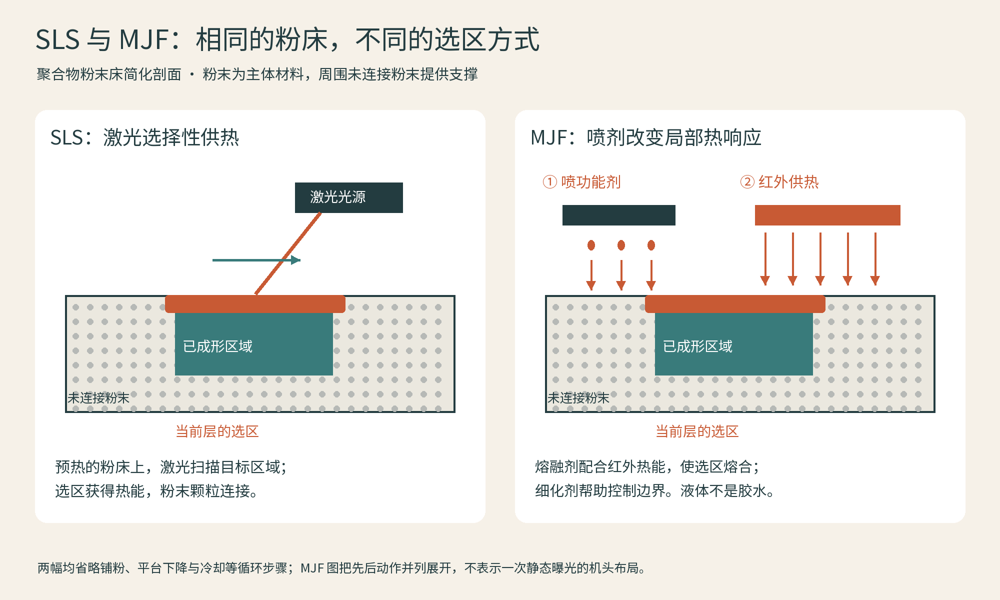

图：SLS 与 MJF 的聚合物粉床连接机制。MJF 功能剂配合红外热能，并非用胶水把粉末粘住。依据 [Formlabs SLS 说明](https://formlabs.com/blog/what-is-selective-laser-sintering/)及 [HP 技术比较](https://www.hp.com/us-en/printers/3d-printers/learning-center/3d-print-binder-vs-material-jetting.html)绘制。

| 问题 | 高分子SLS | HP MJF |
| --- | --- | --- |
| 选择结合区域 | 激光路径 | 功能液体沉积与热能协同 |
| 共通点 | 粉末床、逐层构建、需清粉 | 粉末床、逐层构建、需清粉 |
| 易误读之处 | 名称不能证明任意材料都能烧结 | 喷液体不等于黏结剂喷射 |
| 应怎样比较 | 同材料、同几何、同验收要求 | 同材料、同几何、同验收要求 |

从产品照片很难可靠区分所有SLS与MJF零件。染色、喷砂与平滑处理可能遮住原始外观，材料与设备条件也会改变颜色和触感。因此，照片适合观察表面；判断工艺还需要加工记录。

<!-- polymer-stage-start -->

## SLS：激光怎样在粉中留下形状

按下列顺序向下阅读；各图沿用同一件阶梯形示例，比例和层数只用于解释过程。

**第1步：铺平薄粉层**

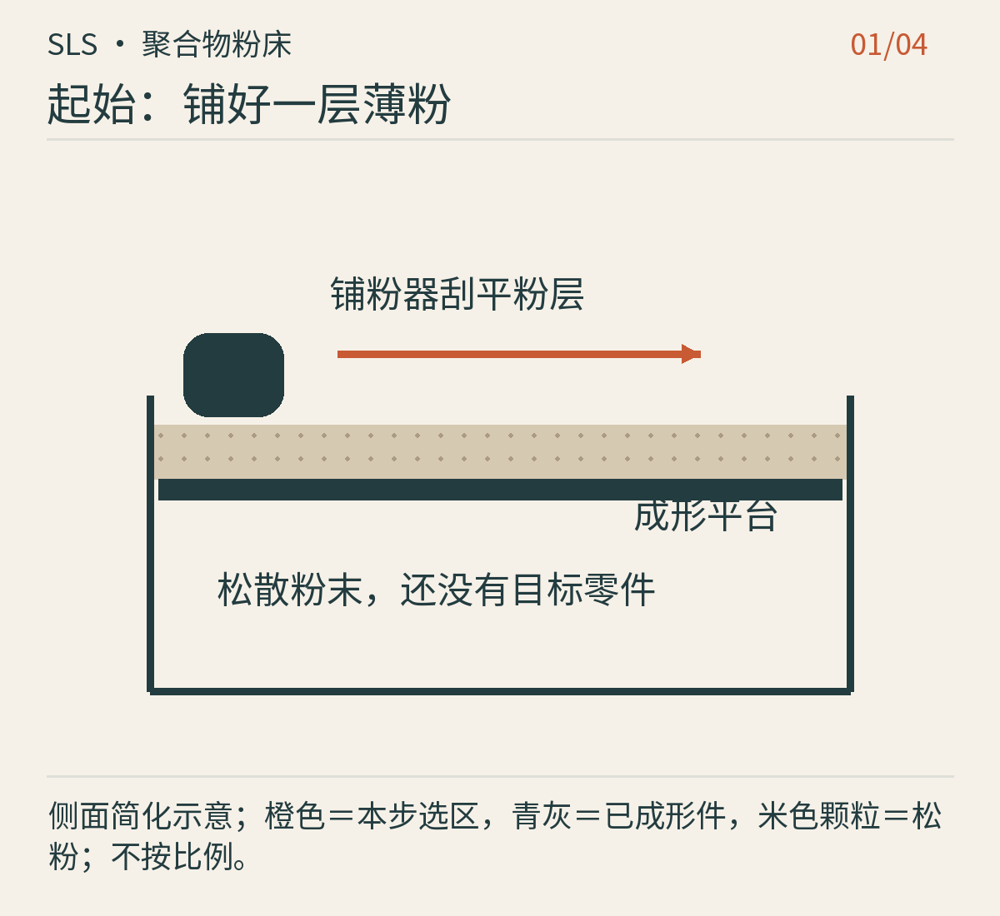

图：原创连续步骤图 1/4，简化结构，不是具体设备。 [工艺依据](https://formlabs.com/blog/what-is-selective-laser-sintering/)

铺粉器把预热的高分子粉末摊成薄层。松散粉末本身不是成品，平台上也不会一次出现完整三维形状。

**第2步：激光扫描当前截面**

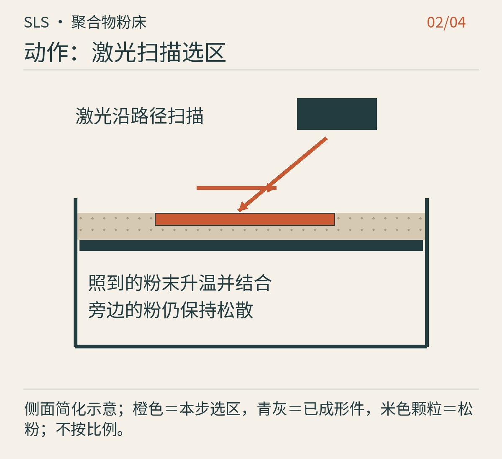

图：原创连续步骤图 2/4，简化结构，不是具体设备。 [工艺依据](https://formlabs.com/blog/what-is-selective-laser-sintering/)

激光只扫描当前截面需要的区域，使粉末受热结合；周围未被选中的粉末仍保持松散。橙色区域只是这一层，不是整个零件。

**第3步：下降、铺粉、重复**

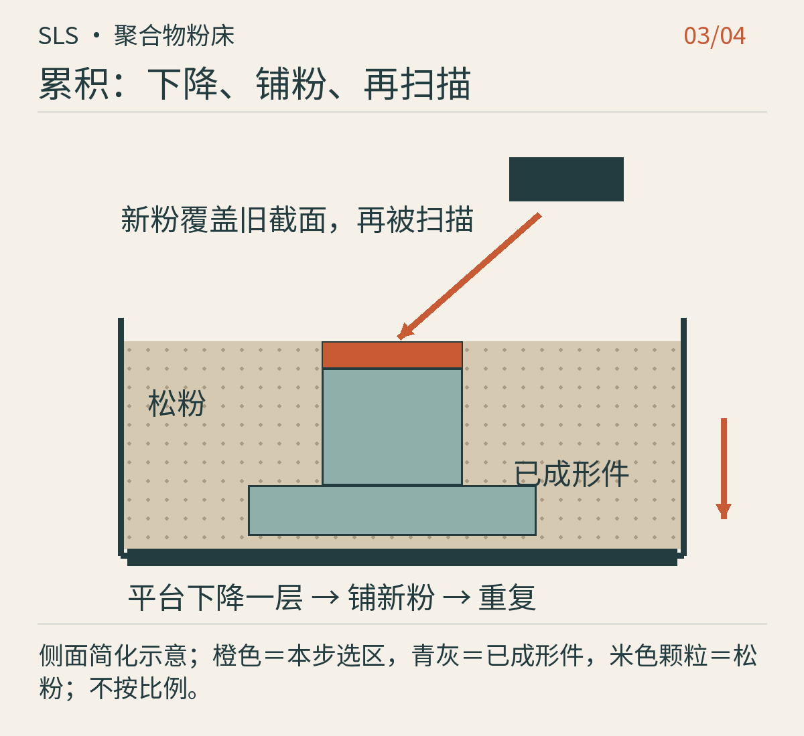

图：原创连续步骤图 3/4，简化结构，不是具体设备。 [工艺依据](https://formlabs.com/blog/what-is-selective-laser-sintering/)

成形平台下降一层，铺粉器覆盖新粉，激光再次扫描。新结合的截面连接下面已有材料；旁边的松粉包围并支承它，零件逐渐埋入粉床。

**第4步：先冷却，再取出**

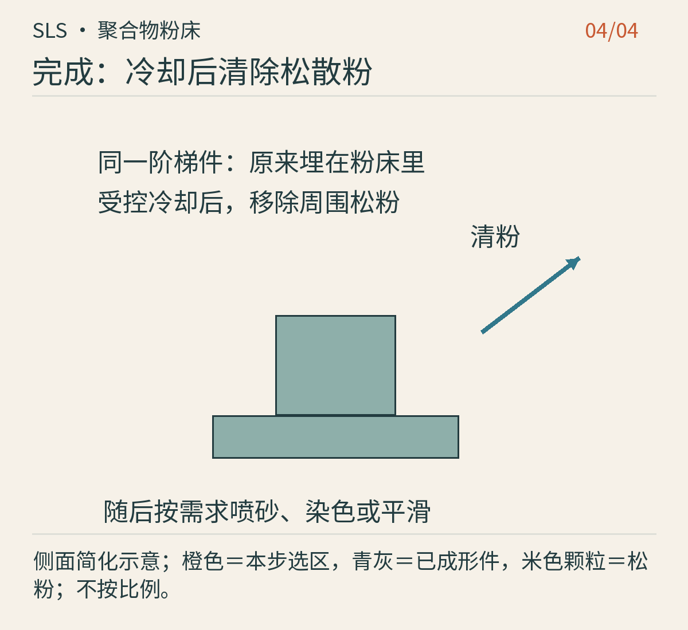

图：原创连续步骤图 4/4，简化结构，不是具体设备。 [工艺依据](https://formlabs.com/blog/what-is-selective-laser-sintering/)

构建结束后按工艺受控冷却，再清除松粉，才露出同一阶梯件。必要时还要喷砂、染色或平滑；封闭腔体中的粉不会自行消失。

本组原理依据：[官方工艺说明](https://formlabs.com/blog/what-is-selective-laser-sintering/)。

## MJF：液体标记与热能怎样配合

按下列顺序向下阅读；各图沿用同一件阶梯形示例，比例和层数只用于解释过程。

**第1步：铺好聚合物粉层**

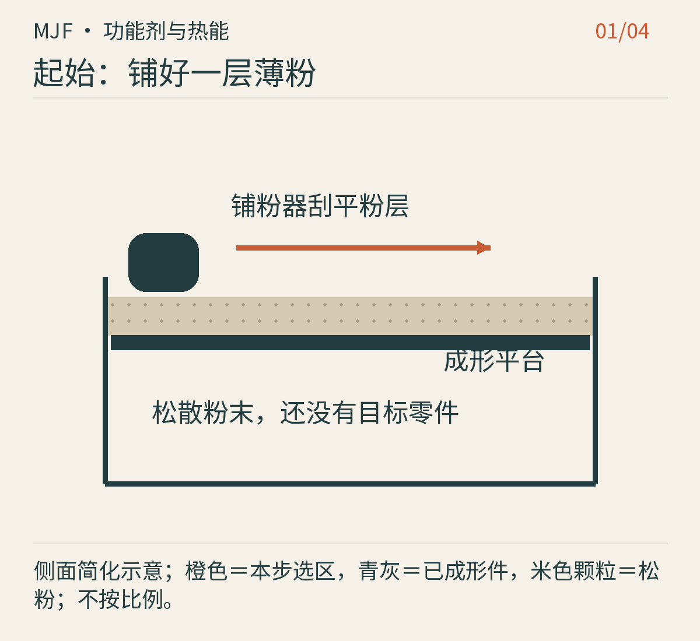

图：原创连续步骤图 1/4，简化结构，不是具体设备。 [工艺依据](https://www.hp.com/us-en/printers/3d-printers/learning-center/3d-print-binder-vs-material-jetting.html)

起点同样是一层高分子粉末。后面的液体主要用于调节局部热响应，而不是承担成品的主要体积。

**第2步：先给截面做功能标记**

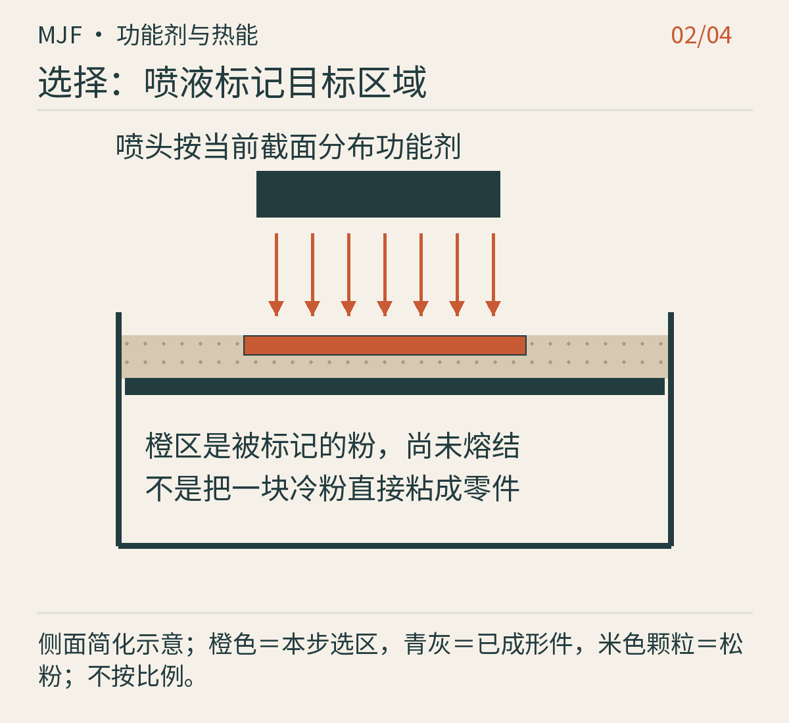

图：原创连续步骤图 2/4，简化结构，不是具体设备。 [工艺依据](https://www.hp.com/us-en/printers/3d-printers/learning-center/3d-print-binder-vs-material-jetting.html)

喷头按截面选择性沉积功能剂。图中橙区表示已标记的粉，尚不等于固体零件；边界附近还可使用细化剂控制热行为，图中省略其细小分布。

**第3步：施加热能并逐层累积**

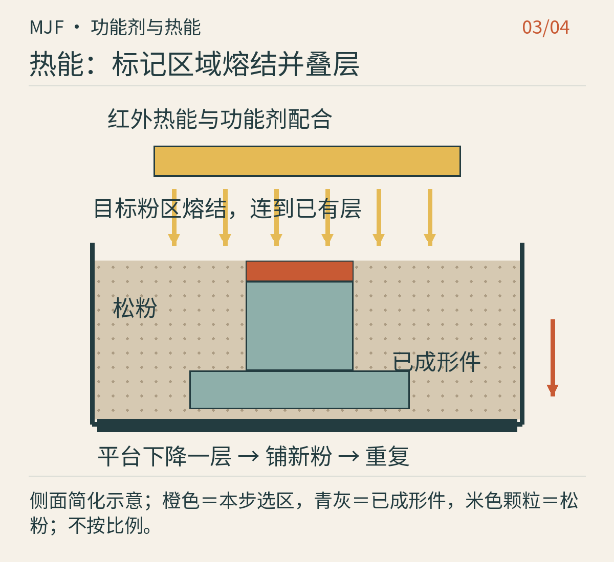

图：原创连续步骤图 3/4，简化结构，不是具体设备。 [工艺依据](https://www.hp.com/us-en/printers/3d-printers/learning-center/3d-print-binder-vs-material-jetting.html)

红外热能与功能剂配合，让目标粉区熔结并连接前一层。之后平台下降、重新铺粉、喷剂、加热，重复形成三维形状。它不是用胶水把冷粉粘在一起。

**第4步：冷却清粉后才能使用**

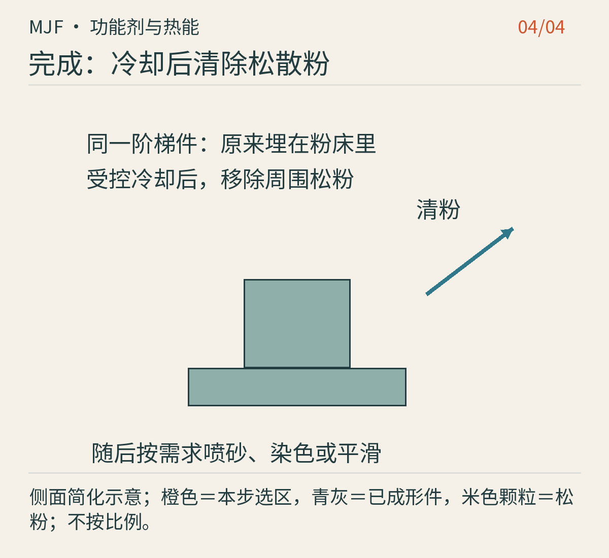

图：原创连续步骤图 4/4，简化结构，不是具体设备。 [工艺依据](https://www.hp.com/us-en/printers/3d-printers/learning-center/3d-print-binder-vs-material-jetting.html)

构建完成后依系统流程冷却、取出并清粉，露出与前图对应的阶梯件。表面处理和尺寸检验仍是制造链的一部分。

本组原理依据：[官方工艺说明](https://www.hp.com/us-en/printers/3d-printers/learning-center/3d-print-binder-vs-material-jetting.html)。

<!-- polymer-stage-end -->

## 颗粒感可以是风格，也可以需要处理

粉末件表面常有细颗粒质感。它对工业夹具可能完全可以接受，放在经常触摸的眼镜框上，则可能希望通过染色、喷砂、涂覆或化学平滑得到更舒适外观。EOS把多种后处理路线列为独立工艺；这提醒我们，漂亮成品不是从机器里自动“掉出来”的默认状态。[资料：EOS《Post-Processing in 3D Printing》](https://www.eos.info/enablement/polymer-post-processing)

封闭空腔是一个典型误区：能把外壁打印出来，不代表里面的粉能自动消失。设计时必须安排清理通路，检查实际开口和内部路径。对于活动连接，还要留足让粉末移除与运动发生的间隙；“打印成一个组件”不等于“零间隙”。

## 用料与经济性，要看整批任务

未结合粉末可能按照指定比例与新粉混用，但它经历过热历史，不能无限循环，也不能假设所有系统共用一个刷新比例。材料利用率、更新粉量、清粉损失、冷却等待和设备利用率都会影响成本。服务商的一只小外壳报价，包含的不只是成品称出的几克尼龙。

适合兴趣读者的练习，是拿一张粉末打印成品图，圈出它最难清粉的三个区域，再想象如果改成FFF，需要在哪里加支撑。这个练习不要求你买工业机，却能帮助理解为什么同一个模型在不同工艺中，设计要跟着改变。

## 应用现场：一批一样，或者每件都不一样

**Brose：汽车座椅里的小零件，也可能成为终用件。** Formlabs于2024年的Brose案例展示了SLS制造的汽车座椅组件，包括用于BMW X7的卡扣，以及作为另一项生产任务介绍的Bowden拉索释放组件。这里的打印已不只是检查外观：零件会进入实际装配，必须符合对应车型和用途的要求。[CASE-P05]

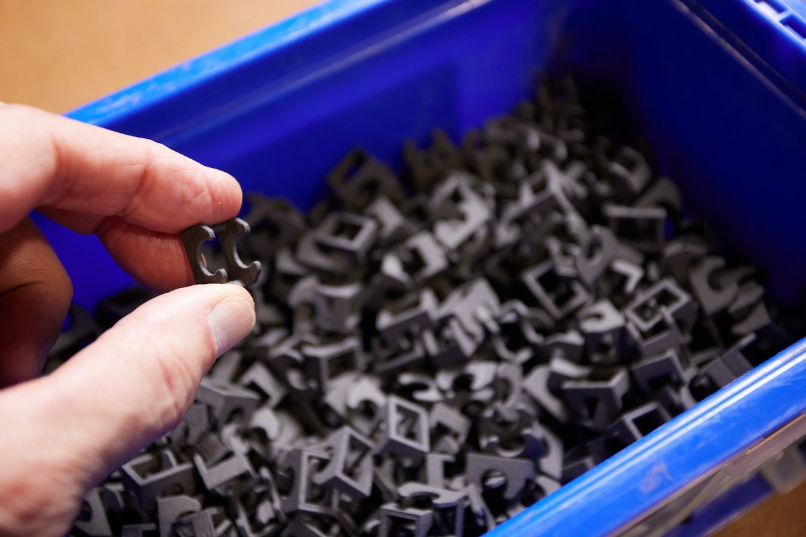

图：Formlabs案例中用于BMW X7座椅装配的打印卡扣[CASE-P05]。真实照片；图片权利归原权利人，未确认开放再分发许可。它与文中的Bowden释放组件是不同零件。

对小型批量零件来说，粉床能在一次构建中安排许多件，又不用为每件增加树枝状独立支撑。省下支撑设计并不免除冷却、清粉、尺寸与功能检验。报道中的用途成立，也不代表随意换一种尼龙或打印方向，就能得到已经通过同样验证的汽车零件。

**iOrthotics：把不同人的足形，放入同一个数字流程。** 该企业2018年公开的案例描述了接收足部扫描、通过专用软件生成矫形器设计、使用HP Multi Jet Fusion制造的工作流。这里的重点是批量定制：同一批次可以容纳不同形状，不必先为每位使用者开一副固定模具。[CASE-P06]

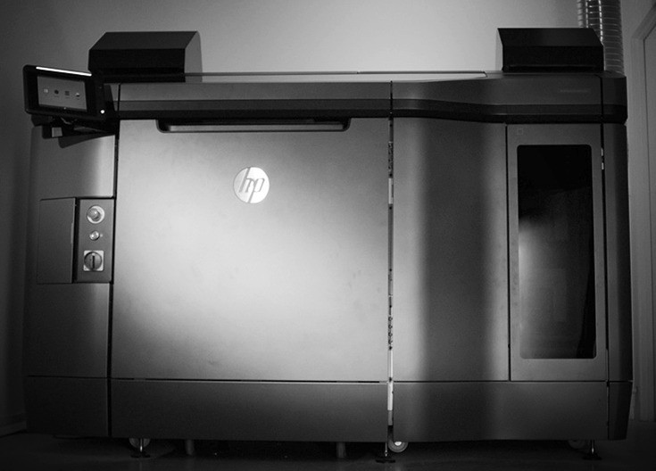

图：iOrthotics公开案例中的HP打印设备照片[CASE-P06]，不是足矫形器成品。图片权利归原权利人，未确认开放再分发许可。

这条路线把价值放在“扫描、设计、制造、适配”之间的衔接，而不是仅把传统铣削材料换成粉末。成形后仍要清理和完成相应表面、配套与适配工作。足矫形器的形状和使用效果由专业评估决定，不能把一份足部扫描直接当作已完成的产品设计；本例介绍制造分工，不提供诊疗方案。

两个案例分别说明了粉床的不同吸引力：Brose重视合格小件的批量组织，iOrthotics重视不同几何的统一生产。两者都需要批次追踪、稳定材料和检验；“同一盒里放得下”只是工艺规划的起点。

## 本章资料

- [CASE-P05] Formlabs，Brose的SLA与SLS汽车生产应用（2024）：https://formlabs.com/blog/brose-sla-sls-bolster-automotive-production/
- [CASE-P06] iOrthotics，HP MJF足矫形器数字制造案例（2018）：https://www.ioprint3d.com.au/post/case-study-how-hp-s-3d-printing-technology-helps-iorthotics-develop-products-that-benefit-people-ev
