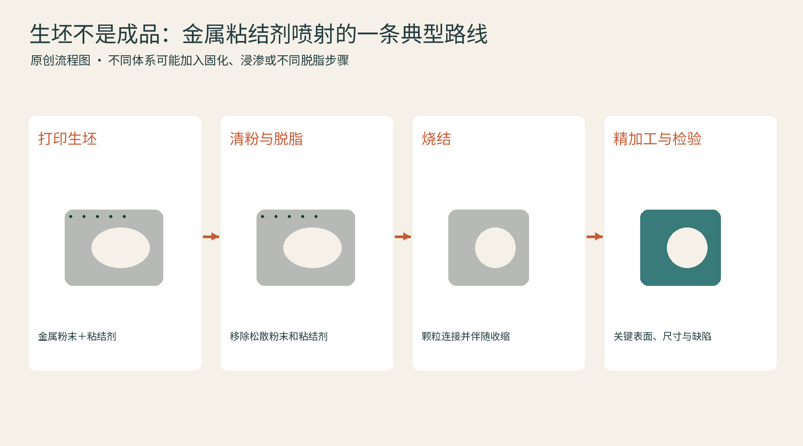

# 05 金属打印：熔化、沉积与烧结的不同道路

金属3D打印最动人的照片，往往是一束光在粉末上闪烁，或者喷头沿着零件喷出耀眼熔池。但金属打印不只有一种“激光烧粉”。有的在粉床中熔化，有的边送丝边沉积，有的先做一个黏住的坯体，再送进炉子。要判断一个金属作品，先把打印过程和最终致密化过程分开看。[资料：Fraunhofer IFAM《Additive Manufacturing》](https://www.ifam.fraunhofer.de/en/technologies/additive-manufacturing.html)

## 激光粉床：在薄粉层里形成熔池

](../assets/images/real-nasa-copper.jpg)

激光粉末床熔融通常写作LPBF或PBF-LB。激光选择性熔化粉末，凝固后连接已成形区域，再铺下一层。它适合复杂内部流道、轻量结构和某些小型高价值零件。粉末粒度、铺层质量、能量输入与凝固行为共同影响孔隙、组织和性能。把激光功率调大，不能自动解决所有缺陷。[资料：EOS《EU Project InShaPe》](https://www.eos.info/press-media/press-center/press-releases/2022/eu-project-inshape)

高分子粉床常能利用周围粉末承托作品，但金属LPBF支撑还可能承担导热、固定与控制变形的任务。悬垂几何、热积累和残余应力相互牵连，所以不能把“粉末包着”误解成“不需要支撑”。切下基板、去支撑、热处理和关键表面机加工，是许多金属零件工艺链的一部分。

## 电子束粉床：能量源与环境也变了

电子束粉床熔融使用电子束作为能量源，通常在真空和预热条件下工作。它与激光粉床都属于熔融型粉床路线，但工艺窗口、材料适用性、粉末状态和后处理条件不同。不能只凭两台设备都处理钛合金，就把参数、支撑经验或表面预期直接互换。Fraunhofer把选择性电子束熔融与其他增材路线分别列出，正是因为它们需要各自的过程知识。[资料：Fraunhofer IFAM《Additive Manufacturing》](https://www.ifam.fraunhofer.de/en/technologies/additive-manufacturing.html)

## DED：把材料送进正在发生的结合区

定向能量沉积DED不像铺一整床粉再扫描，而是把材料送到能量作用区域，沉积在基体或既有零件上。激光送粉、激光送丝、电弧送丝等都是应进一步区分的路线。NIST以喷嘴送材和定向能量共同作用解释这类过程；其价值既包括长出新零件，也包括在旧件上增加材料。[资料：NIST《Directed Energy Deposition》](https://www.nist.gov/additive-manufacturing/research-areas/technologies/directed-energy-deposition)

TRUMPF的激光金属沉积资料展示了表面增材、修复与材料叠加等应用。可以想象一个已经加工过的轴，在局部沉积耐磨层，再通过磨削恢复尺寸。这里3D打印不必独立完成整个零件，它可以是维修与再制造的一段。[资料：TRUMPF《Laser Metal Deposition》](https://www.trumpf.com/en_INT/solutions/applications/additive-manufacturing/laser-metal-deposition/)

## 黏结剂喷射：先得到坯体

金属黏结剂喷射先在粉床上选择性喷入黏结剂，形成具有形状但尚未达到最终性能的坯体。后续脱脂、烧结等过程让它成为所需金属件，尺寸收缩和变形因此是设计与质量控制的重要问题。它与粉床熔融的区别，在于打印阶段不依靠选择性熔化来完成金属结合。[资料：Siemens《Binder jetting》](https://www.siemens.com/en-gb/technology/binder-jetting/)

| 路线 | 打印时发生什么 | 常见后续关注点 |
| --- | --- | --- |
| 激光粉床熔融 | 薄粉层局部熔化凝固 | 应力、支撑、表面与检测 |
| 电子束粉床熔融 | 电子束作用于粉床 | 环境、热过程、粉末移除 |
| DED | 边送材料边结合 | 形状余量、稀释、再加工 |
| 黏结剂喷射 | 先把粉黏成坯体 | 脱脂、烧结收缩、变形 |

选用不锈钢、铝合金、钛合金或镍基合金时，还要核对该牌号是否经过特定设备和工艺验证。金属名称只是一层信息；材料批次、方向、热处理和检测结果，决定一个零件是否足以承担真正任务。

阅读金属打印案例，建议追问四件事：哪里体现了打印优势，哪些面又被切削，性能由什么试验确认，以及更换工艺后设计是否改变。这样看，航空零件与日常金属摆件都能成为很好的制造教材。
