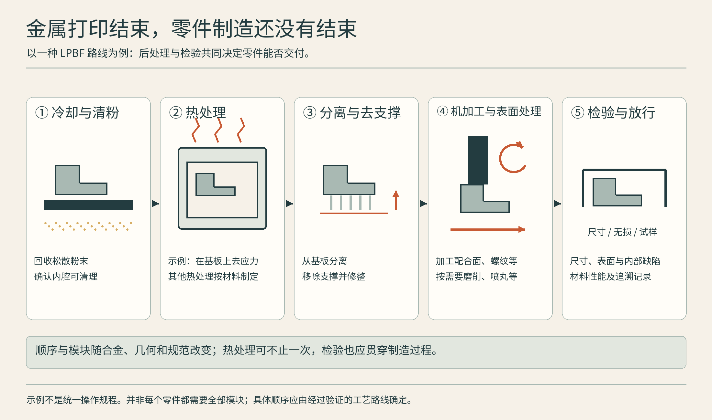
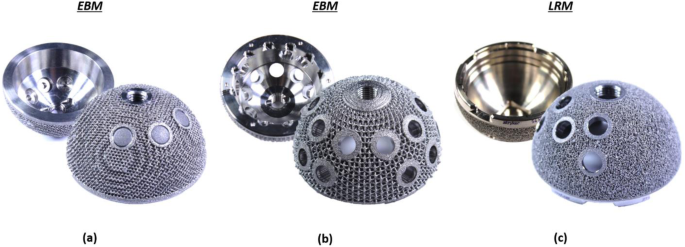
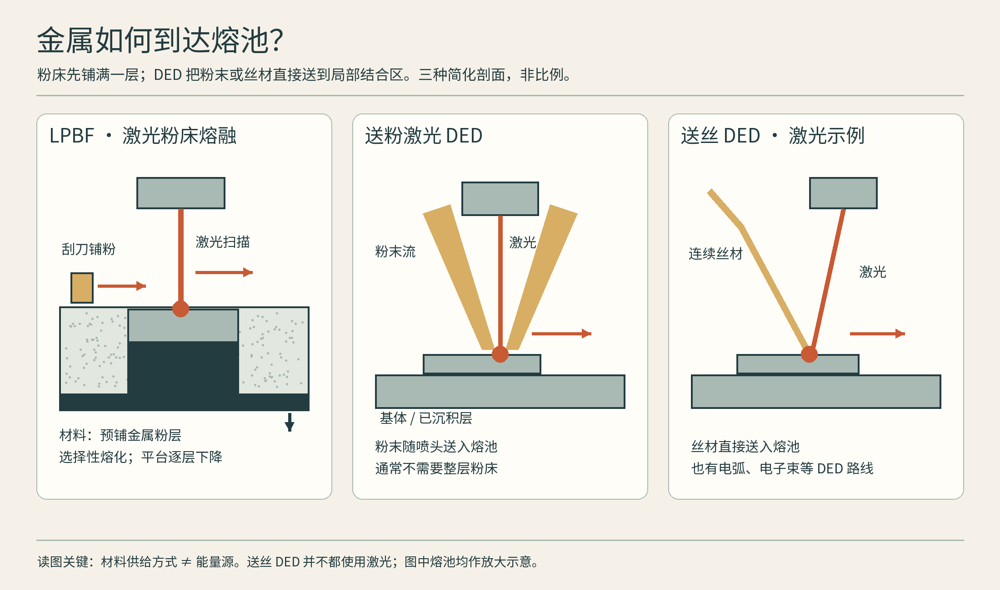
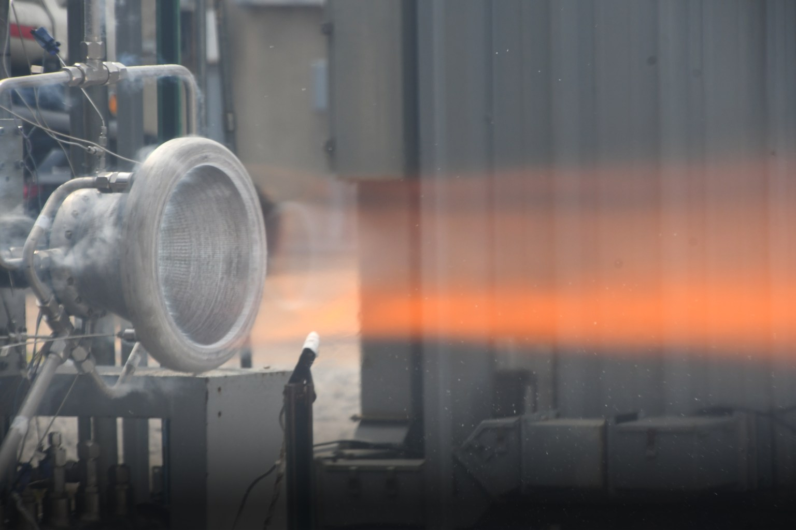
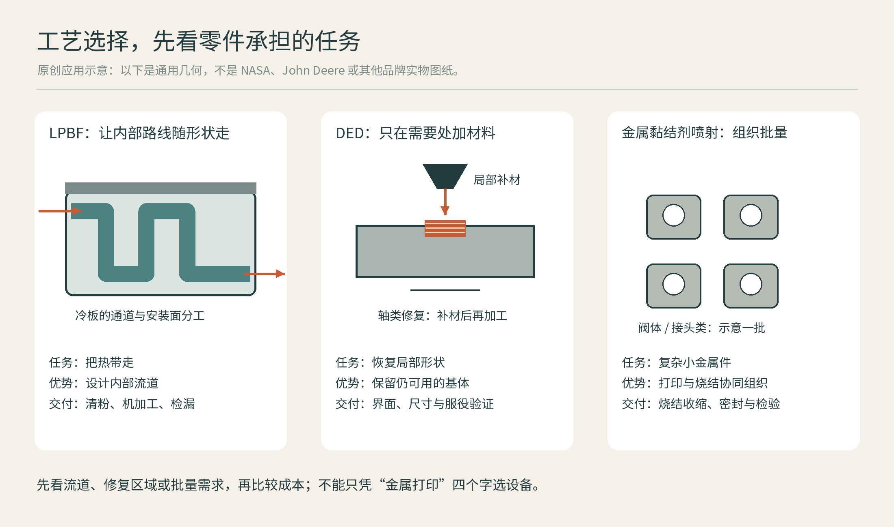

# 05 金属打印：熔化、沉积与烧结的不同道路

金属3D打印最动人的照片，往往是一束光在粉末上闪烁，或者喷头沿着零件喷出耀眼熔池。但金属打印不只有一种“激光烧粉”。有的在粉床中熔化，有的边送丝边沉积，有的先做一个黏住的坯体，再送进炉子。要判断一个金属作品，先把打印过程和最终致密化过程分开看。[资料：Fraunhofer IFAM《Additive Manufacturing》](https://www.ifam.fraunhofer.de/en/technologies/additive-manufacturing.html)

## 激光粉床：在薄粉层里形成熔池

](../assets/images/real-nasa-copper.jpg)

激光粉末床熔融通常写作LPBF或PBF-LB。激光选择性熔化粉末，凝固后连接已成形区域，再铺下一层。它适合复杂内部流道、轻量结构和某些小型高价值零件。粉末粒度、铺层质量、能量输入与凝固行为共同影响孔隙、组织和性能。把激光功率调大，不能自动解决所有缺陷。[资料：EOS《EU Project InShaPe》](https://www.eos.info/press-media/press-center/press-releases/2022/eu-project-inshape)

高分子粉床常能利用周围粉末承托作品，但金属LPBF支撑还可能承担导热、固定与控制变形的任务。悬垂几何、热积累和残余应力相互牵连，所以不能把“粉末包着”误解成“不需要支撑”。切下基板、去支撑、热处理和关键表面机加工，是许多金属零件工艺链的一部分。

图：一种 LPBF 后处理示例；热处理、分离、机加工和检验需组成经过验证的路线。依据 [EOS 金属后处理](https://www.eos.info/metal-solutions/metal-periphery)；不是通用操作规程。

**实际案例：NASA铜合金燃烧室内衬——让冷却通道与热壁一起成形**

NASA在2015年的研发报道中，用选择性激光熔化制造带复杂冷却通道的铜合金燃烧室内衬。任务不是打印一个“像火箭的金属壳”，而是在承受高热负荷的内壁旁安排冷却路线；难点同时涉及内部几何和铜合金的激光成形特性。报道还说明，团队先制作试样、表征材料，再制造内衬。[CASE05A]

从这个案例可以学到：选择增材时，应指出传统钻孔或拼接难以实现的具体位置。对冷却零件，打印之后还应沿本章的工艺链核查通道清理、连接面、密封与试验。2015年的样件制造记录本身，不代表所有同形零件都已获得装机资格。

## 电子束粉床：能量源与环境也变了

电子束粉床熔融使用电子束作为能量源，通常在真空和预热条件下工作。它与激光粉床都属于熔融型粉床路线，但工艺窗口、材料适用性、粉末状态和后处理条件不同。不能只凭两台设备都处理钛合金，就把参数、支撑经验或表面预期直接互换。Fraunhofer把选择性电子束熔融与其他增材路线分别列出，正是因为它们需要各自的过程知识。[资料：Fraunhofer IFAM《Additive Manufacturing》](https://www.ifam.fraunhofer.de/en/technologies/additive-manufacturing.html)

**实际案例：EBM髋臼杯——同一零件的两面需要不同表面**

2019年一项原始研究分析了三种市售钛合金髋臼杯，其中LimaCorporate的Delta TT与Medacta的Mpact 3D Metal使用电子束熔融制造。研究比较了外侧多孔结构、内侧表面和杯壁几何。这些是标准型号，不应看到“医疗3D打印”就自动理解成患者定制。[CASE05B]

应用价值在于把承载壳体与复杂多孔外层组织在一起；但研究也观察到表面的部分熔化颗粒。对制造者而言，孔隙、残留颗粒和内侧配合面都是要测量的问题，不能用漂亮晶格照片代替质量评价。该结构研究不构成某种植入物疗效更优的证明。[CASE05B]

图：Dall’Ava等，2019，原文图2；a为Delta TT，b为Mpact 3D Metal，c为Trident II Tritanium。前两者采用EBM，不能将整张图均称为EBM产品。[CASE05B] 依[CC BY 4.0](https://creativecommons.org/licenses/by/4.0/)引用，未改动图像内容，仅随版面缩放。

## DED：把材料送进正在发生的结合区

图：LPBF 与两种 DED 的材料供给对照。依据 [NIST DED](https://www.nist.gov/additive-manufacturing/research-areas/technologies/directed-energy-deposition)、[EOS LPBF](https://www.eos.info/press-media/press-center/press-releases/2022/eu-project-inshape) 与 [TRUMPF 激光金属沉积](https://www.trumpf.com/en_INT/solutions/applications/additive-manufacturing/laser-metal-deposition/)。

定向能量沉积DED不像铺一整床粉再扫描，而是把材料送到能量作用区域，沉积在基体或既有零件上。激光送粉、激光送丝、电弧送丝等都是应进一步区分的路线。NIST以喷嘴送材和定向能量共同作用解释这类过程；其价值既包括长出新零件，也包括在旧件上增加材料。[资料：NIST《Directed Energy Deposition》](https://www.nist.gov/additive-manufacturing/research-areas/technologies/directed-energy-deposition)

TRUMPF的激光金属沉积资料展示了表面增材、修复与材料叠加等应用。可以想象一个已经加工过的轴，在局部沉积耐磨层，再通过磨削恢复尺寸。这里3D打印不必独立完成整个零件，它可以是维修与再制造的一段。[资料：TRUMPF《Laser Metal Deposition》](https://www.trumpf.com/en_INT/solutions/applications/additive-manufacturing/laser-metal-deposition/)

**实际案例：RAMFIRE——大尺寸沉积与热试验放在同一项目里看**

NASA的RAMFIRE项目与Elementum 3D、RPM Innovations合作，用激光送粉DED制造铝合金喷管，将冷却通道纳入一体式结构。2023年的报道呈现了制造与热试验，也把大型示范件称为概念验证。这里选择DED，与大尺寸构建和通道集成有关，不能因其也用激光就写成LPBF。[CASE05C]

图：RAMFIRE喷管热试验，NASA/MSFC；来源为NASA项目报道。[CASE05C] 照片展示的是试验状态，不是已执行深空飞行的证明。NASA署名影像，按NASA媒体使用要求引用，不表示NASA为本书背书。

它提示读者把“打印得出来”和“在工作环境中通过验证”分开。对大型热管理零件，除了沉积效率，还要考虑内部通道能否检查、接口怎样加工、材料与热循环如何验证。照片里的火焰属于试验，不是性能数字。

## 黏结剂喷射：先得到坯体

金属黏结剂喷射先在粉床上选择性喷入黏结剂，形成具有形状但尚未达到最终性能的坯体。后续脱脂、烧结等过程让它成为所需金属件，尺寸收缩和变形因此是设计与质量控制的重要问题。它与粉床熔融的区别，在于打印阶段不依靠选择性熔化来完成金属结合。[资料：Siemens《Binder jetting》](https://www.siemens.com/en-gb/technology/binder-jetting/)

**实际案例：John Deere燃油系统阀件——选择的是一条量产链**

HP在2022年的公告中介绍，John Deere与GKN Additive合作，将Metal Jet打印阀件用于拖拉机燃油系统；GKN的应用资料把相关燃油旁通件列为316L不锈钢金属黏结剂喷射应用。它关注紧凑空间中的复杂功能，也把讨论从“展会上打印了一个样品”推进到了生产零件。[CASE05D][CASE05E]

这个案例不意味着所有小阀件都该打印。比较方案时，应把成批排版、去粉、烧结、后续加工与检验一起计入；烧结变形与密封配合尤其不能留到最后才发现。若结构能方便地车铣加工，且需求量、节拍与现有产线不同，答案仍可能改变。

图：原创通用应用示意，不是上述品牌零件图纸。冷却几何参考NASA内衬案例[CASE05A]，DED修复原理参考[TRUMPF激光金属沉积](https://www.trumpf.com/en_INT/solutions/applications/additive-manufacturing/laser-metal-deposition/)，批量阀件参考HP与GKN报道[CASE05D][CASE05E]；图中形状与数量不代表实物、报价或性能。

| 路线 | 打印时发生什么 | 常见后续关注点 |
| --- | --- | --- |
| 激光粉床熔融 | 薄粉层局部熔化凝固 | 应力、支撑、表面与检测 |
| 电子束粉床熔融 | 电子束作用于粉床 | 环境、热过程、粉末移除 |
| DED | 边送材料边结合 | 形状余量、稀释、再加工 |
| 黏结剂喷射 | 先把粉黏成坯体 | 脱脂、烧结收缩、变形 |

选用不锈钢、铝合金、钛合金或镍基合金时，还要核对该牌号是否经过特定设备和工艺验证。金属名称只是一层信息；材料批次、方向、热处理和检测结果，决定一个零件是否足以承担真正任务。

阅读金属打印案例，建议追问四件事：哪里体现了打印优势，哪些面又被切削，性能由什么试验确认，以及更换工艺后设计是否改变。这样看，航空零件与日常金属摆件都能成为很好的制造教材。

## 本章资料

- [CASE05A] NASA，2015，铜合金燃烧室内衬制造报道：https://www.nasa.gov/technology/nasa-3-d-prints-first-full-scale-copper-rocket-engine-part/
- [CASE05B] Dall’Ava等，2019，钛合金髋臼杯原始对比研究：https://link.springer.com/article/10.1186/s41205-019-0052-0
- [CASE05C] NASA，2023，RAMFIRE制造与热试验：https://www.nasa.gov/centers-and-facilities/marshall/nasas-innovative-rocket-nozzle-paves-way-for-deep-space-missions/
- [CASE05D] HP，2022，John Deere Metal Jet生产应用公告：https://www.hp.com/us-en/newsroom/press-releases/2022/new-hp-jet-fusion-s400-metal-jet-s100.html
- [CASE05E] GKN Powder Metallurgy，Fuel Bypass Components应用说明：https://www.gknpm.com/en/about-us/our-businesses/gkn-additive/
