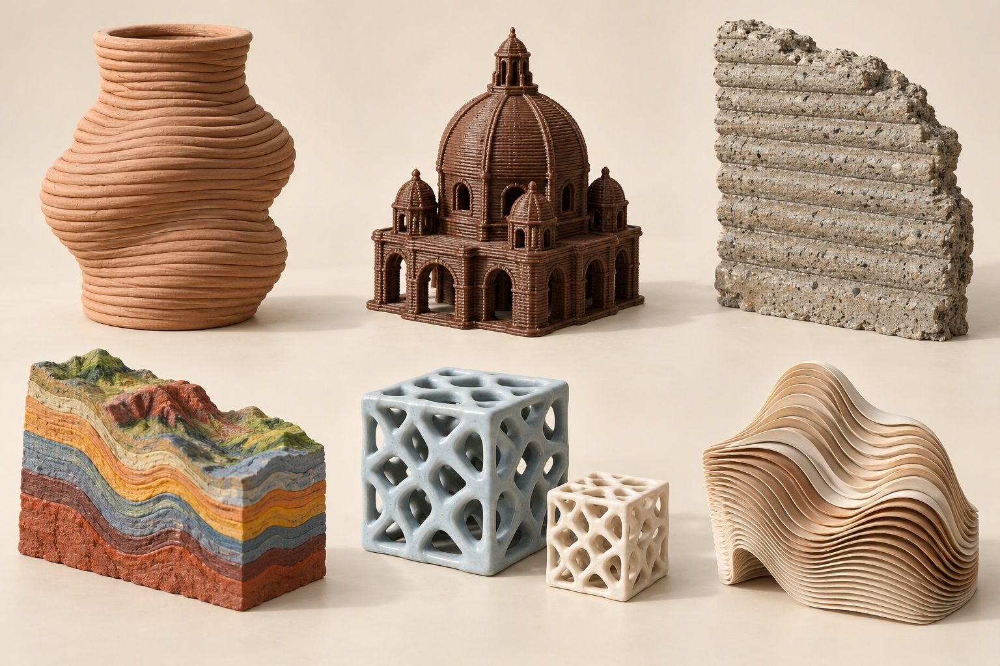
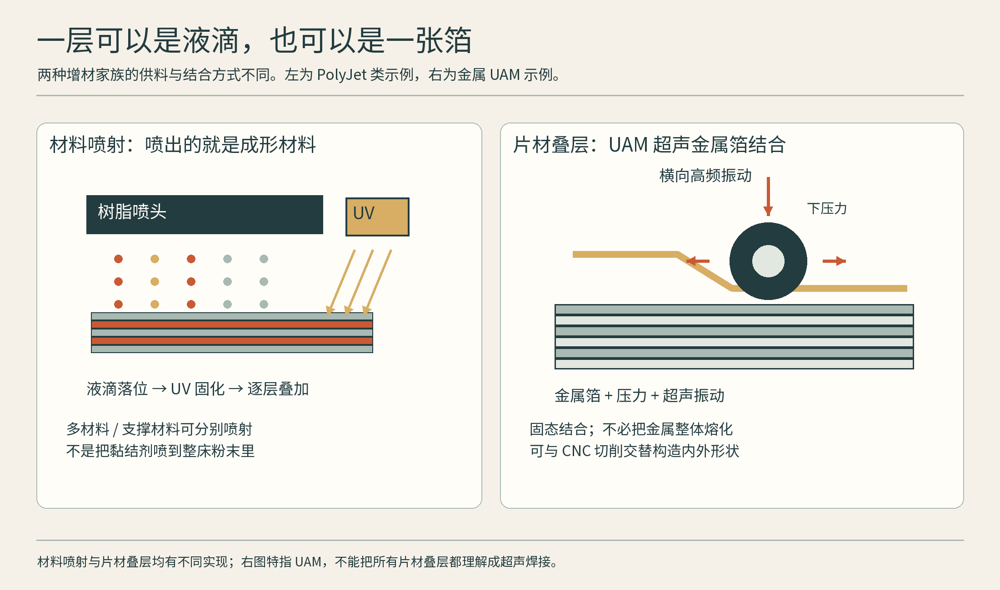
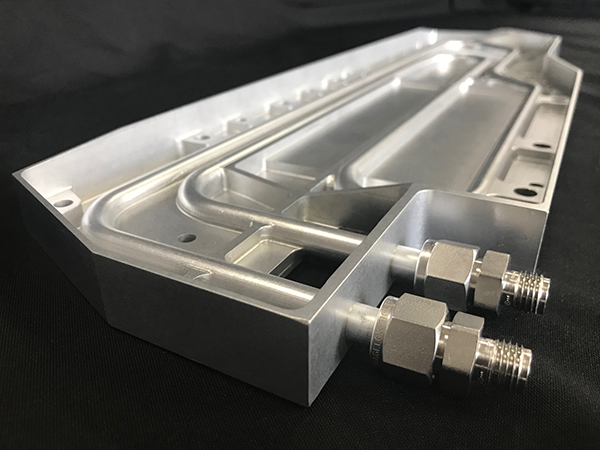
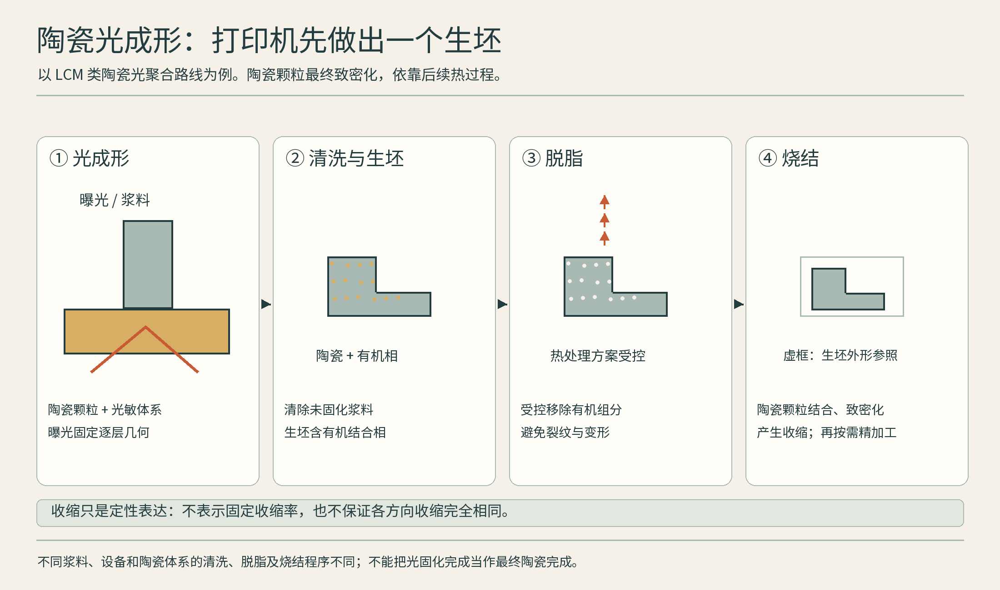
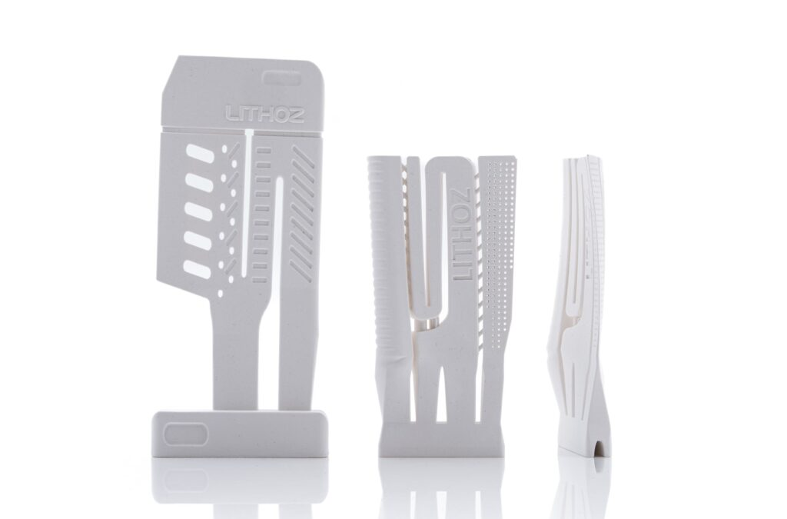
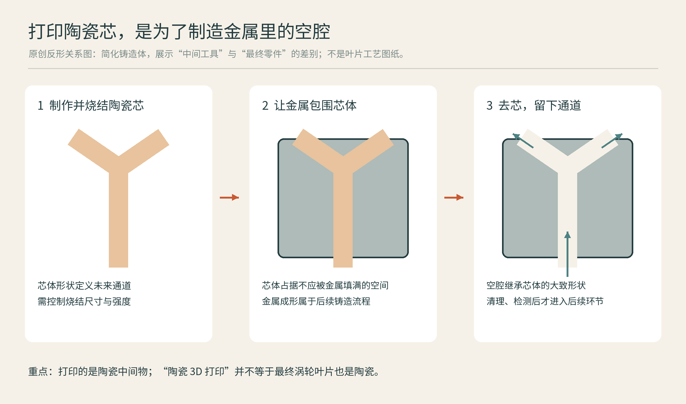

# 06 不只塑料与金属：制造边界上的新风景

如果把3D打印理解成一台桌面机器，就很难把彩色解剖模型、陶瓷芯、混凝土墙和细胞培养结构放在一起。它们真正共享的是数字化控制下的空间布置，而不是相同的喷嘴、材料或使用环境。本章把剩下的工艺家族补齐，也带你看几个跨材料领域。请留意：七类工艺是原理分类，食品、建筑和生物打印则是材料或应用领域，它们并不位于同一个分类层级。

## 材料喷射：液滴本身成为作品

材料喷射把构成零件的材料以液滴形式布置到所需位置。以Stratasys PolyJet为例，喷射的光敏材料被紫外光固化，某些组合可以在一个模型中表现不同颜色、透明度与软硬区域。它适合在产品开发中模拟包胶握把、透明外壳或彩色人体结构。这里的“多材料”能力需要结合具体机器、材料与支撑条件理解。[资料：Stratasys《PolyJet Technology》](https://www.stratasys.com/en/guide-to-3d-printing/technologies-and-materials/polyjet-technology/)

它与MJF的关键区别是，MJF主要对粉床的结合施加选择性控制；材料喷射则沉积构成作品的材料。两者都可能有喷头，但名字相似并不意味着工作方式相同。逼真的模型也不自动拥有被模拟材料的长期性能：看起来像橡胶，不等于就是同一种橡胶。

**实际案例：Audi尾灯外观原型——颜色与透明区域也是设计内容**

Stratasys在2018年的Audi案例中介绍，预生产中心使用J750的全彩、多材料能力制作透明、多色尾灯罩原型，帮助评审形状、纹理和颜色组合。过去需要分别制造再装配的颜色区域，可以在同一打印模型中呈现。[CASE06A]

这类模型解决的是设计沟通和验证问题。它并不自动成为量产车上长期耐候的灯罩；去支撑、表面处理，以及模型与最终注塑材料之间的差异仍应交代。对包胶握把或透明按键，也可沿用同样的判断：要验证触感和外观，还是验证长期承载与环境耐受？两种任务需要不同证据。

## 薄材叠层：一层也可以是一张箔

图：左为 PolyJet 类材料喷射，右为 UAM 片材叠层。依据 [Stratasys PolyJet](https://www.stratasys.com/en/guide-to-3d-printing/technologies-and-materials/polyjet-technology/) 与 [Fabrisonic UAM](https://fabrisonic.com/uam/)。两图仅代表各自家族中的具体实现。

薄材叠层把薄片或箔材逐层结合，再获得所需几何。不同路线可能使用黏接、切割或其他结合方式。Fabrisonic的超声增材制造UAM利用振动结合金属箔，属于固相结合路线，并可与机加工协同。它提醒我们，“增材”不要求材料一定先熔化，也不要求所有细节都由添加步骤完成。[资料：Fabrisonic《What is UAM?》](https://fabrisonic.com/uam/)

对初学者而言，可以把“先铺一张、再结合、再修整”当作理解入口，但别把金属固相结合当成普通胶水贴纸。实际界面质量取决于材料与过程控制，技术价值也不能单凭层层叠叠的外观判断。

**实际案例：Fabrisonic换热器——先加工通道，再用金属箔封住**

NASA Spinoff介绍了Fabrisonic参与JPL换热器开发的案例：在逐层结合的金属中加工弯曲通道，再覆盖后续层，把原本依赖管路、支架等连接的功能纳入一个构件。这是一条UAM与减材交替的制造路线，而不是一台打印机独自完成所有动作。[CASE06B]

图：Fabrisonic LLC铝换热器，NASA Spinoff项目页所载实图，图片署名Fabrisonic LLC。[CASE06B] 第三方版权保留，未发现开放许可；NASA刊载不使该公司照片自动成为公共领域。

选择这条路线的理由，是获得封闭通道与整体金属结构；工程判断还要看层间结合、通道密封以及热循环中的表现。UAM也可用于嵌入传感器，但这种低于熔点的结合过程，仍不是对所有敏感元件都天然安全。[CASE06B]

## 陶瓷：打印的往往是通往成品的中间体

图：光固化固定的是含陶瓷颗粒的生坯几何；后续脱脂与烧结决定最终陶瓷。依据 [Lithoz LCM](https://www.lithoz.com/en/technology/lcm-technology/)。图中收缩不对应定量收缩率。

陶瓷可以走多条增材路线。泥浆挤出适合形成层纹鲜明的器物；含陶瓷颗粒的光固化浆料则能形成精细坯体。以Lithoz的LCM为例，光固化先固定含粉配方的形状，后续清洗、脱脂与烧结构成完整工艺链。高温过程会改变尺寸，设计必须考虑收缩与变形。[资料：Lithoz《LCM Technology》](https://www.lithoz.com/en/technology/lcm-technology/)

Fraunhofer HTL使用相关设备制造技术陶瓷原型和小批量零件，并研究按零件优化脱脂、烧结。这样的案例说明，陶瓷打印的质量既在打印机里决定，也在炉内过程决定。白色外观的树脂模型、含陶瓷填料但未完成烧结的坯体、致密陶瓷成品，必须明确区分。[资料：Fraunhofer HTL《Stereolithographic Process》](https://www.htl.fraunhofer.de/en/ResearchAreas/additive-manufacturing/stereolithography-process.html)

**实际案例：Lithoz与Safran——打印的是铸造芯，不是直接打印金属叶片**

Lithoz在2025年公布，Safran Aircraft Engines在法国安装CeraFab S65设备，建设面向复杂陶瓷铸造芯的生产能力。目标是配合后续铸造，使涡轮叶片中能形成更复杂的冷却结构；设备安装和生产能力建设，不应被写成某一新发动机型号已经全面装机的证明。[CASE06C]

图：Lithoz官方示范陶瓷铸造芯，© Lithoz，保留版权。[CASE06C] 原报道注明图中示范芯由CeraFab S320打印，不是Safran的具体量产件，也不能拿它证明S65制造了图中零件。

图：原创“中间工具”与最终零件的反形关系示意，依据Lithoz铸造芯应用[CASE06C]；几何与步骤已简化，不是实际叶片铸造操作规程。

在这个场景里，工艺选择的重点是精细芯体能否可靠制造、烧结后尺寸能否受控，以及它如何适应铸造和去芯流程。把中间工具也纳入制造视野，才会发现许多打印应用并不直接出现在最终商品表面。

## 食品：机器安排形状，厨房仍要完成食物

食品打印常通过挤出可流动的食材形成图案和层次，例如泥状食物、面团或其他适配配方。Natural Machines的Foodini案例包括餐饮实验与教育用途。与传统裱花相比，数字控制增加了可重复的路径与造型自由，但打印不必然承担烹饪；配方、卫生、温度和食用体验仍是核心。[资料：Natural Machines《Users》](https://www.naturalmachines.com/users)

它值得关注的地方不只是奇异造型，还包括质地与份量的安排。不过，对吞咽困难人群的食品应用，形状设计不能代替专业的营养和质地验证。一个漂亮成品照片，只能告诉我们它看起来如何。

**实际案例：Elior的厨房实验——先解决配方与呈现，再谈规模**

Natural Machines的用户资料收录了Elior实验室使用Foodini探索新烹饪方式的说明。这是食品服务团队的实验应用，适合讨论可挤出配方、重复摆盘和定制造型，而不是把设备描述成自动完成整餐的厨房。[CASE06D]

如果要比较手工裱花和打印，应记录准备与清洗时间、食材在等待过程中的状态，以及成形后是否还需烘烤或冷却。面向吞咽困难者的应用还需专业质地与营养验证；不能从供应商展示的漂亮造型，直接推出临床食用适宜性。

## 建筑：先辨认打印的是哪一部分

COBOD的建筑流程说明展示了逐层挤出墙体的路线。读取“几天打印一栋房子”之类标题时，应分别统计墙体打印时间和完整项目工期，并继续问屋面、基础、配筋、保温、水电与门窗怎样完成。墙体打印是一项有价值的建筑工序，但它不是住宅所有环节的同义词。[资料：COBOD《How it works》](https://cobod.com/how-it-works/)

建筑层纹有时被保留为一种表情：它让曲面和制作过程直接可见。但材料挤出性、层间结合、环境条件与结构规范，也会限制造型。美学自由必须与真实建造系统一起评价。

**实际案例：海德堡IT机房——曲面墙体成为建筑的一部分**

COBOD在2024年报道，PERI 3D Construction参与建造的德国海德堡IT Server Hotel已举行启用仪式，项目使用BOD2建筑打印设备。它提供了一个可观察的完成项目：把层叠墙体和曲面外观放进真实建筑需求中，而不是只展示一堵孤立的试打印墙。[CASE06E]

对这种应用，应该比较墙体的可制造性、现场组织与完整交付，而不是把“纯打印用时”当作从开工到可使用的全部工期。屋面、基础、配筋和机电等仍要由完整建筑方案解释；是否满足当地结构与消防等要求，取决于该项目的设计、施工与验收体系。建筑案例的意义在于工序协同，而非把所有施工工作都归功于喷嘴。

## 生物打印：布置细胞，不等于交付一个器官

生物打印可以用细胞及适配生物材料构建研究结构。CELLINK的细胞与组织模型资料包括多种组织研究方向，生物墨水则承担维持适合细胞环境与可打印性之间的平衡。它已是理解疾病、培养组织和研究药物的工具之一，但不能把“器官样模型”直接说成可以移植的完整器官。[资料：CELLINK《Cell and tissue models》](https://www.cellink.com/cell-tissue-models/)

**研究案例：Harvard SWIFT——打印可灌流通道，给组织内部送养分**

Harvard Wyss与SEAS在2019年发布SWIFT研究：在密集的细胞组织构建体中写入可移除的牺牲墨水，再留下可灌流的分支通道。它解决的是细胞聚集后内部如何获得氧与养分的一项工程问题；研究展示了带通道的心脏细胞组织构建体，而不是可直接移植的人体心脏。[CASE06F]

选择打印是为了在柔软材料内部安排空间路径，后续培养、功能表征与更长期验证同样属于工作的一部分。这个案例适合放在“研究工具与组织工程”的位置；不要把形状像器官、部分功能出现和临床可移植视为同一里程碑。

从一段打印路径，到具备长期功能和可验证安全性的生命组织，中间还有细胞生存、营养输送、成熟与实验验证。理解这些距离，并不会削弱技术的魅力，反而让进步有了尺度。看新领域时始终问：它完成了哪一步，后续还需要什么？这是面对未来制造最有用的阅读习惯。

## 本章资料

- [CASE06A] Stratasys，2018，Audi全彩多材料尾灯原型：https://investors.stratasys.com/news-events/press-releases/detail/466/audi-adopts-stratasys-full-color-multi-material-3d-printing
- [CASE06B] NASA Spinoff，2021，Fabrisonic超声增材换热器与嵌入传感器：https://spinoff.nasa.gov/ultrasonic-welding-additive-manufacturing
- [CASE06C] Lithoz，2025，Safran陶瓷铸造芯设备安装公告：https://www.lithoz.com/en/lithoz-has-installed-cerafab-s65-printers-to-build-casting-parts-for-safran-aircraft-engines/
- [CASE06D] Natural Machines，Foodini用户与Elior实验室说明：https://www.naturalmachines.com/users
- [CASE06E] COBOD，2024，海德堡IT Server Hotel项目启用报道：https://cobod.com/europes-largest-3d-printed-building-unveiled/
- [CASE06F] Harvard Wyss，2019，SWIFT组织灌流研究：https://wyss.harvard.edu/news/a-swifter-way-towards-3d-printed-organs/
