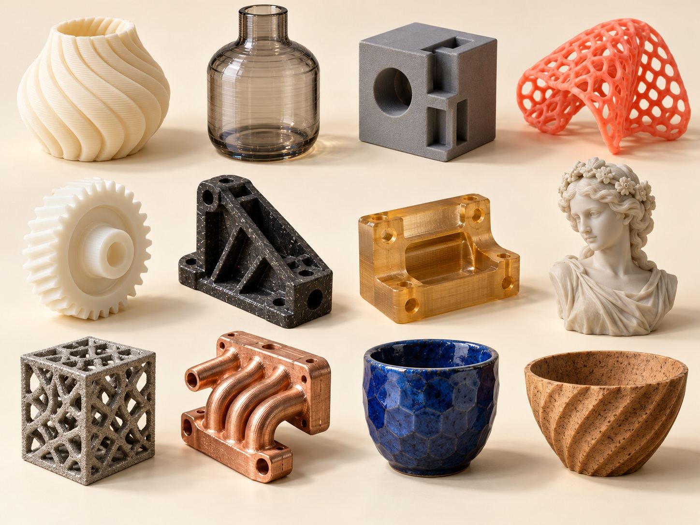
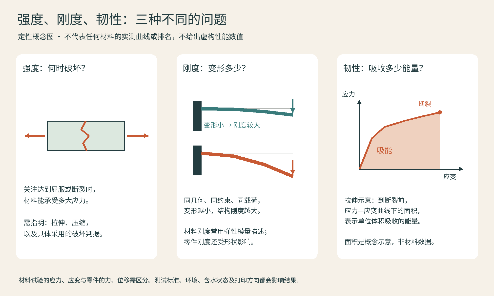

# 07 材料不是排行榜：从一卷线材读懂性能

假设你要做三个东西：放在书架上的小雕塑、卡在自行车上的灯架、能反复挤压的防撞脚垫。它们看起来都只是“小塑料件”，需求却完全不同。雕塑先关心表面和颜色；灯架要面对日晒、振动与夹紧力；脚垫需要变形后恢复。选材料最有效的起点，是写出物件将遭遇什么，而不是问哪种材料最强。

## 三组容易混淆的词

**强度**回答破坏前能承受多大应力；**刚度**回答受力后多容易变形；**韧性**涉及吸收能量、抵抗突然断裂的能力。硬而脆的零件可以很难划伤，却不耐摔。柔软的材料也可能很难拉断。打印件的这些表现又受成形方向、孔隙、壁厚和工艺影响。拿原料颗粒的资料，不能直接替代打印件的测试报告。

图：三个性能概念分别回答不同问题。曲线仅为定性示意，没有材料实测数值；韧性的拉伸吸能定义参见 [Princeton 材料术语说明](https://www.princeton.edu/~humcomp/sophlab/m%26mgl_13.htm)，强度与模量参见 [Penn State 聚合物力学课程](https://courses.ems.psu.edu/matse202/book/export/html/698)。

还要区分“材料家族”和“商品配方”。PA是聚酰胺的总称，PA6、PA11、PA12并不是同一种料；一种品牌的“耐热PLA”也不能代表所有PLA。读技术数据表时，先看测试标准、试样方向、干湿状态和是否退火，再比较数字。Prusa的材料指南适合查打印条件与后处理兼容性，而非把所有性能压成一个总分。[M01]

## 从桌面常用料到工程料

| 材料 | 值得观察的性格 | 首先问什么 |
|---|---|---|
| PLA | 容易获得整洁外观、颜色丰富 | 是否会遇到高温或长期受力？ |
| PETG | 常用于功能件，兼顾可打印性与韧性 | 拉丝、表面和装配间隙能否接受？ |
| ABS / ASA | 常见工程热塑料；ASA偏向耐候需求 | 是否具备合适的封闭环境与排风？ |
| TPU | 柔韧，适合缓冲、柔性连接 | 硬度、回弹与送料系统是否匹配？ |
| PA | 尼龙家族，常见耐磨与功能应用 | 具体是哪种PA，吸湿后如何变化？ |
| PC | 聚碳酸酯家族，适合较高要求功能件 | 翘曲、层间结合与设备能力如何？ |

这张表只是选题地图，不能代替配方数据。比如“TPU 95A”中的数字关联邵氏硬度，但同样硬度不代表相同回弹、耐磨或耐化学性。许多复合配方还改变了基础树脂的表现。[M01]

再往上是PEEK、PEKK、PEI等高性能聚合物。它们的价值可能在耐热、耐化学性或特定阻燃需求上，代价则是更严苛的成形环境。INTAMSYS的材料体系把PEEK、PEKK、PEI与工程材料、支撑材料分列，这说明“能把料熔出来”和“能稳定制成合格零件”是两回事。ULTEM是SABIC的商标；PEI是材料家族名，不能当作两种平行工艺。[M02]

## “碳纤维料”究竟加了什么

常见的PA-CF、PETG-CF，通常是在塑料基体中混入短切纤维。它们可能改变刚度、尺寸稳定性和表面观感，也可能增加磨耗；这不等于把一根连续碳纤维从零件一端铺到另一端。连续纤维增强还涉及纤维路径与载荷方向。买料时应追问基体、填料形态及测试方向，而不是只认包装上的“碳纤维”。Prusa把复合料单列，并提醒填充料具有与未填充树脂不同的性能和打印要求。[M03]

木粉、金属粉、夜光粉也常被加入线材。木粉填充料并非整块木材；金属外观线材通常仍以聚合物承担结构。另一方面，专用于脱脂烧结的金属填充线材，会经历移除粘结剂与烧结，才获得目标金属件。两者应看后续工艺区分，不能凭重量或外观判断。

## 树脂、金属、陶瓷：成形以后还有材料变化

“树脂打印”中的树脂通常指可光固化配方，它可以模拟刚性、弹性、耐热或铸造需求，却不必与其模拟的热塑料具有相同化学组成。颜色相同不代表性能相同；医疗用途还依赖指定的清洗、后固化和完整验证流程。[M04]

金属打印常见不锈钢、工具钢、铝合金、钛合金、镍基合金、钴铬和铜等体系。EOS的材料库按合金与工艺方案组织，而非只写“钢”或“钛”：成分、粉末状态和热处理都会影响最后的组织与表现。选钛不是自动获得轻量化，几何设计和使用条件仍然决定它是否值得。[M05]

陶瓷则可能以浆料、含陶瓷粉的光敏体系、粉末与粘结剂等形式进入设备。打印后往往需要脱脂、烧结，部分路线还需浸渗。成形时的“生坯”与最后的陶瓷件不是同一状态。ExOne对陶瓷粘结喷射的说明也强调，后处理决定最终材料表现。[M06]

## 选材练习：一个放在桌面的传感器外壳

下面是作者设定的教学项目，不是品牌案例，也没有经过实物测试。我们想给一块小型传感器板做外壳：放在室内桌面，偶尔拆盖维护，线缆从侧面进入；先做一套验证安装，暂不要求防水。先量电路板、接口及安装位置，再留出线缆弯曲和工具接近的空间。

第一轮只检查外形、接口与装配，可以把PLA列为候选，用容易检查的浅色打印小样。这个选择只回答“能否装得下、用起来顺不顺手”，不能证明长期使用合格。若之后增加反复拆装、跌落或更热环境的要求，再依据具体配方的数据表比较PETG等候选。Prusa材料指南可用于查阅材料的打印条件和应用特性；表中某项较好，不代表整件外壳已经满足要求。[M01]

| 实际需求 | 要观察的部位 | 先做的验证 |
|---|---|---|
| 盖子能反复打开 | 盖缘、卡扣或螺钉位置 | 用局部样片检查拆装手感与损伤 |
| 线缆不会顶开外壳 | 接口孔与内部转弯空间 | 用实际插头、线缆试装 |
| 放置环境可能改变 | 靠窗处、板件附近与底部 | 先确认环境，再查配方数据并安排相应测试 |
| 需要保持尺寸配合 | 材料状态、成形方向与后处理 | 记录批次和设置，用同一状态的小样比较 |

如果盖子卡住，先找接触位置，区分毛边、底层外扩和设计间隙不足；换成更贵的材料不一定解决问题。如果卡扣断裂，则要同时检查截面、摆放方向和材料状态。若最终任务只是展示内部布局，能清楚表现结构的样件可能已足够；若要交付长期使用的产品，还要补充环境、寿命和相应电气要求的验证。第08章继续走完这一外壳的试样与改版过程。

## 本章资料

- [M01] Prusa Research，Filament Material Guide：https://help.prusa3d.com/filament-material-guide
- [M02] INTAMSYS，Industrial 3D Printing Filaments & Materials：https://www.intamsys.com/materials?list=1
- [M03] Prusa Research，Material guide（复合料与各材料专题）：https://help.prusa3d.com/category/material-guide_220
- [M04] Formlabs，3D printing post-processing FAQs：https://formlabs.com/global/support/3d-printing-post-processing-faqs/
- [M05] EOS，Metal Powder for 3D Printing：https://www.eos.info/metal-solutions/metal-materials
- [M06] ExOne，Polymer / ceramic printing process information：https://www.exone.com/en/3d-printing-solutions_overview/3dp-solutions_polymer/
