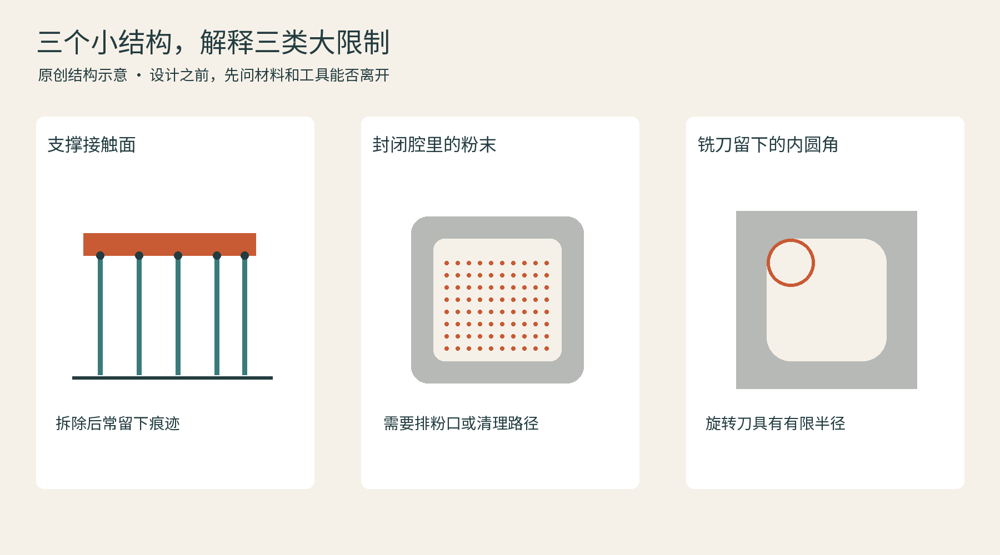

# 08 从屏幕到实物：一次打印真正经过什么

一个模型在屏幕上旋转得毫无破绽，到了打印机里却可能倒塌、变形，或者怎么也装不上。原因通常不在“打印机看不懂艺术”，而在屏幕里没有重力、热收缩、材料流动和工具尺寸。一条完整工作流，就是让这些现实条件逐步进入设计。

## 先让数字模型成为可制造的几何

CAD适合表达尺寸、孔位、装配关系和可修改的设计历史；雕刻与多边形建模则更善于处理有机表面。它们都能通向3D打印，但输出前要确认模型是可解释的实体：面是否封闭、壁是否足够厚、零件是否意外相交。一个画面里的平面，可能没有能被打印的厚度。

STL把表面近似为三角面，广泛兼容，却不标准化表达单位、颜色和材料信息。3MF把这些制造所需的信息纳入规范；具体切片软件保存的项目，还可能包含其自身的配置扩展。因此“能打开3MF”也不等于能完整继承另一软件的全部项目设置。交换文件时，仍应检查单位、零件数量和预览尺寸。[W01]

曲面转网格时也要选择尺度。三角面太粗，圆柱会像多边形；无限加密又会让文件臃肿，而设备未必能表现这些细节。合理做法是让几何误差显著小于作品真正关心的特征，而不是一味追求文件最大。

## 切片不只是把物体横着切开

切片软件把几何转换为设备可执行的层与路径。FFF常涉及外墙、顶底层、内部填充和支撑；光聚合要考虑层截面、曝光及剥离；粉床工艺还涉及排布、粉末与热过程。它们共享“分层”的思想，却不能共享一套参数。

**摆放方向**往往比把层高调得更细更重要。一个L形挂钩怎样放，决定拉力是否容易沿层间界面撕开，也决定哪面留下支撑痕。把它放平可能提高某个方向的承载，却让另一面的细节变差。这是结构、外观、时间三者之间的协商，不存在所有零件都该采用的最佳角度。[W02]

支撑是制造过程中临时需要的结构。它需要长到接住悬空区域，也需要最后能够移除。Prusa的支撑说明建议先考虑改变朝向或拆分模型，以减少支撑；这比打印完成后在狭小腔体里强行清理更有效。[W03]

对底部曝光的树脂打印，较大的层截面会带来剥离负担，封闭或杯状空间还要考虑排液。Formlabs的朝向指南讨论了截面积、支撑与卷曲的关系。它提供的是工艺判断依据，不能简化为“树脂模型一律斜着放”。[W04]

## 打印前看一遍预览

预览时不妨像在检查一段施工录像：第一层落在哪里？细小孤岛从哪一层出现？空腔里的支撑是否有出口？薄壁会不会因小于可实现路径而消失？彩色换料是否发生在预期区域？这些问题在电脑上处理，通常比打印结束后补救省力。

线材状态也属于流程的一部分。许多热塑料会吸湿，潮湿可能表现为表面气泡、拉丝、挤出异常或层间表现下降。烘干应遵循材料厂给出的温度与时间，并注意卷盘的耐温；密封干燥保存和烘干并不是同一动作。Prusa的干燥指南明确区分材料与相应处理要求。[W05]

## 从“打印完成”到“零件完成”

FFF可能需要拆支撑、修边、热熔嵌件或局部钻铰；树脂件需要按配方清洗与后固化；SLS要清粉，金属件还可能需要去应力、切离基板、热处理和关键面机加工。后处理不是可有可无的美容套餐，而是零件性能和几何形成的一部分。Formlabs强调，不同树脂及用途需要相应后处理流程，不能拿一种通用时长替代材料规定。[W06]

公差则回答“允许偏离多少”。层高、像素尺寸、喷嘴直径都不等于成品公差：它们描述的是过程的某个尺度。装配孔、卡扣和滑动配合应先做小样，记录方向、材料、设备与后处理，再修正设计。打印一个只有关键孔与卡扣的试片，比反复打印整个外壳更容易找到原因。

最后用适合的工具确认结果。卡尺可以检查许多外形尺寸，却看不到内部孔隙；复杂工业零件可能需要三坐标、扫描、CT或破坏性试样。模型上的“实心”只是一种几何定义，不是内部无缺陷的证明。

**一次实用的小实验：**把同一薄片竖放和平放，各做一件，用相同材料和主要设置，比较表面、弯曲方向与支撑痕。将结果视为这组工艺的观察，而非所有打印技术的通用定律。

## 本章资料

- [W01] 3MF Consortium，FAQ：https://3mf.io/resources/faq/；Core and extension specifications：https://3mf.io/spec/
- [W02] Prusa Research，Object orientation：https://help.prusa3d.com/article/object-orientation_1658
- [W03] Prusa Research，Support material：https://help.prusa3d.com/article/support-material_1698
- [W04] Formlabs，Model orientation best practices for SLA printing：https://formlabs.com/support/Model-Orientation/
- [W05] Prusa Research，Drying filament：https://help.prusa3d.com/article/drying-filament_332086
- [W06] Formlabs，3D printing post-processing FAQs：https://formlabs.com/global/support/3d-printing-post-processing-faqs/
