# 09 减材制造：让多余的材料离开

看到一块铝料逐渐露出圆润的键盘外壳，最吸引人的往往不是飞溅的切屑，而是表面从粗糙走向准确的过程。减材制造的共同点是移走材料；但移走材料的方法，可以是刀刃、磨粒、放电、光束、液流，也可以是化学反应。

## 先分清“控制方式”和“加工机制”

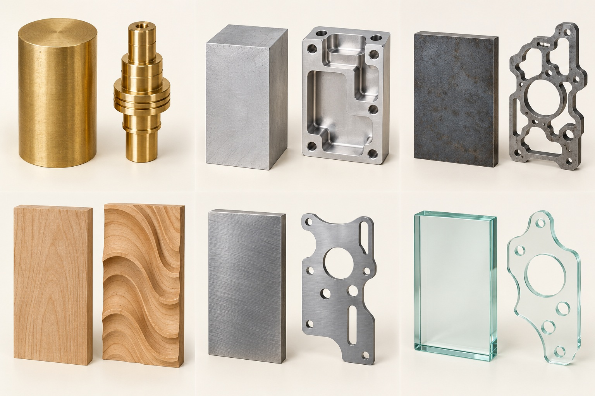

CNC是计算机数字控制，并不是“铣削”的同义词。CNC车床、磨床、水刀都可以由数字程序控制。3D打印机也依靠数字控制，因此“CNC对3D打印”的日常说法，其实经常把数控切削和增材制造作对照。更准确的比较应该说清工艺。

| 工艺 | 主要动作 | 容易认出的对象 |
|---|---|---|
| 车削 | 工件通常旋转，刀具进给 | 轴、套筒、旋钮、回转表面 |
| 铣削 | 多刃刀具旋转并相对工件移动 | 槽、口袋、复杂外壳、曲面 |
| 钻削与后续孔加工 | 制孔，再按需求扩、铰或镗 | 安装孔、定位孔、轴承孔 |
| 磨削 | 大量磨粒逐步去除材料 | 淬硬表面、精密平面与圆面 |
| 锯切 | 连续或往复齿刃分断材料 | 板、棒、型材下料 |
| 拉削 | 多排逐渐变化的刀齿依次切过 | 特定内孔轮廓、键槽等 |

这不是互斥的机器名单。一台车铣复合设备可以把多种动作组合起来，减少装夹。Sandvik Coromant的知识库也把车、铣、钻、铰、镗等分别讲解，因为各自的切屑、刀具和稳定性问题不同。[S01]

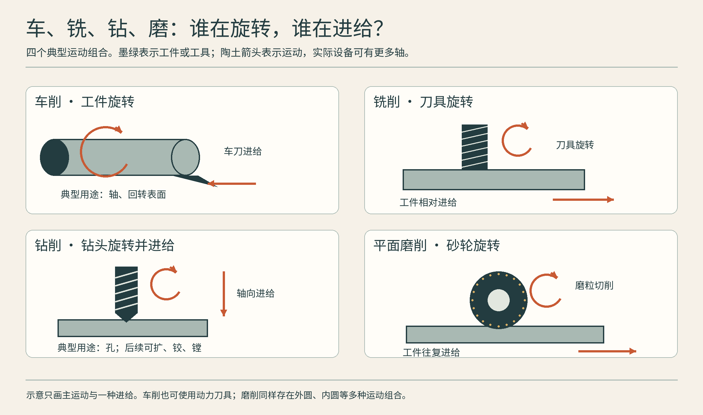

图：四种典型切削运动组合；实际机床可有更多轴与复合运动。依据 [Sandvik Coromant 切削知识](https://www.sandvik.coromant.com/en-gb/knowledge)。

## 为什么铣出来的内角常常是圆的

把一根圆柱形铣刀放进矩形凹槽，它的半径会留在角落。刀具更细可以让角变小，却也可能更难稳定加工深槽。深腔、细长刀具和薄壁又会带来挠曲与振动。这些痕迹说明，减材设计不仅要问“最终形状是什么”，还要问“刀具从哪里到达，工件怎么抓住”。

五轴加工增加了可接近的方向，并没有让刀具无处不达。封闭的弯曲内通道，仍可能需要拆成多个零件、改造设计，或换成增材等路线。刀路自由与几何自由是两个相关但不同的概念。

## 不靠刀刃也可以减材

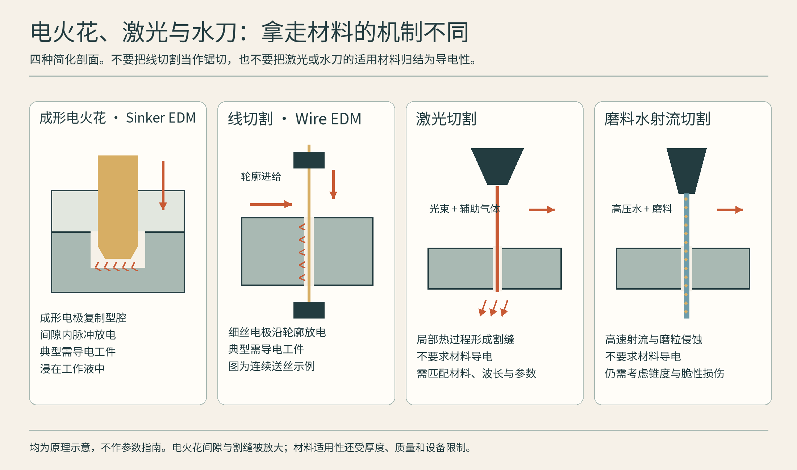

图：成形电火花与线切割依靠放电；激光依靠局部热过程；磨料水射流依靠侵蚀。依据 [AgieCharmilles 成形 EDM](https://www.agiecharmilles.com/die-sinking-edm)、[Makino 线切割](https://www.makino.com/resources/content-library/videos/archive/makino-duo-series-wire-edm-with-up-to-62-lower-wire-consumption/166)、[TRUMPF 激光切割](https://www.trumpf.com/en_US/solutions/applications/laser-cutting/) 与 [OMAX 水刀](https://www.omax.com/en/learn/how-does-waterjet-work/)。

**电火花加工（EDM）**利用受控放电去除材料，通常针对导电工件。线切割用持续供给的电极丝形成轮廓；成形电火花则使用有形状的电极加工型腔。它适合处理一些传统切削棘手的硬材料或细节，但仍需考虑电极、冲液、速度和表层状态。JLC CNC的技术解释强调其非接触、放电去除的特点。[S02]

**激光切割**把能量聚集到局部，借助熔化、氧化反应或汽化等机制形成切缝，具体取决于材料与过程。它既可用于金属，也可用于适合相应波长和设备的非金属；切口、热影响和烟尘都需要处理。TRUMPF的应用资料把激光切割归为分离加工，并区分不同切割方式。[S03]

**磨料水射流**把高速水流与磨料结合，侵蚀材料。OMAX的说明解释了射流滞后与切口形状为什么需要软件补偿。水刀常用于金属、石材、玻璃或复合材料等板件，但并非“没有限制的冷刀”：穿孔、脆材破损、切缝锥度、磨料与废水都属于工艺问题。[S04]

**化学蚀刻**先保护需要保留的区域，再让蚀刻剂移走暴露的材料。光化学加工利用感光图案形成掩膜，适合薄片上的细密轮廓。英国开放大学的工艺资料强调“受保护／未受保护”的选择性去除；它与把整块金属车成轴显然不是同一尺度的加工。[S05]

## 连续看懂：材料究竟怎样离开

以下每组从同一方向追踪同一块材料，一步一图，按从上到下的顺序阅读。灰绿色表示仍留在工件上的材料；箭头说明本步运动，虚线保留计划路径或原始轮廓。图形、间隙和刀具比例经过放大，不可作为加工参数。

**铣削：凹槽怎样逐步出现**

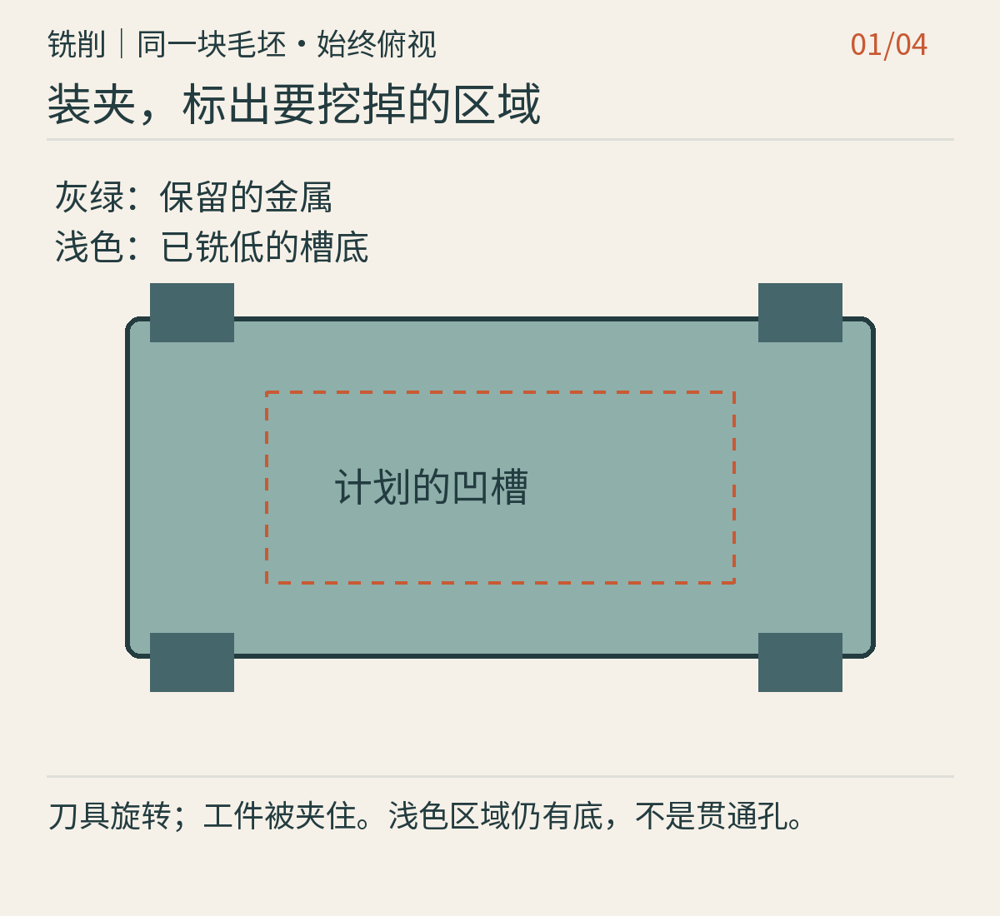

图：铣削：凹槽怎样逐步出现 · 1/4，装夹与规划。原创程序绘图；依照本段所列资料简化。 [S01]

从上面看同一块毛坯：夹具固定材料，虚线圈出凹槽范围。凹槽下面还要留底；刀具进入、退刀和夹具避让必须先规划。[S01]

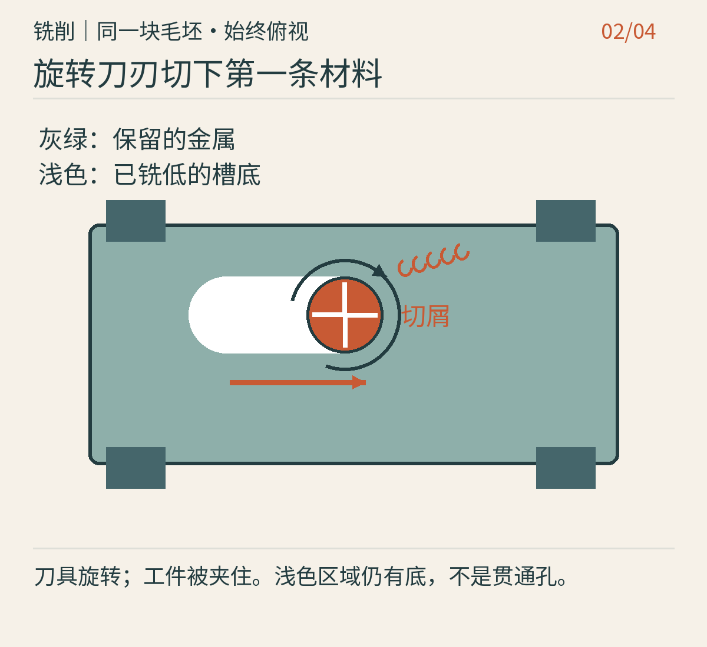

图：铣削：凹槽怎样逐步出现 · 2/4，刀刃第一次去料。原创程序绘图；依照本段所列资料简化。 [S01]

圆柱铣刀绕自身轴线旋转，刀齿把接触到的金属切成切屑；相对工件向右进给后，刀后留下已经铣低的浅色槽底。浅色不是穿透板材的孔。[S01]

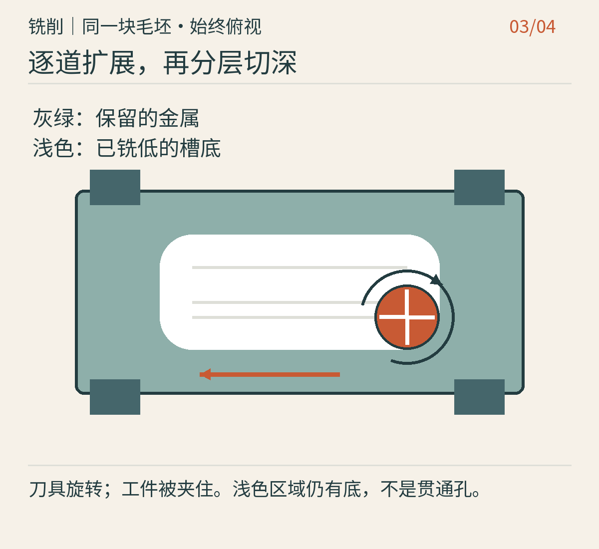

图：铣削：凹槽怎样逐步出现 · 3/4，逐道、逐层扩展。原创程序绘图；依照本段所列资料简化。 [S01]

相邻刀路逐步覆盖更大范围，达到这一层的切深后再安排后续层。前一步的槽保留下来，刀具只继续移走剩余材料；图中刀路是概念示意，不是可直接上机的程序。[S01]

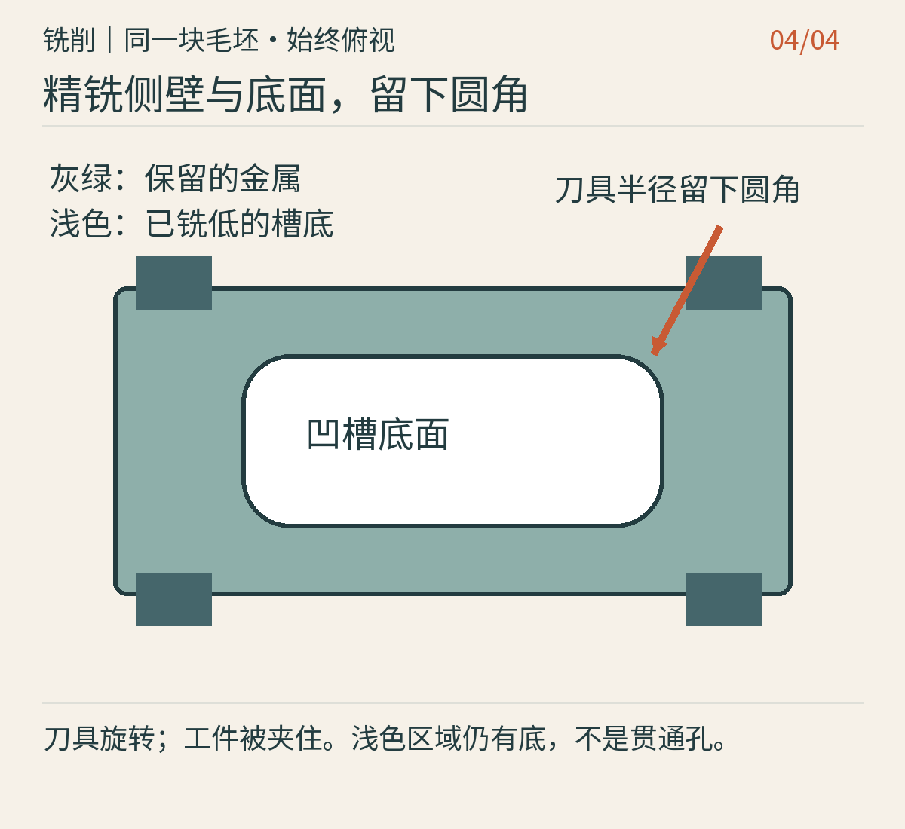

图：铣削：凹槽怎样逐步出现 · 4/4，精加工与检查。原创程序绘图；依照本段所列资料简化。 [S01]

粗加工接近形状后，再精铣侧壁与底面，并去毛刺、测量。圆形刀具无法在同样路径下留下无限尖锐的内角；成品仍有底和内圆角。[S01]

**车削：棒料怎样变成阶梯轴**

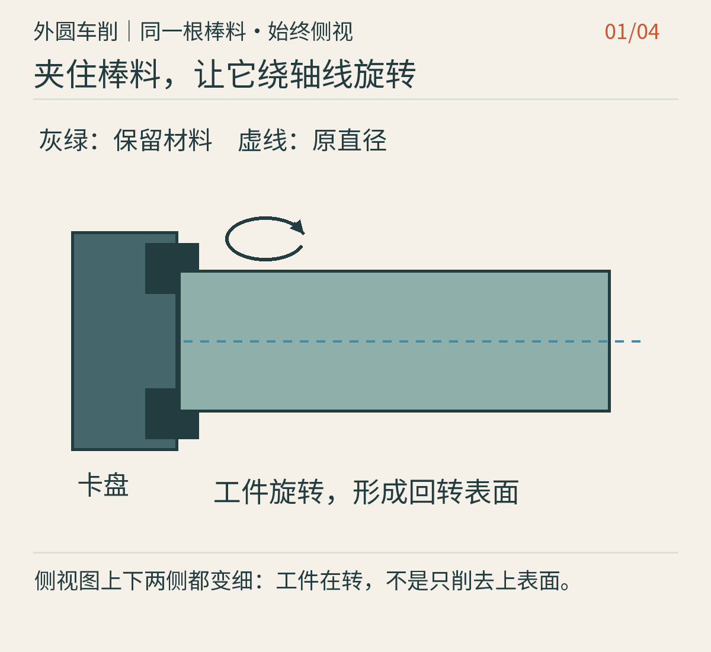

图：车削：棒料怎样变成阶梯轴 · 1/4，旋转棒料。原创程序绘图；依照本段所列资料简化。 [S01]

卡盘夹住棒料并带它绕蓝色中心线旋转；本组始终从侧面观察。最终要变细的右端，最初和左侧仍是同一根等直径棒料。[S01]

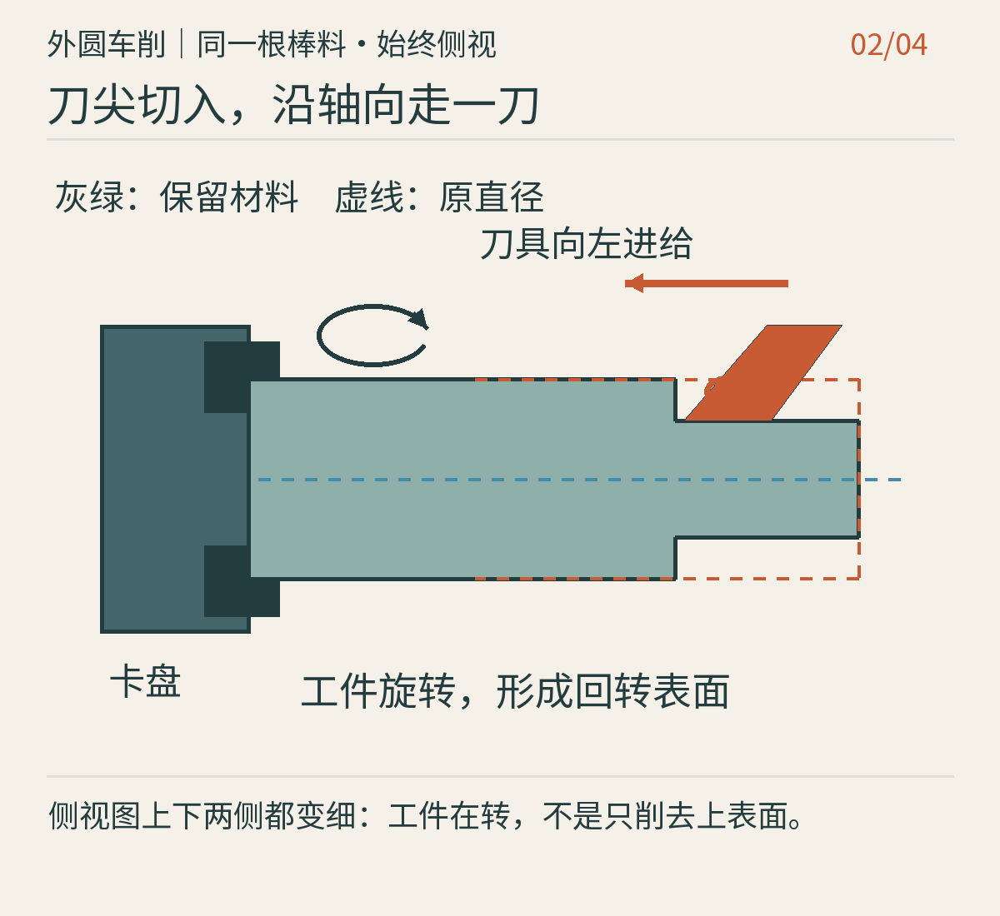

图：车削：棒料怎样变成阶梯轴 · 2/4，切入并轴向进给。原创程序绘图；依照本段所列资料简化。 [S01]

刀尖切入旋转的外圆，再沿轴向向左进给。刀尖经过之处，材料变成切屑离开，右端开始出现较小直径；不是只在棒料上表面挖一条槽。[S01]

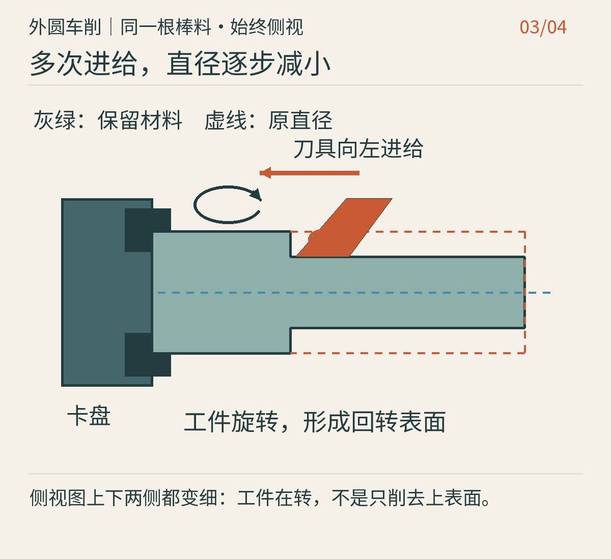

图：车削：棒料怎样变成阶梯轴 · 3/4，重复走刀。原创程序绘图；依照本段所列资料简化。 [S01]

重复走刀，并按要求改变径向切入量，较小直径的段落逐渐延长到台阶位置。图中虚线保留原棒料外径，便于看出哪些材料已经离开。[S01]

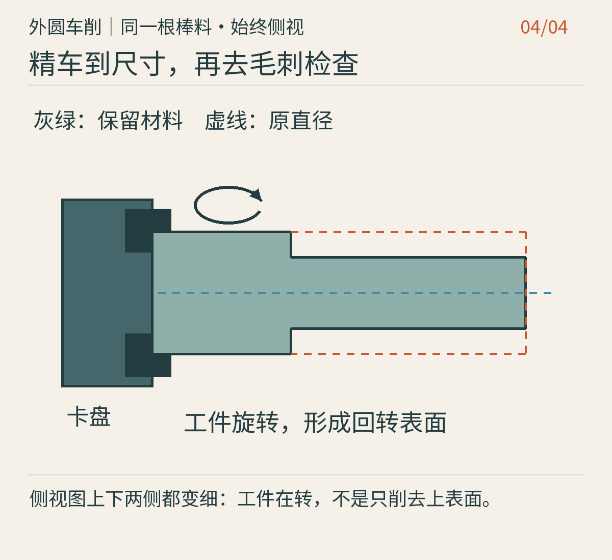

图：车削：棒料怎样变成阶梯轴 · 4/4，完成外圆与台阶。原创程序绘图；依照本段所列资料简化。 [S01]

精车取得要求的外径、长度与肩部表面，再去毛刺并检查。图中是外圆工序完成状态；卡盘夹持区仍可能需要调头或其他工序，不把一次装夹画成整根零件全部完成。[S01]

**线切割：电极丝怎样围出贯通轮廓**

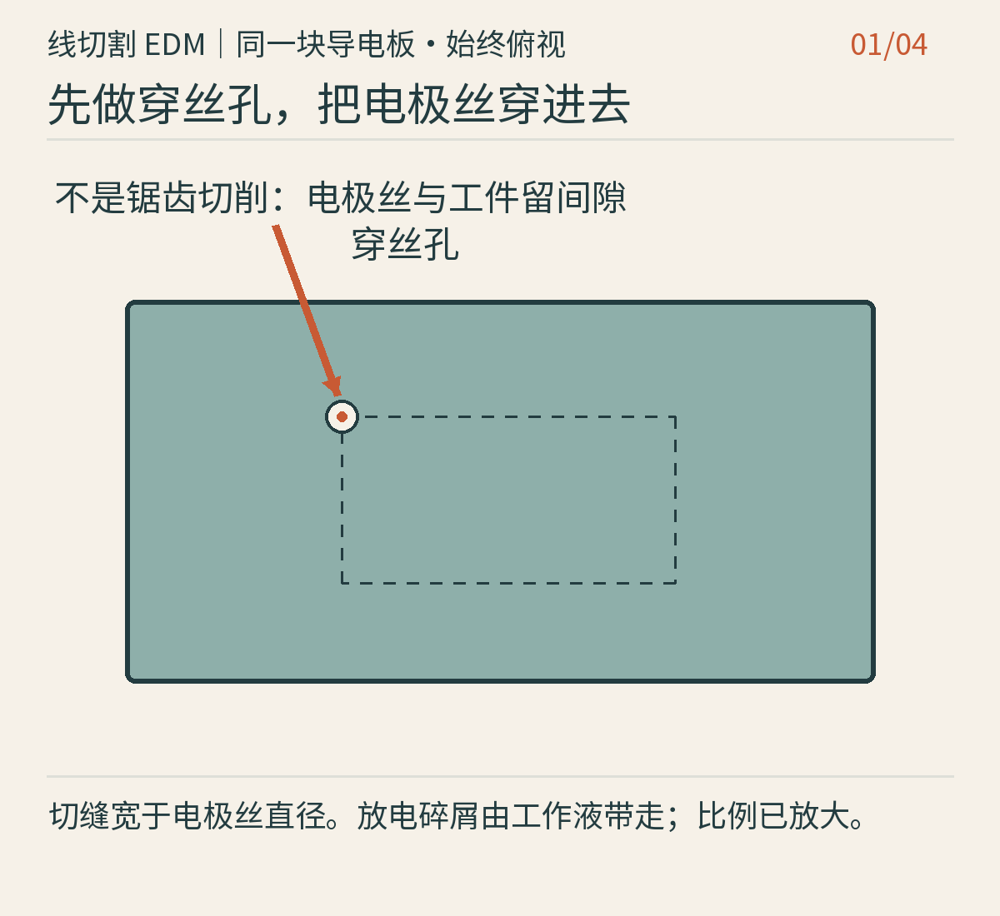

图：线切割：电极丝怎样围出贯通轮廓 · 1/4，先穿丝。原创程序绘图；依照本段所列资料简化。 [S02]

对于图示封闭内轮廓，先在轮廓起点安排穿丝孔。橙点是从板厚方向穿过的电极丝，主图保持俯视；工件必须适合这种导电放电加工。[CASE-S04]

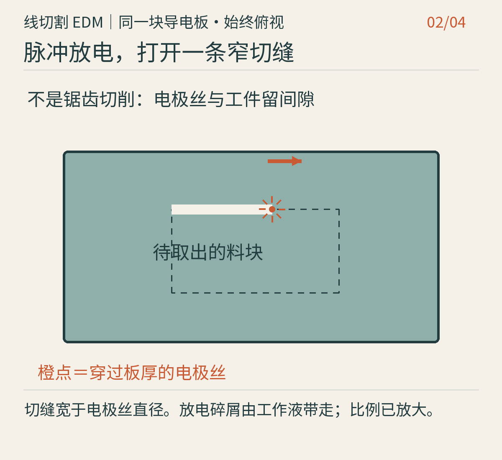

图：线切割：电极丝怎样围出贯通轮廓 · 2/4，放电打开切缝。原创程序绘图；依照本段所列资料简化。 [S02]

电极丝与工件之间保持微小放电间隙，受控脉冲局部去除材料，工作液帮助带走碎屑。丝沿计划路径前进，留下比丝径更宽的切缝，并非像锯条那样靠齿刃接触切削。[S02][CASE-S04]

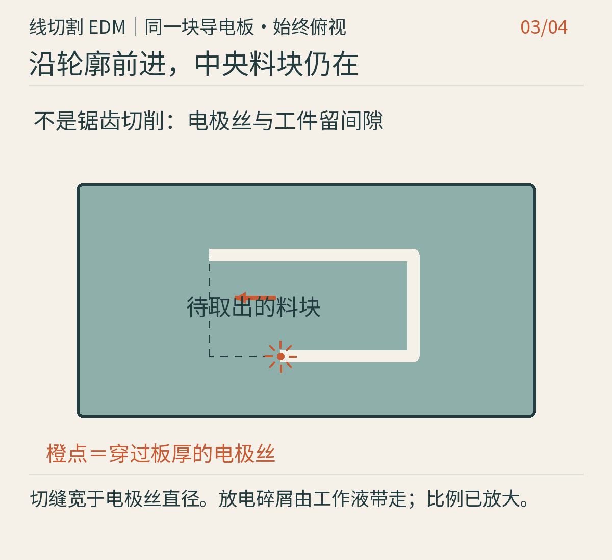

图：线切割：电极丝怎样围出贯通轮廓 · 3/4，沿轮廓持续切割。原创程序绘图；依照本段所列资料简化。 [S02]

丝继续沿轮廓走，已经切开的路径保留在后方；中央料块此时还由未切完的部分连着外板。实际加工需安排冲液、支承和必要的多次修切。[CASE-S04]

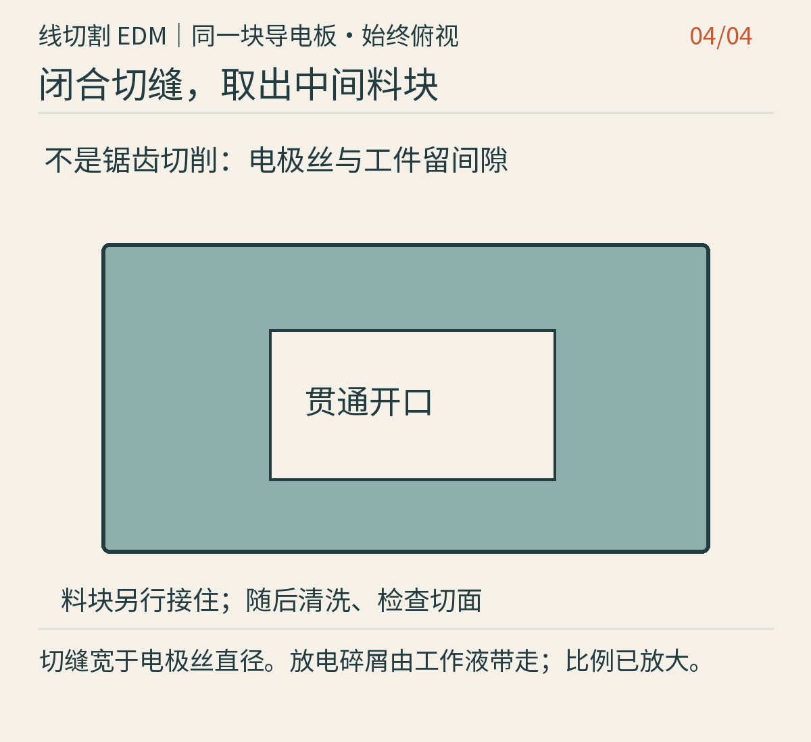

图：线切割：电极丝怎样围出贯通轮廓 · 4/4，接住料块并取出。原创程序绘图；依照本段所列资料简化。 [S02]

最后一段连通后，接住并取出中央料块，留下贯穿板厚的开口。再清洗、检查尺寸与切面；图中转角为简化画法，实际内角仍受丝径和放电间隙限制。[CASE-S04]

**激光：热与气流怎样打开切缝**

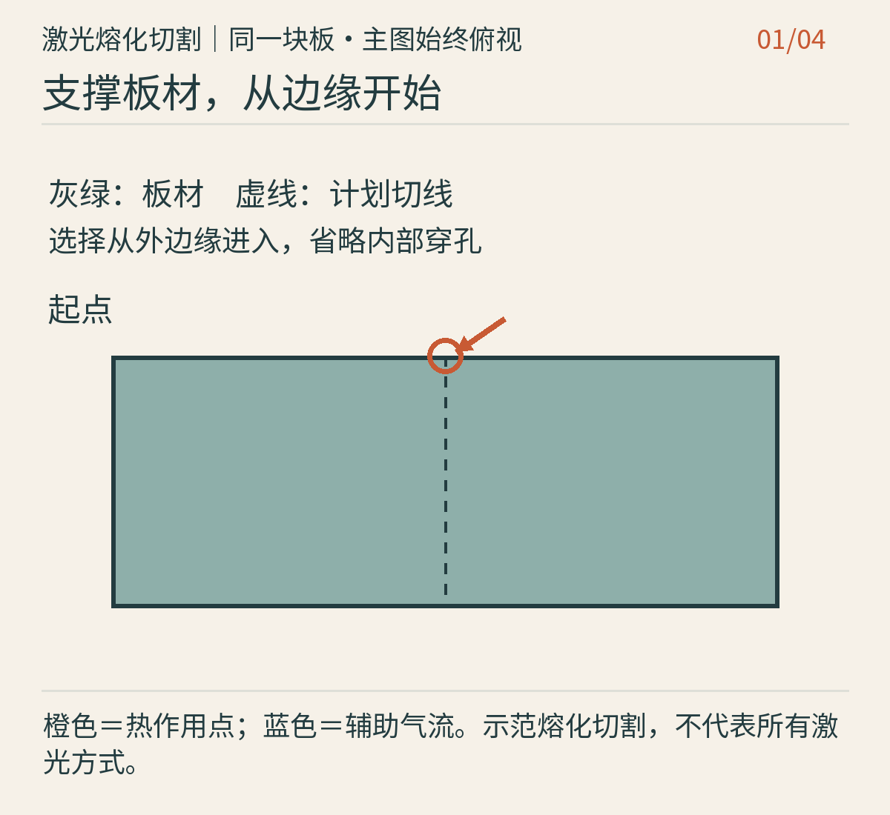

图：激光：热与气流怎样打开切缝 · 1/4，边缘起切。原创程序绘图；依照本段所列资料简化。 [S03]

这组选择金属板的激光熔化切割，从板材外边缘起切，始终沿同一条直线前进。板材由切割台支承；封闭内轮廓通常还要解决内部起切与穿孔。[S03]

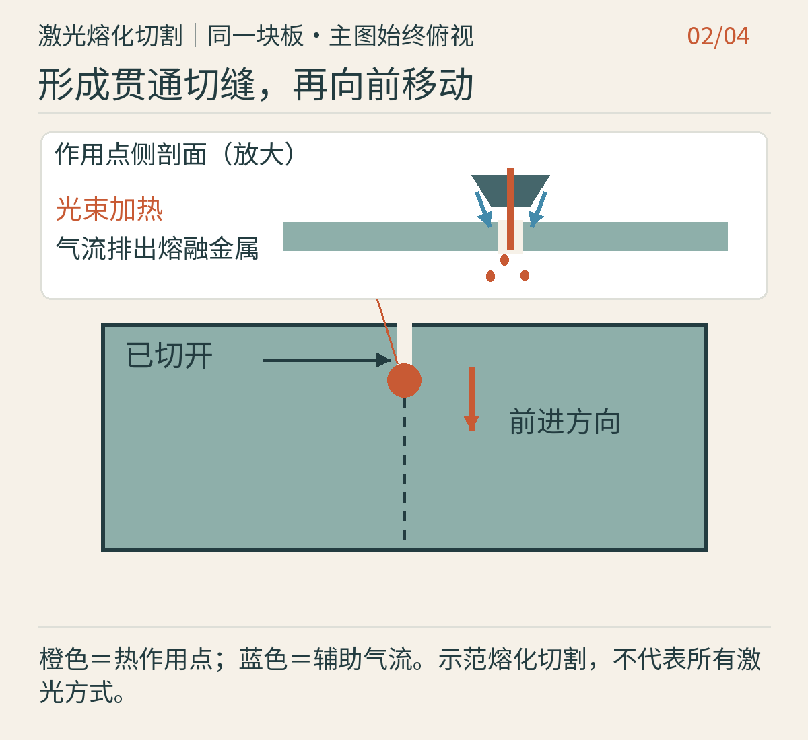

图：激光：热与气流怎样打开切缝 · 2/4，局部熔化并排出。原创程序绘图；依照本段所列资料简化。 [S03]

放大侧剖面显示：聚焦光束把局部金属加热至熔融，辅助气流将熔融材料从切缝排出。只有形成贯通去料通道，移动的作用点才会留下完整切缝。[S03]

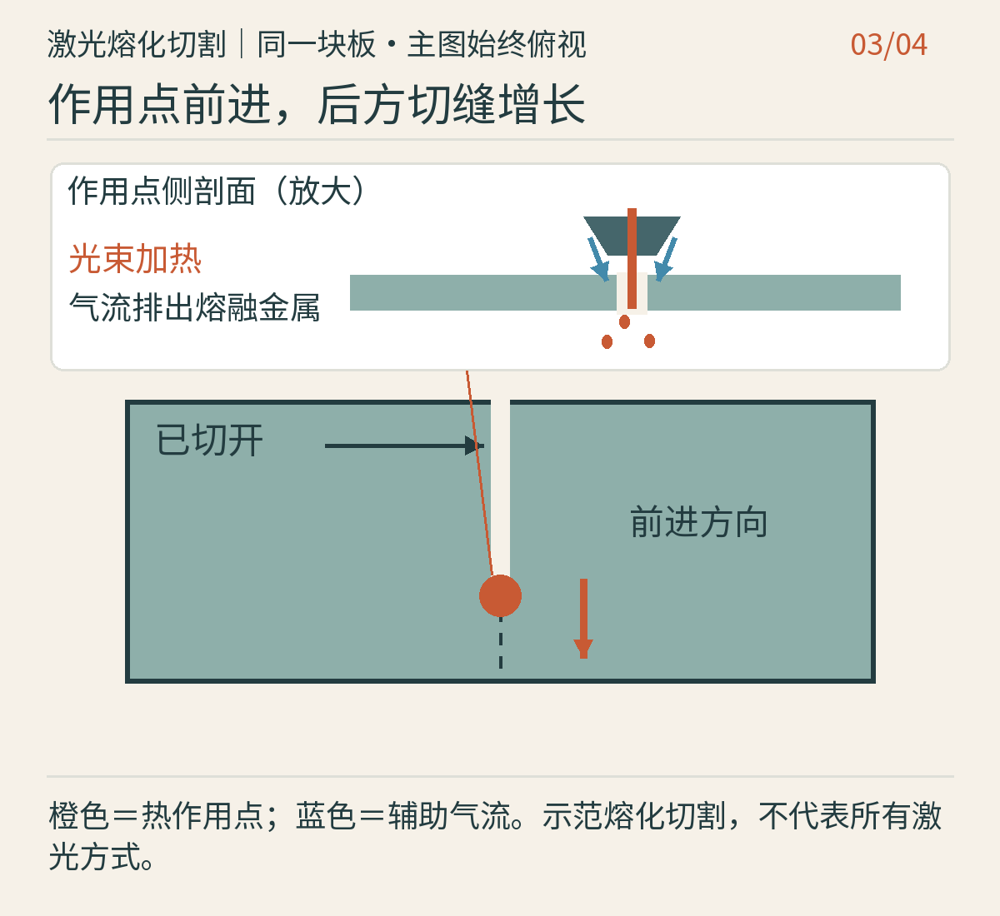

图：激光：热与气流怎样打开切缝 · 3/4，切缝随运动增长。原创程序绘图；依照本段所列资料简化。 [S03]

作用点向前移动，前方仍是完整板材，后方已形成切缝。图中主视图保持俯视，旁边的放大图解释同一作用点的板厚方向变化；氧气反应切割等路线还有不同能量机制。[S03]

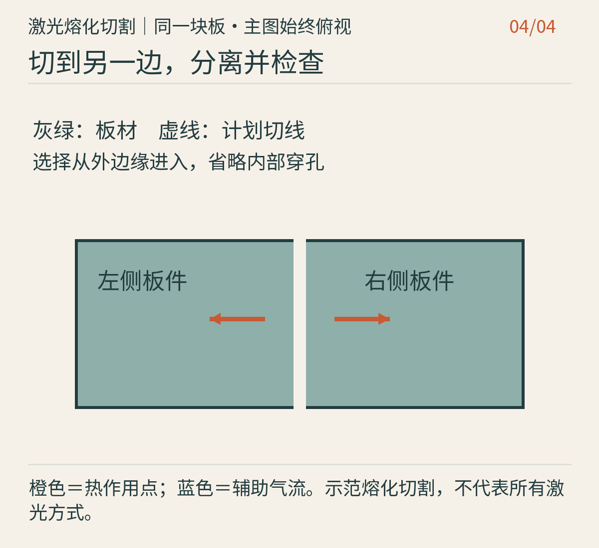

图：激光：热与气流怎样打开切缝 · 4/4，分离、清理与检查。原创程序绘图；依照本段所列资料简化。 [S03]

切至另一边后，板材分离。随后根据要求处理挂渣与边缘，检查尺寸、表面和热影响；完成分离不代表自动取得最终装配质量。[S03]

**水刀：磨粒怎样把板材冲开**

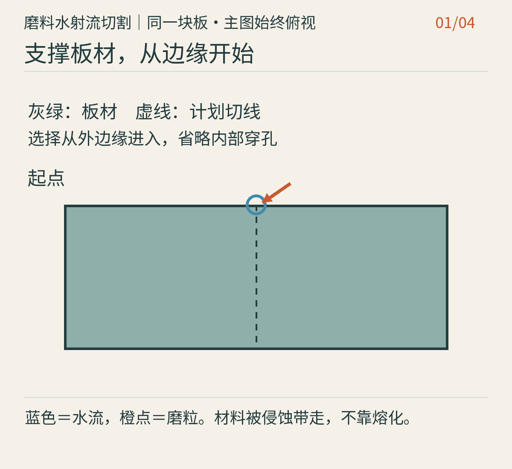

图：水刀：磨粒怎样把板材冲开 · 1/4，支撑与边缘起切。原创程序绘图；依照本段所列资料简化。 [S04]

从外边缘进入，沿同一条直线切开板材；切割台支承零件和余料。本组画的是磨料水射流，不是用于某些软材料的纯水切割。[S04]

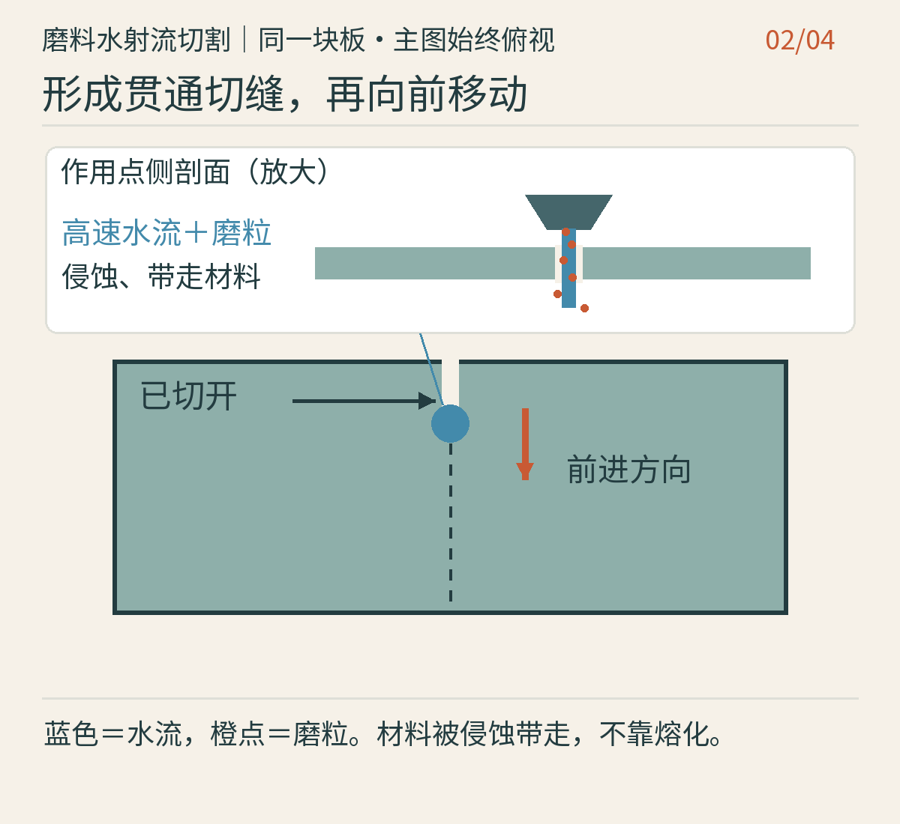

图：水刀：磨粒怎样把板材冲开 · 2/4，磨粒侵蚀材料。原创程序绘图；依照本段所列资料简化。 [S04]

水在喷头内形成高速射流并携带磨料；放大图中的橙色颗粒冲击、侵蚀材料，水流将碎屑带走。贯通切缝来自材料不断离开，不靠把整条缝熔化。[S04]

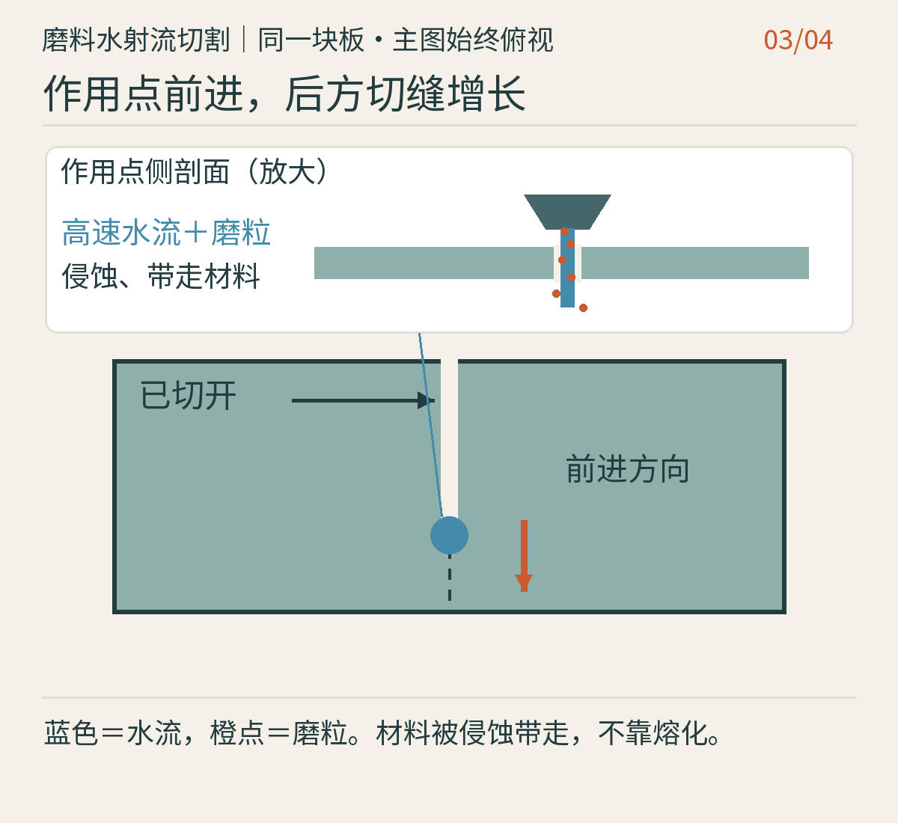

图：水刀：磨粒怎样把板材冲开 · 3/4，射流沿路径移动。原创程序绘图；依照本段所列资料简化。 [S04]

射流前进后，后方留下连续切缝，前方板材仍完整。实际射流会发生滞后与形状变化，需要把速度、路径补偿和材料厚度一起考虑；示意图不表达具体工艺参数。[S04]

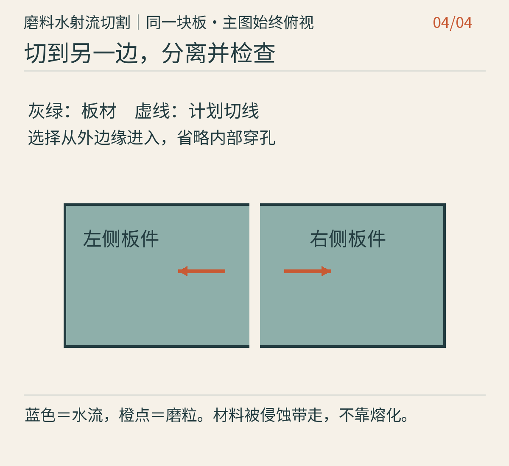

图：水刀：磨粒怎样把板材冲开 · 4/4，分离、清洗与检查。原创程序绘图；依照本段所列资料简化。 [S04]

切到另一边后接住两侧板件，清洗并按要求处理边缘。检查内容包括轮廓、切缝锥度与切面条纹；用磨料水刀也不等于每种材料都能无损穿孔或得到相同表面。[S04]

## 把工艺放回真实任务

同样是“准确”，轴承要能稳定旋转，模具要反复复制外形，薄垫片则要保持平整。下面将厂商公开项目与其技术资料中的典型应用分开标明。真实项目说明这条路线确实有人采用，并不意味着厂商公布的收益适用于所有零件。

**轴承套圈：车削与磨削接力**

**典型工业应用。**Norton的轴承制造手册把套圈制造分成成形、车削、热处理、磨削和装配：先建立回转形状，热处理取得所需材料状态，再对内外径、端面和滚道做相应磨削与超精加工。[CASE-S01] 这解释了为什么“已经车圆”还不等于完成：配合、旋转与接触表面各有要求。

读这个任务，可以先画出真正与轴、座孔和滚动体接触的面。交付检查应围绕相应尺寸、圆度、表面与热处理状态制定；不能只量一次外径就认为轴承合格。这些是本书的评审线索，不是对某一型号的验收规范。

**外壳模具与孔板：形状相似，工作不同**

**厂商公开展示实例。**DMG MORI在2026年展览资料中展示电视外壳注塑模具，并说明采用DMU 65五轴铣床制造。[CASE-S02] 这里铣的是供后续注塑复制外壳的模具，不是每个电视外壳。复杂曲面和不同刀具方向促使工程师考虑多轴加工，但仍需规划分型、装夹、可达性与最终表面；不能从“一台五轴”推导出整副模具一次完成。

**典型应用及厂商加工记录。**Sandvik Coromant的CoroDrill DE10资料列出换热器孔板、法兰、轴类和阀件等应用，还给出不锈钢板通孔与盲孔的加工记录。[CASE-S03] 制孔不是只把钻头向下推：排屑、冷却和出口状态都会影响稳定性。看一块多孔板，可分别询问孔径、位置、孔壁、毛刺与清洁度要求；需要更严配合的孔，还可能安排铰、镗等后续工序。

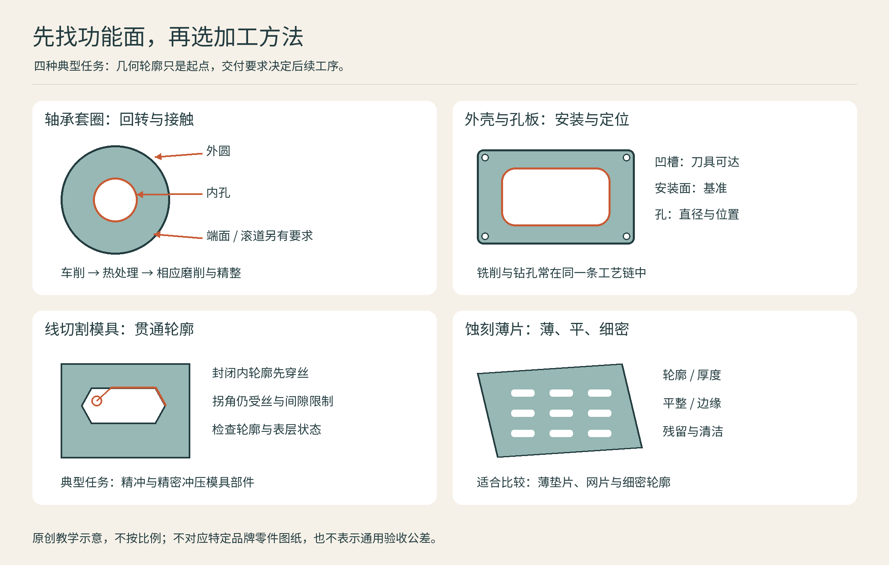

图：原创教学示意。画面比较需要交付的几何特征及检查对象，不是品牌零件图纸；尺寸、比例与加工顺序须由具体项目确定。套圈、孔加工与线切割应用依据[CASE-S01]、[CASE-S03]、[CASE-S04]。

**两种电火花：贯通轮廓与不贯通型腔**

**典型模具应用。**Makino把精密冲压和精冲模具部件列为UPV-5线切割的应用。[CASE-S04] 当导电板材要得到复杂贯通轮廓时，可以让电极丝沿轮廓移动；封闭内轮廓通常要先安排穿丝孔。它也有丝半径、放电间隙、表层与冲液等条件，并不会自动得到数学意义上无限尖的内角。

**另一种典型应用。**对于导电模具上刀具难以加工的深窄细节，成形EDM使用具有相应形状的电极逐步进入型腔；Makino将其用于淬硬材料及复杂细节。[CASE-S05] 它能处理不贯通的凹形细节，但要制作和管理电极，并评估磨损、排屑与重铸表层。拿到任务时，先问“丝能不能贯穿”，再问“电极怎样进入并排出碎屑”，比把EDM当成万能精修更有用。

**医疗薄管与马具银饰：沿轮廓去掉材料**

**真实案例：Alpine Laser。**这家2019年创立的团队公开介绍了专用于医疗细管切割的激光平台，应用包括支架等管状部件。[CASE-S06] 激光能在薄管上形成细密切缝，随后仍须针对具体产品安排表面、清洁和功能验证；“激光切出了形状”并不等于医疗产品已完成全部制造与合规流程。这里的实践问题，是细小连接段在切割、夹持和后续处理时能否保持完整。

**真实案例：Rod Teuscher。**OMAX记录这位马具制作人使用ProtoMAX水刀，为马刺、马衔侧片、扣件与银饰下料。[CASE-S07] 定制图案可以转为平面轮廓，后续再做贴银、装配和外观处理。这个案例适合兴趣读者：数字切割负责重复轮廓，手工仍决定许多成品细节。设计时要留意最细连接处、切缝以及小片如何固定；不能把原稿中的每条细线不加判断地当成可切结构。

**一枚雾化器垫片：化学蚀刻做薄而平的部件**

**真实供货案例，客户名称未公开。**Precision Micro介绍为医疗器械客户蚀刻不锈钢雾化器垫片。[CASE-S08] 薄片上的轮廓可由掩膜定义，不靠刀刃逐边施力。这使它值得与冲压、激光等路线比较，但蚀刻存在侧向去除，材料厚度也会限制细节；不是任意厚度都能复制同样精细的图案。

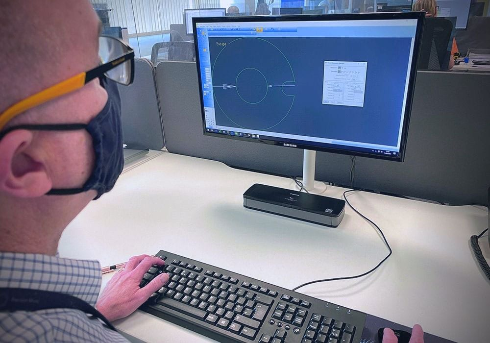

图：真实官方案例图片——Precision Micro雾化器垫片案例页中的CAD设计与数据准备场景，画面显示电脑上的部件轮廓，不展示成品垫片[CASE-S08]。图片版权归原权利人；未取得开放再分发许可。

这个任务的实用检查点包括厚度、平整、轮廓与边缘、残留物和批次一致性。它们必须写进零件要求并选择适当测量方法；本书不把供应商的“无毛刺”等宣传语解释为所有情况下都无需检验。

## 和冲压、锻造、铸造的边界

冲压中的落料、冲孔会分离材料，可以纳入广义减材讨论；折弯、拉深则主要改变形状。锻造使材料塑性流动；铸造把液态材料填入型腔；注塑把熔融聚合物注入模具。它们不能因为“传统”就统称减材。实际制造常常是先铸或锻得到毛坯，再切削关键表面。

**观察练习：**寻找家里的金属物件，看圆周车纹、平面铣纹、分模线和折弯圆角。它们是推测路线的线索；若表面经过喷砂、电镀或抛光，证据可能被覆盖，所以应说“可能采用”，而不是仅凭照片下定论。

## 本章资料

- [S01] Sandvik Coromant，Metal cutting knowledge：https://www.sandvik.coromant.com/en-gb/knowledge
- [S02] JLC CNC，What Is EDM? How Electrical Discharge Machining Works：https://jlccnc.com/blog/what-is-edm-electrical-discharge-machining
- [S03] TRUMPF，Laser cutting：https://www.trumpf.com/en_US/solutions/applications/laser-cutting/
- [S04] OMAX，How do waterjets work?：https://www.omax.com/en/learn/how-does-waterjet-work/；Abrasive Waterjet Overview：https://knowledgebase.omax.com/protomax/content/401434/abrasive-waterjet-overview.htm
- [S05] The Open University，Photochemical Machining：https://www.open.edu/openlearn/science-maths-technology/engineering-technology/manupedia/photochemical-machining-photo-fabrication-chemical-milling

- [CASE-S01] Norton／Saint-Gobain Abrasives，Technical Solutions for Grinding in the Bearing Market，套圈制造与磨削章节：https://www.nortonabrasives.com/en-gb/resources/document/technical-solutions-grinding-bearing-market
- [CASE-S02] DMG MORI，High-precision manufacturing technology for modern everyday life，2026-04-19：https://en.dmgmori.com/news-and-media/news/nws2664-knee-implants
- [CASE-S03] Sandvik Coromant，CoroDrill DE10，应用与加工记录：https://www.sandvik.coromant.com/en-us/tools/drilling-tools/exchangeable-tip-drills/corodrill-de10
- [CASE-S04] Makino，UPV-5，精冲与精密冲压模具应用：https://www.makino.com.sg/en-us/machine-technology/machines/wire-edm/upv-5
- [CASE-S05] Makino，EDM—When Milling Just Won’t Cut It，成形EDM与制孔说明：https://www.makino.com/en-us/machine-technology/machining-process/edm
- [CASE-S06] Alpine Laser，How a start-up makes life-saving medical devices，2023-01-13：https://alpinelaser.com/how-a-start-up-makes-life-saving-medical-devices/
- [CASE-S07] OMAX，Revolutionizing the Bit and Spur Business with the ProtoMax，2025-04-30：https://www.omax.com/en/customer-successes/revolutionizing-bit-and-spur-business-protomax/
- [CASE-S08] Precision Micro，Medical device manufacturer partners with Precision Micro to increase etched shim production：https://www.precisionmicro.com/medical-manufacturer-turns-to-etching-for-metal-shim-manufacture/
