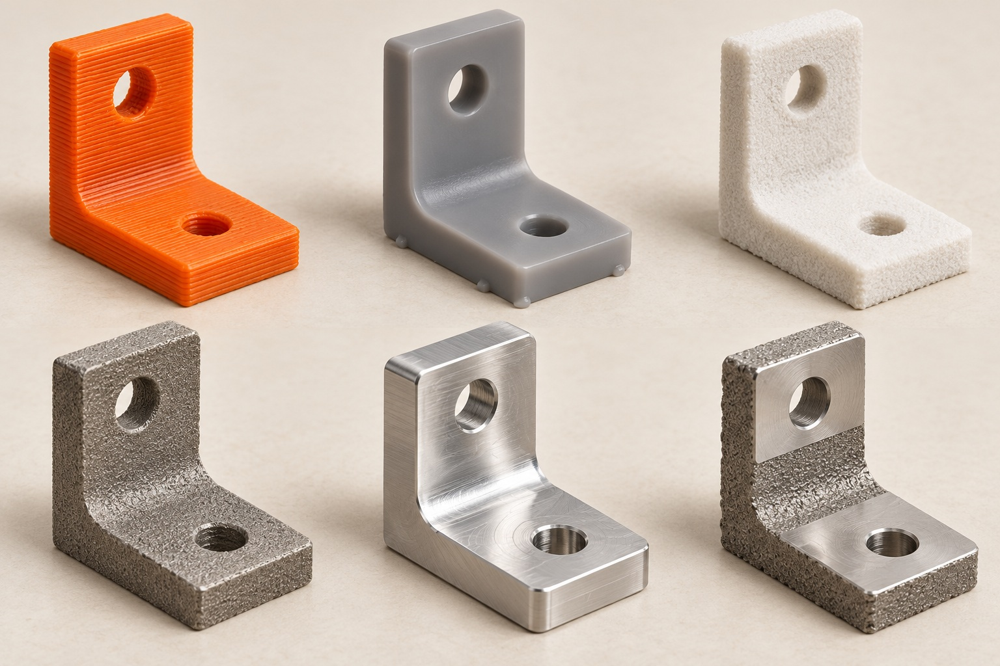
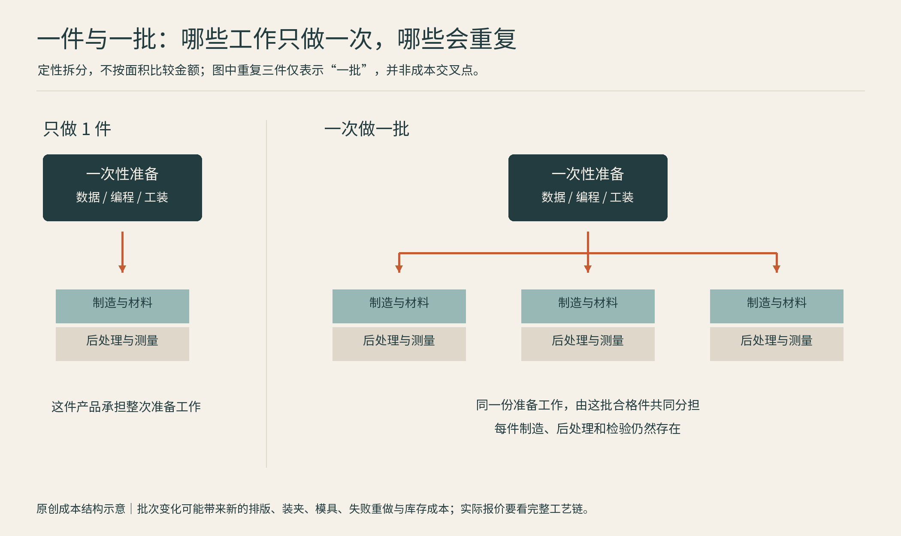
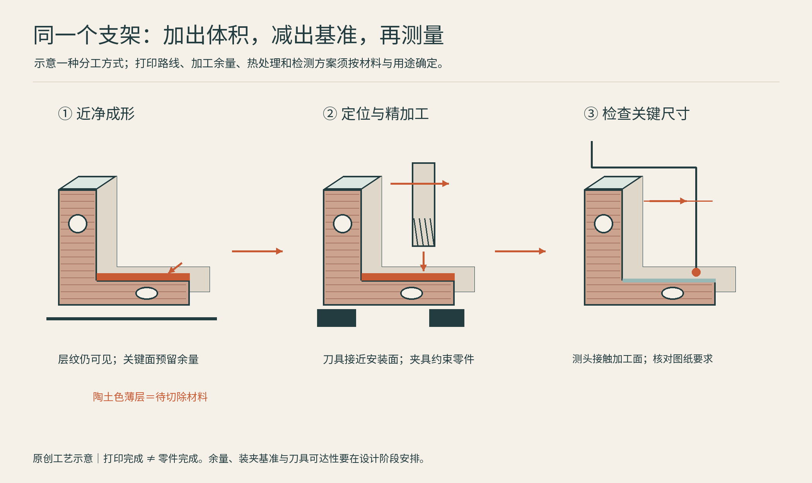
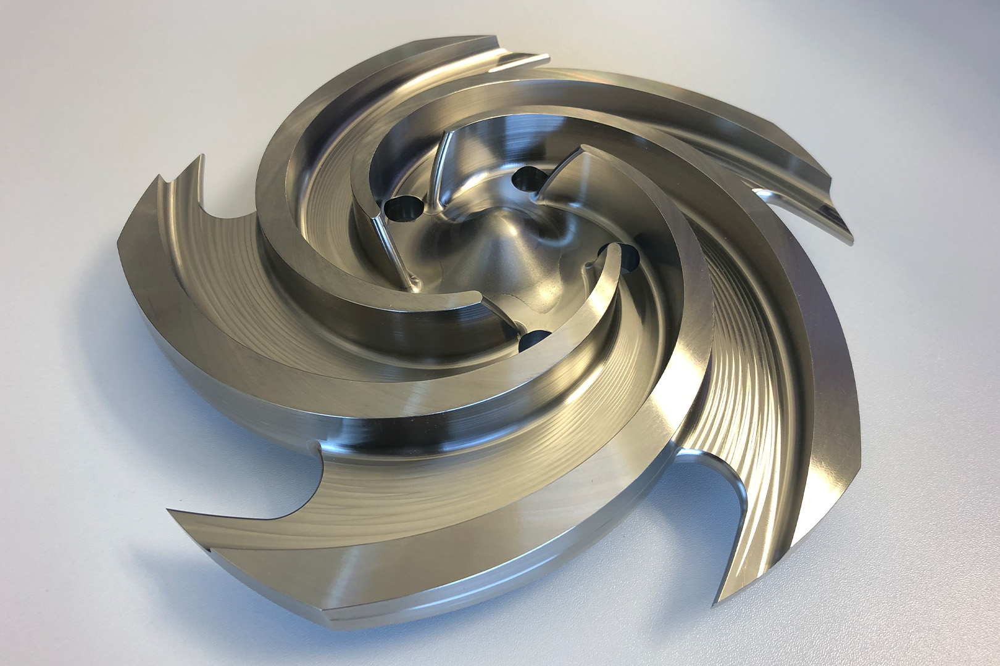
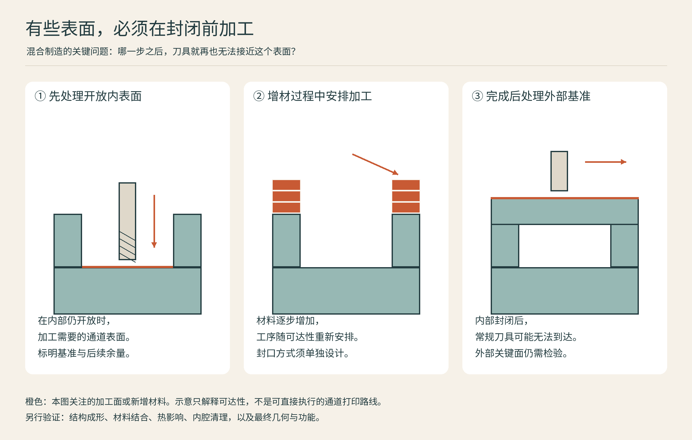

# 10 一件东西怎样做更合适：打印、切削与混合制造

假设要做一个相机支架：它有贴合手掌的外形、几个螺丝孔，以及与相机接触的平面。完全打印、铝块铣削，或打印主体再加工关键面，都可能成立。选工艺不是选阵营，而是寻找能以可接受代价实现需求的路线。

## 先把“同一零件”拆成不同任务

外观曲面决定手感，安装孔决定位置，接触面决定装配，内部结构决定重量。它们未必需要同样精度。把整件作品都要求到最严的公差，可能只是增加时间。合理的设计会标出真正关键的尺寸，并为测量和加工保留基准。

| 需求情景 | 值得先比较的路线 | 主要检查点 |
|---|---|---|
| 一件外形样机，明天还会改 | 聚合物3D打印 | 外观、支撑、迭代速度 |
| 少量、结构简单的金属支架 | 切削、板材切割折弯 | 装夹、材料状态、孔面要求 |
| 复杂内流道或轻量格构 | 工业增材 | 清粉、检测、后加工与认证 |
| 大批外形稳定的塑料外壳 | 注塑与打印分别估算 | 模具投入、单件成本、改版风险 |
| 已有昂贵金属件局部磨损 | 合适的修复与再加工路线 | 可修复材料、热影响、检验 |

表格是思考顺序，不是报价结论。Protolabs把3D打印、切削和注塑同时纳入服务体系，反映了工程项目常需要多种路径；具体选择要回到几何、材料、数量与质量要求。[H01]

## 数量为什么会改变答案

图：原创定性成本图：图块面积不代表金额，三件只表示一批。分类依据本章完整工艺链讨论及Protolabs制造服务范围[H01]；不预设打印、切削与开模的通用数量交叉点。

打印常能避开专用成形模具，但并非没有准备成本：摆放、支撑、机器准备、后处理和检验都要花时间。注塑需要前期模具，却能在稳定量产中摊薄这一投入。切削不一定需要昂贵模具，却可能因材料去除量和多次装夹耗费机时。

因此不要给出脱离条件的“超过多少件就一定注塑”。零件尺寸、周期、模具寿命、设计变更概率和合格率都会移动交点。一个简单的估算框架是：**总成本＝准备与工装＋生产数量×合格单件成本＋失败、检验、库存和变更成本。**这是本书用于比较的账本框架，不是行业统一报价公式。

比如做活动限量徽章，设计可能每周更换；即便总件数不少，昂贵专用模具也未必容易摊销。做多年不变的家电扣件，则可能愿意为稳定节拍投入工装。制造的“便宜”，总是有时间跨度的。

## 加出来的形，减出来的面

图：原创工艺图：陶土色薄层为待切除余量，精加工不必覆盖整个零件。概念参考DMG MORI混合制造机床的增材、铣削与测量能力说明[H02]。图为分阶段示意，不对应特定机床的装夹布局。

工业金属增材可以先获得接近目标的复杂形体，再用切削处理定位面、轴承孔或密封面。这里的关键词是**加工余量**：设计时就留下足够材料，让刀具有机会把几何修到要求。若等打印完成才发现关键面够不到、抓不住或没有余量，组合两种工艺也救不了计划。

DMG MORI的LASERTEC 65 DED hybrid把粉末喷嘴增材与机加工集成到同一设备平台，其当前第二代资料列出铣削、车削、磨削、增材、预热与扫描功能。这个案例说明，混合制造不只是把打印机和铣床放在一间车间：它还试图把工序、坐标与装夹连成工作流。厂商宣称的效率收益依赖具体任务，本书不将宣传比例推广为通用结果。[H02]

也有很朴素的混合路线：先打印定位夹具，再铣削金属件；用打印模型制作铸造模样；打印砂型或型芯，再浇铸金属。这些都让3D打印参与最终制造，但成品未必是逐层打印出来的。看到“3D打印制造”的案例时，应追问它打印的是成品、工装、模样还是中间坯体。[H03]

## 从备件项目看混合制造的价值

**真实案例：Sulzer与Chevron的泵叶轮。**Sulzer公开记录了一条结合五轴铣削和激光金属沉积的制造路线：先从坯料加工叶轮内部可接近的形状，再增加材料并继续加工，直到完成复杂叶轮。案例叶轮用于Chevron的一台泵，记录称其2019年安装运行，并在后续取出时进行了尺寸和金相检查。[CASE-H01]

图：真实官方案例图片——Sulzer展示的复杂叶轮，原图说明为可实现复杂几何的例子，来源[CASE-H01]。不将这张示例照片直接等同于现场运行的那一只叶轮。版权归Sulzer或原权利人；未取得开放再分发许可。

这里的关键不是给“打印再铣”贴上更先进的标签，而是**在封闭之前加工原本可达的内表面**。如果一开始就把所有外层材料加满，刀具可能再也碰不到内部。下图用通道截面说明这种工序安排，几何由本书另行设计，不复原Sulzer叶轮的内部结构。

图：原创教学示意——混合制造的加工时机。依据Sulzer案例中的交替增材与机加工思路绘制[CASE-H01]；不是机器刀路、零件剖面或经验证的工艺规程。图中简单通道只解释可达性，不保证按示意顺序即可制成任意封闭结构。

把这类项目变成可执行的任务书，可依次回答四个问题：材料和服役环境是否匹配；哪些内部表面必须提前加工；每次增加材料后如何保持基准和留足余量；最后怎样验证几何、材料状态和整机功能。这四问是本书从案例中提炼的评审方法，具体验收标准仍须由产品与工程要求决定。

它与“LPBF打印整个复杂毛坯，再切离基板、处理和加工安装面”不是同一条工序链。前者可以在构造过程中穿插切削，后者往往在打印完成后加工可达部位；选路时要对照真正需要的内部表面与设备能力，不能只比较最终外观。[CASE-H02]

## “一体化”也需要付账

将多个零件合成一个，可能减少紧固件、装配和泄漏接口，却也可能让维修更困难。原本只需换一个小零件，变成整件报废；内部通道虽能打印，残余粉末却未必容易移除。设计自由需要清粉口、检测路径和维修策略共同支撑。

材料利用率同样不能只看切屑桶。打印可能减少某些毛坯浪费，但仍消耗支撑、净化气体、能源和后处理资源；粉末也不总能无限循环。比较环境影响要说明功能、寿命、边界和能源来源，不能把“增材”直接等同于“环保”。Nikon SLM Solutions关于铸造与金属打印的讨论也将选择条件放在产品设计、产量与制造能力上，而非宣布一种路线取代另一种。[H04]

**给自己的设计做一次评审：**圈出必须准确的三处位置，找出最难清理的一个空腔，再问零件坏了以后如何修。往往就是这五分钟，决定你需要打印、切削，还是两者合作。

## 本章资料

- [H01] Protolabs，Custom Manufacturing Services：https://www.protolabs.com/en-gb/services/
- [H02] DMG MORI，LASERTEC 65 DED hybrid 2nd Generation：https://en.dmgmori.com/products/machines/additive-manufacturing/powder-nozzle/lasertec-65-ded-hybrid-2nd
- [H03] ExOne，3D printing solutions overview：https://www.exone.com/en/3d-printing-solutions_overview/
- [H04] Nikon SLM Solutions，Metal 3D Printing’s Impact on the Casting Industry：https://nikon-slm-solutions.com/addictive-additive/the-casting-industry-meets-the-future-with-integrated-3d-printing/

- [CASE-H01] Sulzer，Sulzer creates a hybrid additive manufacturing process to minimize lead time on components for Chevron：https://www.sulzer.com/en/shared/case-studies/chevron-hybrid-machining
- [CASE-H02] EOS，Metal Additive Manufacturing Periphery，金属增材后处理说明：https://www.eos.info/metal-solutions/metal-periphery
