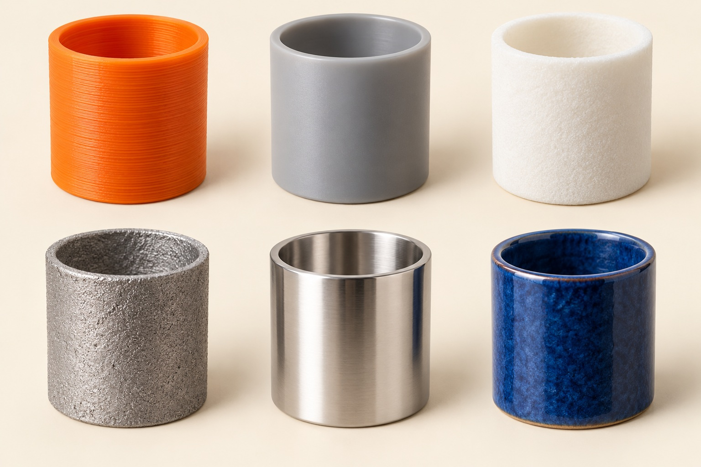
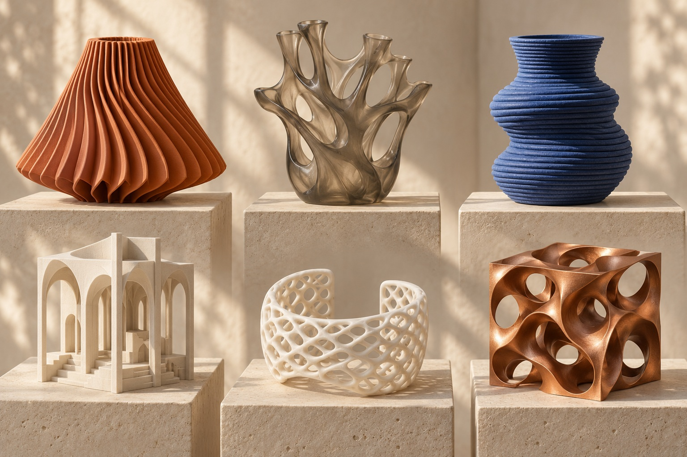
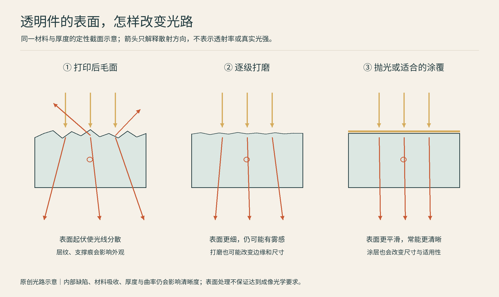

# 11 制造也是审美：层纹、透明、颜色与计算形态

同样一盏灯，可以像石膏一样柔和，也可以像半透明的贝壳；同样一个支架，可以是规整的金属折板，也可以长得像骨骼。制造并非只在图纸完成后负责“把它做出来”。材料、表面和工艺会反过来改变我们想设计什么。

## 层纹不一定要藏起来

在细密人像上，明显层纹可能打断面部的细微起伏；在大型花器上，重复的路径却可能成为节奏。判断它是否好看，先问纹理是否顺着物体的形态。凸起、凹槽、拼缝和颜色变化若互相争抢，技术细节就容易变成噪声；把其中一种作为主角，往往更清楚。这是本书的观察方法，不是设备性能结论。

层高也不是唯一决定外观的变量。朝向改变阶梯纹所在位置；外墙路径、接缝位置、材料光泽和照明共同影响观感。SLS的朝向资料指出，浅角度表面可能更容易显露层线，提醒我们：即使没有FFF那样清楚的挤出条纹，分层也仍参与表面形成。[A01]

可以做一组同形小花器，让它们只改变一个变量：细层／粗层，哑光／高光，直立／倾斜。若同时更换形状、颜色和工艺，你很难判断美感来自哪里。

## 透明是一条工作流，不是一桶透明液体

图：原创定性光路图：箭头不代表实测光强或透射率。表面处理流程参考Formlabs透明树脂抛光指南[A02]；清晰度也受内部缺陷、材料吸收、厚度与曲率影响，图中三个阶段不代表光学等级认证。

透明树脂能让光进入材料，却不保证打印件一出机就像玻璃。表面的微小起伏会散射光，支撑痕和层纹会让它看起来发雾；材料本身、内部缺陷、厚度与几何也影响光路。Formlabs的透明件教程把湿磨、抛光等步骤作为提高可见透明度的途径，说明“透明材料”与“光学级透明成品”之间仍有距离。[A02]

一只灯罩可能只需要均匀透光；观察内部流动的模型，希望轮廓清楚；真正的成像透镜，还涉及远比“看起来清澈”严格的光学要求。它们不应共用一个透明度承诺。为了美观而涂清漆或包覆树脂，也会改变尺寸、表面和用途适配性。

## 颜色可以来自哪里

FFF常通过换线、多个喷头或多工具系统组合颜色；材料喷射可在小尺度上组合着色材料；粉末件也可以染色；几乎所有适合的表面还可经过底漆、手绘、喷涂等后处理。颜色是成形时形成，还是后加上去，会影响接缝、耐磨、成本和修补方式。

不要把屏幕的全彩预览直接当成实物承诺。色域、层叠、表面粗糙度和光源都会改变观感。3MF的材料与属性扩展定义颜色和多材料表达，但文件能描述某种颜色，不等于所有设备都能准确制造它。[A03]

“金属感”同样需要区分：金属色塑料、含金属粉聚合物、电镀表面和真正的金属件，会在重量、触感、耐磨和修复上表现不同。Formlabs的后处理资料收录涂覆与电镀等路线，说明展示照片里的材质，可能是打印与表面处理共同完成的。[A04]

## 从参数化到拓扑优化：让形状有来由

**参数化设计**把尺寸、间距、角度等关系写成规则，改变参数便得到一个家族。它适合定制灯罩、分码鞋形或重复格纹，不必依赖人工逐个修改。**拓扑优化**则在载荷、约束与目标下寻找材料应放在哪里；**生成式设计**的具体含义因软件而异，常涉及同时探索多种方案和制造条件。它们不等于“输入一句话，得到合格零件”。Autodesk的资料把目标与约束作为设计探索的输入。[A05]

骨骼状、蜂窝状、格构状外观因而有两种不同来源：有时是经过计算的功能结构，有时只是审美语言。长得像骨头不证明更轻更强；做了仿真也仍要核查载荷、材料方向、最小特征和真实制造结果。

## 一个真实设计故事：TA.TAMU折叠椅

Patrick Jouin与Dassault Systèmes设计团队合作的TA.TAMU，把折叠、轻量化与3D打印放在同一问题中。官方项目介绍强调拓扑优化、建模和模拟，并探索以折叠状态打印及本地制造。这件作品值得看的不是“计算机画了一把奇怪的椅子”，而是折叠关系、结构与造型如何同时协商。它仍是特定设计项目，不能单独证明所有打印家具都更可持续。[A06]

另一种更接近大众的观察入口，是试着让一款桌面收纳件形成系列：保持同一配色、圆角和纹理尺度，只改变高度与用途。此时3D打印的优势不只是复杂造型，而是把一个设计规则快速变成多个可触摸的版本。

**看作品时问三句：**这道纹理服务了什么？如果换成另一种工艺，形态还成立吗？照片里最漂亮的效果，来自打印本身、材料，还是后处理与摄影？回答清楚，你就开始真正看懂“制造的美”。

## 本章资料

- [A01] Formlabs，Model orientation best practices for SLS printing：https://formlabs.com/uk/support/Model-orientation-best-practices-for-SLS-printing/
- [A02] Formlabs，Polishing Clear Resin for a transparent finish：https://formlabs.com/support/Polishing-Clear-Resin-for-a-Transparent-Finish/
- [A03] 3MF Consortium，Materials and Properties Extension：https://3mf.io/spec/
- [A04] Formlabs，Guide to Post-Processing and Finishing SLA Resin 3D Prints：https://formlabs.com/blog/post-processing-and-finishing-sla-prints/
- [A05] Autodesk，Generative Design overview：https://help.autodesk.com/view/fusion360/ENU/?contextId=GD-OVERVIEW
- [A06] Dassault Systèmes，TA.TAMU Installation：https://www.3ds.com/design/tatamu
