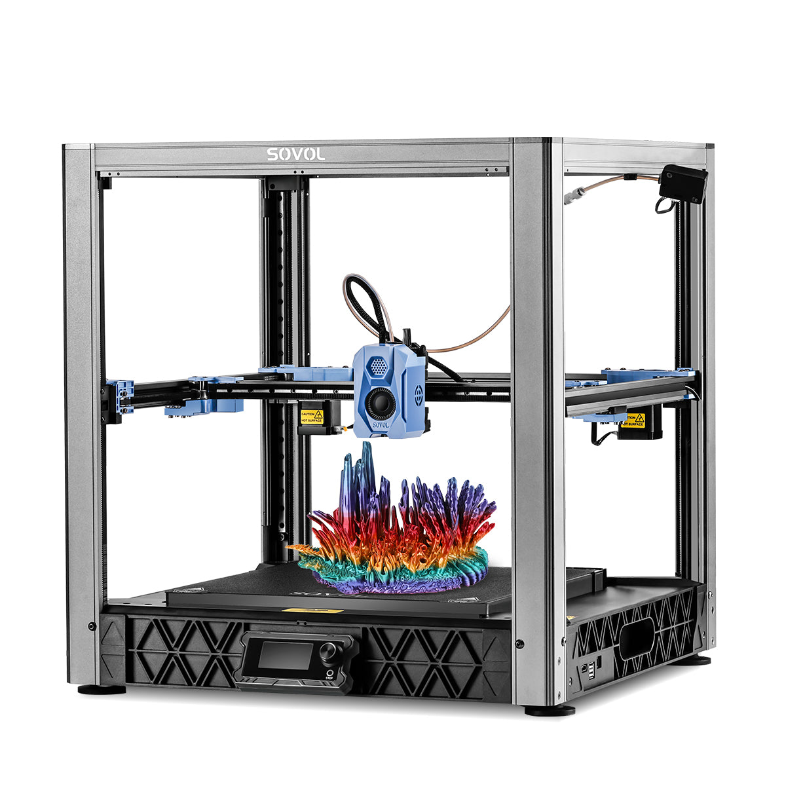
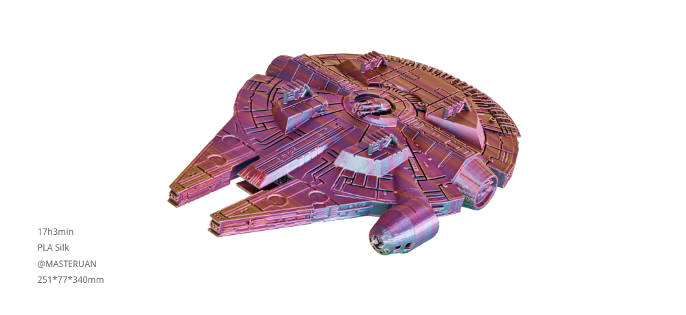

# 12 桌面上的制造业：消费级品牌与开源社区

第一次看打印机目录，很容易被速度、颜色数量和机身外观带走。更有用的看法，是把品牌放回它所服务的工作中：谁帮助你快速得到模型，谁让你研究机器本身，谁把树脂打印与清洗固化做成一套流程？同一家品牌也可能同时走几条路线。以下是生态地图，不是质量排名；型号仅用于识别技术方向，库存、固件与区域服务需另查。

## 先认识名字，再理解路线

| 品牌或项目 | 主要观察方向 | 读者可顺着研究什么 |
| --- | --- | --- |
| Prusa Research | 桌面FFF，配套切片、材料与社区 | 可维修性、装配说明、打印农场 |
| Bambu Lab 拓竹 | 集成度较高的桌面FFF与多色工作流 | 自动校准、换料、切片与模型平台 |
| Creality 创想三维 | 多价格段FFF及树脂设备 | 开放式机架到封闭高速机的变化 |
| Anycubic 纵维立方 | Kobra系列FFF、Photon系列树脂设备 | 模型需求怎样把人带向不同工艺 |
| ELEGOO 智能派 | 桌面树脂与FFF两条产品线 | 小模型、清洗固化、入门材料 |
| Sovol | FFF及强调可修改性的机型 | 开源文件与整机交付的关系 |
| Flashforge 闪铸 | 桌面FFF、教育及工作室应用 | Adventurer系列操作与软件配套 |
| QIDI Tech | 封闭FFF及部分机型主动温控腔体 | ABS、PC等材料为何需要环境控制 |
| Rat Rig | 模块化打印机与套件 | 大尺寸装配、调试与结构扩展 |
| Voron Design | 社区开发的开放设计项目 | 自行采购、组装、配置的完整过程 |

核查入口：[Prusa公司介绍](https://www.prusa3d.com/page/about-us_77/)、[拓竹公司介绍](https://bambulab.cn/zh-cn/about-us)、[Anycubic支持中心](https://www.anycubic.com/SupportCenter)、[QIDI产品与文档](https://wiki.qidi3d.com/)、[Flashforge手册](https://wiki.flashforge.com/en/adventurer-series/manual)。表中的路线是概括，不能代替某一型号的数据表。

## 故事一：Prusa，把改机器的经验变成产品

Prusa Research于2012年成立，Josef Prusa此前参与RepRap生态。它的故事不只是一个人做出一台机器，还包括把设计、装配、切片和用户反馈连接起来。今天读其资料，值得同时看硬件与PrusaSlicer：打印品质既来自机械，也来自软件如何决定线宽、支撑和路径。开源不等于任何衍生机器都有相同的装配品质和售后；具体版本开放了哪些文件，应以相应仓库和许可证为准。[Prusa十周年回顾](https://blog.prusa3d.com/celebrating-10-years-of-prusa-research_68570/)

## 故事二：拓竹，观察一体化体验

拓竹官方介绍记载公司成立于2020年。对于普通读者，它提供了一个观察现代消费打印机的窗口：用户越来越关心从下载模型到开始打印之间有几次手动操作，而不只关心机架与电机。多色系统尤其能说明这种变化：它扩展表达能力，也引入换料、清理和时间成本。购买时应把联网功能、离线工作方式、耗材兼容与备件获取一并了解；品牌的整合程度是一项取舍，不是自动等同于某种打印效果。[拓竹关于我们](https://bambulab.cn/zh-cn/about-us)

## 故事三：Creality与ELEGOO，两条普及路径

创想三维官方访谈把创立时间记为2014年，并把让更多人接触FFF列为早期目标。它适合用来观察桌面设备如何从可改装工具走向包含扫描、耗材、软件的产品群。不要由“Ender”或“K”这样的系列名推断全部能力：不同代际之间，机架、挤出、封闭条件与控制方式都可能改变。[创想十周年访谈](https://www.creality.com/blog/creality-ceo-on-the-brands-10-year-anniversary)

ELEGOO的官方品牌故事则从2015年的电子与结构工具套件讲起。对制造的兴趣常从机器人或小电路开始，但电路还需要外壳、旋钮和支架；这说明3D打印并非孤立爱好。它与开源电子、模型设计和手工装配共同构成创客工具箱。这里保留官方记载的创业节点，不把品牌宣传中的愿景当作已实现的客观成果。[ELEGOO品牌故事](https://www.elegoo.com/pages/about)

## 品牌之外，还有可以参与的设计

图：Sovol SV08官方产品图。观察上方CoreXY机架与开放成形区；这是品牌产品资料，可能为渲染，不是本书AI示意。 来源：[品牌官网](https://www.sovol3d.com/products/sovol-sv08-3d-printer)；图片版权归原权利人。

图：Sovol官方展示的SV08打印样件。颜色与层纹可用于观察；仅据这张照片不能验证打印参数或机械性能。 来源：[品牌官网](https://www.sovol3d.com/products/sovol-sv08-3d-printer)；图片版权归原权利人。

Voron不宜与整机厂商按同一口径比较。它的核心是开放设计、配置资料和社区，第三方套件商的用料、包装与售后需要单独判断。官方文档把项目最初目标追溯到2015年；它把安静、外观、装配乐趣和长时间工作放在同一个设计问题里。Rat Rig则是销售模块化产品与套件的公司，V-Core的装配与调试文档是理解其路线的入口。[Voron项目介绍](https://docs.vorondesign.com/about.html)、[Rat Rig文档](https://wiki.ratrig.com/)

Sovol SV08提供了另一种交叉：官方承认其与Voron 2.4设计的关系，并提供开源资料，同时以较多预装部件交付。这提醒我们，“开源”与“买整机”并不互斥；真正要核查的是具体文件、许可证、维护活动和你要承担的工作。[Sovol SV08官方页](https://www.sovol3d.com/products/sovol-sv08-3d-printer)、[SV08官方仓库](https://github.com/Sovol3d/SV08)

给自己的小练习：选择一个想做的台灯罩、一枚游戏棋子和一个户外支架。分别写下尺寸、表面、材料和后处理要求，再回看本章地图。你会发现，“哪个品牌最好”逐渐变成了“哪条工作流适合这件东西”。
