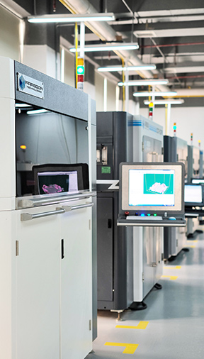
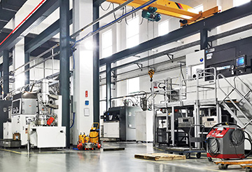

# 14 中国品牌与新的分工：机器、材料、扫描和服务

谈起中国3D打印，不能只想到便宜的桌面机器。工厂里的金属粉床、鞋模与手板用的大幅面光固化、牙科数字化、耗材以及按需打印服务，也在同一张产业地图上。它们可能服务不同客户，甚至互为供应商。把所有公司放在一个“打印机品牌榜”上，会丢掉最值得学习的部分。

## 先分清它在链条上的位置

| 品牌 | 主要观察位置 | 适合跟进的线索 |
| --- | --- | --- |
| BLT 铂力特 | 金属增材设备、粉末、打印及技术服务 | 金属零件从开发到交付的完整链条 |
| Farsoon 华曙高科 | 聚合物与金属激光粉床 | 开放材料、工艺参数和量产应用 |
| Eplus3D 易加三维 | 金属粉床设备与应用方案 | 大尺寸构件、多激光协同与产线组织 |
| UnionTech 联泰科技 | 工业光固化及应用方案 | 手板、模具、鞋业等光固化应用 |
| SHINING 3D 先临三维 | 高精度3D扫描、计量与齿科数字化 | 从实物取得数据，以及怎样检测打印结果 |
| LuxCreo 清锋 | 光聚合材料、设备与数字化工作流 | 弹性体、齿科及具体应用认证 |
| eSUN 易生 | 打印材料与高分子材料 | 线材配方、干燥、技术资料和批次 |
| Polymaker | 打印材料与应用支持 | 工程线材、支撑材料、材料数据库 |

资料入口：[BLT官方](https://www.xa-blt.com/en/)、[Farsoon公司介绍](https://www.farsoon-gl.com/about/)、[Eplus3D公司历史](https://www.eplus3d.com/our-history/)、[UnionTech](https://www.uniontech3d.com/)、[先临简介](https://www.shining3d.cn/news/article_xianlinsanweijianjie)、[LuxCreo技术平台](https://luxcreo.com/technology/)、[eSUN集团介绍](https://www.esungroup.net/about-esun/)、[Polymaker介绍](https://polymaker.com/about-polymaker/)。这是角色地图，品牌实际覆盖范围可有交叉。

## 三段不同的工业故事

铂力特官方资料记载其成立于2011年。阅读它时，值得同时看设备与服务，而不只看成形缸有多大：用户有时购买机器，有时购买已打印、处理、检测的零件。前者把工艺能力留在自己手里，后者则把部分能力交给供应商。这是制造业中常见的分工，不能只按机器单价比较。[BLT公司信息](https://www.xa-blt.com/en/career/)

华曙成立于2009年，其官方介绍特别强调开放的工业系统；创始人许小曙曾在早期激光烧结公司DTM担任技术负责人。这里的“开放”应结合材料和参数权限理解，不能自动解释为整机全部代码与硬件开源。2026年华曙公布与ALM高性能聚合物粉末的适配扩展，则提供了一个具体观察点：工业设备的能力可以随材料验证继续增长。[Farsoon介绍](https://www.farsoon-gl.com/about/)、[2026年材料生态公告](https://www.farsoon-gl.com/news/farsoon-expands-open-materials-ecosystem-with-alm-high-performance-polymer-powders-for-industrial-pbf-production/)

图：Farsoon官网工厂设备照片。机器之外，成排生产空间同样是工业增材的一部分。 来源：[品牌官网](https://www.farsoon-gl.com/about/)；图片版权归原权利人。

易加的历史尤其需要仔细读。其2024年十周年活动说明公司成立于2014年；官网同时把创始人冯涛的相关技术开发经历追溯到1993年。两件事不是同一个日期，不能把个人与团队的早期研究直接写成公司成立时间。它的路线也提示我们，大尺寸打印的难题不只是把导轨拉长，还涉及热场、铺粉、激光协同和后续搬运。[Eplus3D十周年活动](https://www.eplus3d.com/eplus3d-celebrates-a-decade-of-innovation-at-the-global-partners-summit-2024.html)、[官方历史](https://www.eplus3d.com/our-history/)

## 光固化也有工业尺寸和专门用途

联泰的官方回顾记载其于2000年进入3D打印市场，起点包括自主紫外固化设备。对于只见过桌面树脂机的读者，这是一条有价值的延伸：工业光固化并非专为小摆件服务，也可用于外形评审、手板与工装等环节。大尺寸件仍需考虑排液、支撑、收缩与后固化，不会因为机器更大就自动省去处理。[UnionTech二十年回顾](https://www.uniontech3d.com/uniontech-promoting-innovation-with-technology-and-development-with-innovation-for-20-years.html)

清锋LuxCreo则可沿其LEAP平台及齿科工作流继续认识。特别要警惕把“齿科树脂”四个字理解成所有产品都可以直接用于口内：设备、材料、后处理、用途与适用地区共同构成验证条件。本书不凭一项宣传将所有材料视为同等认证，也不把某一应用批准泛化到整个产品目录。[LuxCreo技术](https://luxcreo.com/technology/)、[LuxCreo应用问答](https://luxcreo.com/faq)

## 打印之前和之后，也有重要品牌

图：Farsoon官网工厂照片：大型设备与厂房。注意大幅面打印需要的搬运与场地条件。 来源：[品牌官网](https://www.farsoon-gl.com/about/)；图片版权归原权利人。

先临三维成立于2004年，官方简介把当前重点放在高精度工业3D扫描与齿科数字化设备及软件。扫描仪能将物体转为数字表面，但“扫描得到模型”不意味着已经有可编辑的参数化CAD；孔、遮挡、反光和精度要求仍需处理。打印之后，同类测量技术又可以把实物与设计比较。由此看，扫描与打印是相连的环节，而非同一种设备。[先临三维简介](https://www.shining3d.cn/news/article_xianlinsanweijianjie)

材料品牌也有自己的发展时间线：eSUN集团资料记载公司成立于2002年，Polymaker则记载于2012年末成立。了解它们时，可以少看包装上的“升级版”，多看技术数据表的测试方法、试样状态、打印条件以及干燥建议。相同的PLA或PA大类中，配方可针对韧性、颜色、流动或耐热调整；材料商提供的参数是起点，不能替代你自己的零件测试。[eSUN集团](https://www.esungroup.net/about-esun/)、[Polymaker历史](https://polymaker.com/about-polymaker/)

如果今天还不准备买设备，可以先向打印服务商提交同一个小支架，分别询问FFF、SLS与金属粉床的报价及后处理项目。问清谁负责修模、最小壁厚、尺寸验收和失败重打。品牌地图此时会变成实际问题的索引，而不是购买清单。
