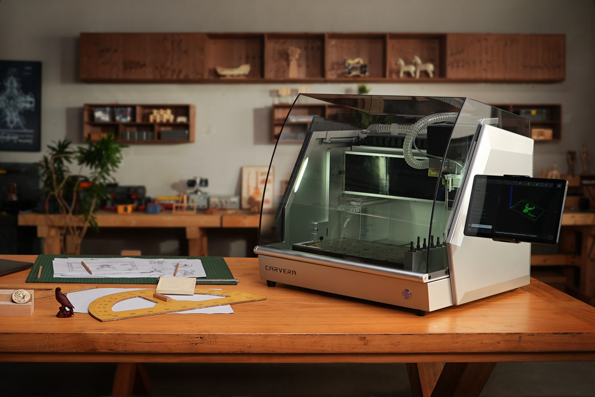
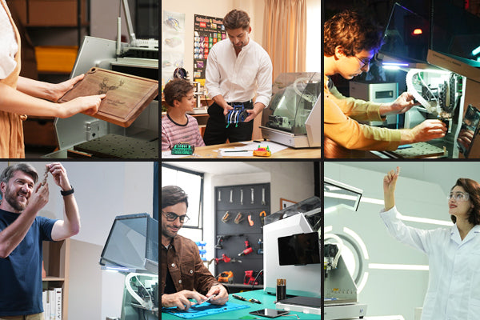

# 15 减材品牌与造物者的下一步

3D打印让人习惯从空平台得到物体，CNC则让人学会从一块材料安排刀具能够到达的表面。理解后者不需要先拥有大型机床：观察一个木托盘、铝旋钮或黄铜印章，就能开始认识切削留下的线索。减材品牌的差异，往往藏在刚性、装夹、控制、换刀、排屑和服务体系中，而不在外壳颜色里。

## 从工厂到工作台

](../assets/images/real-makera-story.jpg)

| 品牌 | 可认识的设备方向 | 值得观察的问题 |
| --- | --- | --- |
| DMG MORI | 五轴、车铣复合及DED混合加工 | 怎样把增材和精加工放在同一装夹中 |
| Mazak 山崎马扎克 | 车削、加工中心与INTEGREX复合加工 | 减少工序转移怎样影响生产 |
| Haas | 立式加工中心、车床等 | 标准化机型、控制与车间服务 |
| Okuma 大隈 | 车床、加工中心及OSP控制体系 | 热变形怎样通过结构与控制共同管理 |
| FANUC 发那科 | ROBODRILL加工中心、ROBOCUT线切割等 | 一家公司可以同时覆盖不同减材机理 |
| SYIL | 小型工业加工中心 | 紧凑体积与机床结构设计 |
| Makera | Carvera系列桌面CNC等 | 测量、换刀、软件与封闭工作区 |
| Carbide 3D | Nomad桌面CNC、Shapeoko路由机 | 小封闭机与大幅面路由的任务差异 |
| Onefinity | 桌面/工作室CNC路由设备 | 工作范围、台架、控制与集尘 |
| Langmuir Systems | MR-1等小车间设备 | 安装、冷却与金属加工工作流 |

核查入口：[DMG MORI混合加工](https://en.dmgmori.com/products/machines/additive-manufacturing/powder-nozzle/lasertec-65-ded-hybrid)、[Mazak INTEGREX](https://www.mazak.com/sg-en/products/integrex-i-neo/)、[FANUC设备目录](https://www.fanuc.co.jp/en/product/robomachine/)、[SYIL X7](https://in.syil.com/x7)、[Onefinity](https://www.onefinitycnc.com/)、[Langmuir MR-1](https://www.langmuirsystems.com/pages/mr1)。表格区分方向，并不表示所有设备适合相同材料、精度或场地。

## 故事七：Haas，从分度装置到加工中心

Haas官方历史记载公司成立于1983年，最初产品包括可编程分度装置；1988年推出VF-1立式加工中心。这段故事能帮助读者理解，制造工具的进步不只来自某个全新机理，也来自把已有操作变得更容易配置与重复。分度装置负责把零件转到需要的位置，围绕一件零件的定位、加工和再定位，本来就是机床能力的重要部分。[Haas历史](https://haascnc.com/about/history)

## 故事八：Makera与Carbide 3D，缩小的不只是尺寸

Makera官方时间线记载2019年成立、2021年Carvera众筹、2024年Carvera Air众筹。对爱好者来说，这类桌面CNC最值得研究的是完整使用路径：如何对刀、测量材料、换刀、控制飞屑，以及CAM如何把几何转成加工任务。“自动”通常指特定步骤被自动化，绝不表示材料与装夹可以不检查。[Makera官方故事](https://www.makera.com/pages/about-us)

图：Makera官网Carvera产品场景图。封闭工作区与工作台周围物件一起提示桌面CNC的使用尺度。官方资料图，可能含渲染或合成。 来源：[品牌官网](https://www.makera.com/pages/about-us)；图片版权归原权利人。

Carbide 3D官方介绍把Nomad与Shapeoko两条产品线联系起来，Shapeoko从个人项目与众筹走向公司产品。这让我们看见另一种路线：一台紧凑封闭机适合研究小件与可控环境，一台较大路由机适合板材、木工与更大轮廓。两者都受刀具、夹持和材料限制，不应仅以“都是CNC”来横比。[Carbide 3D公司介绍](https://carbide3d.com/about/)

## 为什么工业品牌谈热与装夹

Okuma的Thermo-Friendly Concept把机床结构与控制放在一起处理温度变化。主轴和运动系统发热，车间环境也会变化；尺寸误差并不全部来自电机没有走准。这个例子适合与打印机的热床、腔体和材料收缩对照：增材和减材都在与热打交道，只是影响路径不同。[Okuma技术说明](https://www.okuma.com/thermo-friendly-concept)

DMG MORI的LASERTEC DED hybrid则把激光沉积与铣削合并在一台设备中。它提供一个直观画面：先在需要的位置增加材料，再把关键配合面加工到要求。修复磨损位置、获得复杂外形与控制尺寸可以成为同一条工艺链的不同阶段。但多工艺设备也需要相应编程、检测和工艺验证，并非把两个机头并排装上就完成混合制造。[DMG MORI产品说明](https://www.dmgmori.co.jp/en/products/machine/?id=3592)

## 三条不必昂贵的学习路径

图：Makera官方用户场景拼图。相同制造工具可以进入不同工作室；拼图本身不证明各场景的加工参数。 来源：[品牌官网](https://www.makera.com/pages/about-us)；图片版权归原权利人。

如果喜欢外观与色彩，可以从FFF灯罩、小型树脂模型与后处理样片开始，先学会描述层纹、光泽、颜色和接触痕迹。你不必急于换机器，改变摆放方向、线宽与表面处理，就能形成一组值得比较的作品。

如果喜欢机械结构，可以先设计一个带螺母槽的小支架，再做一版平板切割与螺栓装配方案。对比两版装配、变形和维修方式，理解“打印成一体”不总是好处：部件可拆换有时更重要。

如果喜欢材料与精度，可以请加工服务商做一枚简单的铝旋钮，同时打印同一外形。比较重量、触感、细节、孔的配合与表面，而不是只比较照片。记录设计文件、工艺、材料、后处理与测量方法，便得到自己的小型材料与工艺档案。

走进共享工坊或学校车间时，应按场地规程接受设备培训。树脂接触、粉尘、旋转刀具、热端和激光的控制方式不同；一块透明罩也不等于所有危害已经消失。知道自己在观察什么、需要谁来协助，是继续探索的一部分。

这本书的观察方法最终可以落在一个物件上：它为何用这种材料？形状给制造留下了什么限制？关键表面如何得到？成本花在了哪里？当你能回答这些问题，品牌和工艺名称就不再只是需要背诵的名词，而成为继续认识世界的入口。
