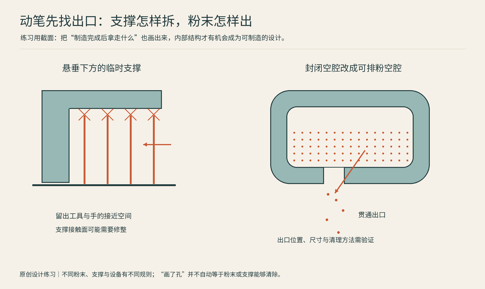

# 16 从旁观到判断：四个不必买机器的造物练习

读过工艺与品牌，最有收获的变化并非记住更多缩写，而是看到一个物件时，开始问它为什么用这种方式制造。下面四个练习是作者设计的观察方法。它们不设唯一答案，目标是让选择理由变得具体。

## 练习一：给台灯设计一个新灯罩

先在纸上画三种外形：直筒、褶皱曲面、镂空网格。再分别写下光从哪里透出来、手碰在哪里、靠近光源的部分会经历什么温度。你会发现“能打印”只解决了其中一个问题。

想保留连贯的层纹，可以把材料挤出的路径当作纹理的一部分；想让透光更均匀，则需要同时考虑壁厚、材料散射、层间结构与表面处理。透明料不等于透明成品，第11章的表面讨论正是为这个问题准备的。此时不要随意给概念图配上一个材料名，就宣称它适用于所有灯具。先把造型研究与实际电气产品验证分开。

## 练习二：让同一个支架走三条路

图：原创设计练习图：左侧标出支撑接触与工具接近空间，右侧将封闭空腔改为带出口的截面；两侧属于不同工艺情境。支撑原理参见第08章Prusa官方文档[W03]，后处理与清粉参见[W06]。实际出口与拆除要求由设备、材料及清理方法决定。

画一个带两个孔的L形支架，标出它固定在哪里、力往哪个方向拉。为它写三份制造方案。

第一份用FFF：选择朝向，画出层面，圈出需要支撑的表面。第二份用铣削：从毛坯外形出发，画出刀具进入的方向，标注内角可能留下的圆角。第三份用金属打印加精加工：保留复杂体积，明确哪些孔和接触面最后还要加工。切片软件和CAM软件在这里做的事情不同；前者组织层与沉积路径，后者组织刀具、切削与装夹，第08、09章有对应解释。

比较时，先保持用途相同。不要拿一个很厚的打印支架与一个极薄的金属支架，只凭外观讨论谁更强。材料、几何、方向和工艺状态一变，问题就已经换了。

## 练习三：拆解一个案例，再写自己的工艺选择卡

从第02至06章或第09、10章中选一个实际案例。先遮住品牌名和设备名，只写下它要解决的任务，再补回工艺与结果。把“企业采用了某技术”和“换到我的零件也合适”分开：形状、数量、交期与验收要求可能完全不同。

先在一张纸上做三件事：圈出案例中必须实现的特征；划出资料明确说过的结果；把资料没有给出的条件留作待核实。随后用自己的物件填一张卡。下面以第07、08章的假设外壳为填写样例，它不是测试报告。

| 卡片项目 | 外壳练习的填写样例 |
|---|---|
| 要交付什么 | 一套可供室内桌面试装的外壳与盖 |
| 本轮必须通过什么 | 板件能放入、插头可插拔、盖子可装拆 |
| 先试哪条路线 | FFF局部配合试片，验证后再做整件 |
| 为什么先这样做 | 可以集中比较盖缘与接口，并保存改版记录 |
| 暂时不能证明什么 | 长期寿命、耐热、防水与量产一致性 |
| 有什么替代方案 | 几何允许时改现成盒体；有金属或较严配合需求时再评估机加工 |

最后给相同模型做两份询价说明，不必下单。两份都写清数量、材料、表面和关键尺寸，询问报价是否包含后处理与检测。将数量改成另一组，再比较准备、制造和检验的费用如何变化；供应商要求人工审核的地方，也往往是你的说明还不够完整的地方。报价差异需要回到交付范围解释，不能只看每克材料或机器每小时价格。

## 练习四：给品牌故事画一张证据地图

挑选第12至15章里一个不熟悉的品牌。打开它的官方历史、一个产品技术页面和一份用户文档，分别寻找三个问题的答案：它最初解决什么具体问题，现在主打什么工艺，用户为了稳定使用需要学习什么？

把“我们领先世界”的宣传语放到一边，记录能核实的节点，例如推出了哪套系统、开放了哪些文件、是否公布材料数据、维修与耗材如何获取。某个创始人的经历可以解释公司的起点，却不能单独证明今天的所有产品都优秀。遇到并购新闻，继续寻找完成公告；没有找到，就保留“拟收购”的状态。

## 留一张自己的制造观察卡

| 观察项目 | 你可以填写的内容 |
|---|---|
| 我想造什么 | 用途、外形、数量，而不只是文件名 |
| 必须满足什么 | 尺寸、温度、受力、触感、寿命 |
| 我考虑的路线 | 工艺家族、具体材料、后处理 |
| 最容易遗漏什么 | 排粉、支撑、装夹、方向、检测 |
| 证据从哪里来 | 数据表、样件、官方文档与实际测试 |

制造能力不是把每件事都交给同一台机器。能解释为什么这个形状值得打印、那个表面值得铣削，并知道哪些判断还需要样件和测量来回答，就已经拥有了一套可以继续扩展的观察方法。

## 本章资料

- [W03] Prusa Research，Support material：https://help.prusa3d.com/article/support-material_1698
- [W06] Formlabs，3D printing post-processing FAQs：https://formlabs.com/global/support/3d-printing-post-processing-faqs/
